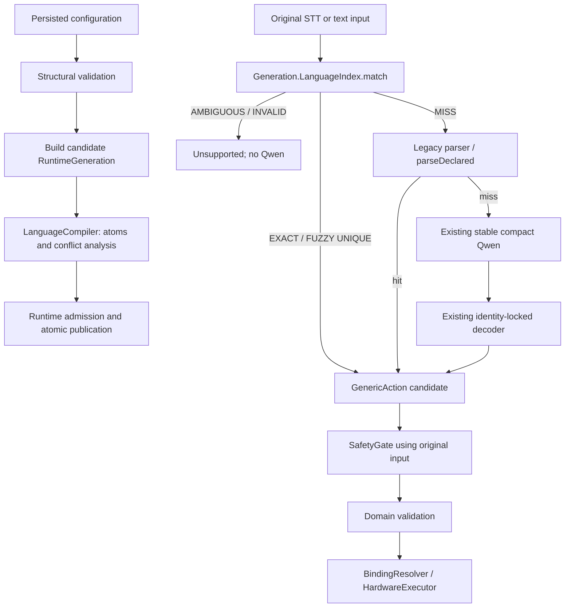

# Config-derived language index

> Dated milestone/design record. Its test results and deployment statements apply to the recorded revision, not today. For current M19 identity, architecture and operating instructions, start at [the production baseline](production-baseline.md) and [README](../README.md). Historical results below are preserved.

## Audit at 72b154742b1506ca2c1f002ed2bdb84e8c21e660

Config schema v2 already owns location mentions/phrases/metadata aliases, device
spoken/metadata aliases, action speech_aliases, typed parameters and assignments.
DomainView::resolve provides span evidence, longest exact mentions, conservative
one-edit entity matching and location disambiguation. requestedActions uses exact
configured action phrases; parseDeclared accounts for a single generic action's
whole utterance but only extracts literal scalar tokens. DeterministicParser
preserves the legacy whole-input light grammar. SafetyGate always sees original
text; its generic integer check currently recognizes digits only (Russian cardinal
recognition exists privately for protected brightness). RuntimeGeneration already
owns immutable catalog/domain/parser/executor and serializes model admission.

Admin already has language proposals for Locations/Devices, editable drafts,
capability proposals for generic actions, CAS Save, preflight Apply and LKG recovery.
There is no explicit compiled language artifact/conflict report or language-only
Action proposal. Schema arrays allow empty domains, but mandatory legacy mapping
validation still requires the historical house. This must become optional in v2.

## Contract

Config remains authoritative. LanguageCompiler builds an immutable in-memory
LanguageIndex, with catalog hash/revision and compiler version, inside the same
RuntimeGeneration. Entity matching reuses DomainView; action atoms are tokenized
once, never expanded into sentence products. No SQLite, persistent cache, runtime
learning, embeddings or second AI service.

UNIQUE -> candidate -> unchanged mandatory safety/domain/execution boundaries.
AMBIGUOUS/INVALID -> reject without Qwen. MISS -> existing parser/parseDeclared ->
existing stable compact Qwen fallback. A shared exact cardinal reader extends
original-value evidence for generic integer parameters without transcript repair.

## Runtime implementation

`LanguageIndex` retains the same validated Catalog pointer as DomainView. Its
first-token map stores normalized, deduplicated action atoms; entity spans and
one-edit matching reuse DomainView rather than introducing a second resolver.
The fingerprint is SHA256(`language_atoms_v1:<catalog content SHA256>`). Revision
and compiler version are exposed separately. No executable identity comes from
an alias proposal or model output.



CommandEngine rejects a mismatched index/domain content hash. Production requests
hold one RuntimeGeneration lease: Apply prepares a candidate before admission and
publishes atomically after existing requests finish. Old retained generations
keep their original index. Alias changes, device deletion and revision restore
all rebuild from configuration; no independently mutable active index exists.

The optional index constructor parameter preserves standalone legacy parser and
CLI regression callers. The production Admin/voice RuntimeGenerations path always
passes its compiled index. Legacy light whole-input regex rules, protected door
rules and `parseDeclared` remain after INDEX_MISS. Old configurations with empty
light action aliases continue to use those rules and existing Qwen fallback.

## Matching and argument evidence

1. Resolve all configured location/device evidence. Shared device aliases are
   filtered by explicit location; unresolved multiple entities reject, never pick
   the first device.
2. Select exact declared action atoms. No fuzzy action or number matching. For a
   generic device, an explicit percent unit can select a **unique** required
   integer-percent action when no explicit action atom matched. Multiple such
   schemas are ambiguous. No value is invented.
3. Extract no arguments, one integer, one boolean literal (`true`/`false`), or one
   exact single-token enum value. Digits and exact Russian cardinals 0..100,
   including compound tens, are supported. Percent units: `%`, `процент`,
   `процента`, `процентов`. Fractions in integer requests, multiple values and
   out-of-range values reject. A comma between cardinal words is not a compound
   number; argument spans cannot consume an entity name; percent input cannot be
   assigned to a differently unit-labelled integer. No fuzzy number correction.
4. Account for every meaningful token using selected entity spans, action atoms,
   argument spans and the small neutral set `в`, `во`, `на`, `пожалуйста`.
   Unexplained words cause MISS; unconsumed conjunctions/alternatives cause
   AMBIGUOUS; negation causes INVALID. Input remains bounded by 192 UTF-8 bytes.
5. Even a unique candidate passes the existing SafetyGate and domain validator.
   Its generic scalar evidence check now recognizes exact Russian cardinals in
   the **original** input, using the same integer reader as the index. This is
   evidence validation, not transcript replacement or candidate repair. A test
   deliberately produces INDEX_EXACT followed by SafetyGate rejection.

FUZZY_UNIQUE refers only to existing conservative one-edit **entity** evidence.
It does not mean probabilistic confidence. Longer exact evidence retains the
existing specificity semantics. Original input, model protocol, Qwen stable
context, bindings, transports and wake/STT models are unchanged.

## Conflicts and validation stages

LanguageCompiler rejects duplicate normalized location ownership, identical
normalized action atoms selecting different actions on one device, and duplicate
normalized enum interpretations. Normalization follows the same punctuation
boundaries as DomainView, so punctuation cannot conceal a collision.

Shared device aliases are contextual warnings, not configuration errors.
Overlapping device/action phrases are warnings; the existing longest-specific
span rule can disambiguate some, while unresolved alternatives reject at runtime.
Multiple conflicting scalar values reject at match time. No confidence score is
used. The same alias may belong to different actions on different devices when
target grounding selects exactly one device.

Structural ConfigLoader validation remains separate from runtime language
admission. This preserves existing editable Action Draft proposals, which may
contain an alias conflict awaiting review. Admin Validate, Save, import and Apply
all build RuntimeGeneration and therefore run blocking LanguageCompiler checks.
A structurally valid offline config is not evidence of runtime admission.
Warnings, index identity and up to five deterministic examples are returned by
`/api/config/validate`; examples must themselves pass index/SafetyGate/domain
checks and are never persisted as a phrase database.

## Empty home and compatibility

`config/empty-home.json` is a production-supported initialization source:

```sh
./build/firefly-demo --store /path/to/new-private-store \
  --init-config config/empty-home.json \
  --model /home/firefly/demo_Linux_aarch64/Qwen3-4B_W8A8_RK3588_3core.rkllm \
  --admin-port 8080
```

Schema remains v2. Its existing `compatibility` field now also permits `null`.
This means no historical fixed-room/door mapping; only generic declarative actions
and devices are admitted in that mode. Existing non-null mappings retain every
previous validation requirement; v1 is unchanged. Empty arrays already existed
in the schema. No language fields or model assets were added.

Empty domain is ready infrastructure with no commandable target: speech produces
Unsupported without inference. Admin remains usable. A new light template creates
generic ON/OFF/SET_BRIGHTNESS actions and typed state for an empty home. Existing
legacy light templates retain their behavior when compatibility is present.
Protected entrance-door template creation remains restricted. Admin Plan and
Copilot use the same empty-home adaptation; they do not invent binding facts.

## Measurement on RK3588S

Reproducible corpus/config and machine-readable reports live in
`benchmarks/language-index/`. The baseline was compiled from the untouched product
sources at `72b154742b1506ca2c1f002ed2bdb84e8c21e660` in an isolated worktree;
only the benchmark target was added there. Both versions use the same 23 inputs
and catalog, including the historical domain plus a configured generic light in
Мастерская. A counting ContextModel substitutes only inference: production
parser, grounding and RuntimeGeneration dispatch execute normally. These are
**invocation counts**, not claimed Qwen correctness or NPU latency measurements.

| Measure | Checkpoint | LanguageIndex |
| --- | ---: | ---: |
| Inputs | 23 | 23 |
| Executable deterministic results after SafetyGate | 11 | 16 (15 exact, 1 fuzzy) |
| Model invocations | 7 | 2 |
| Requests without inference, including safe rejects | 16 | 21 |
| Grounding/ambiguity/invalid rejects before inference | 4 | 5 |

The checkpoint also rejected one legacy deterministic candidate in SafetyGate
(out-of-range 101); it is included in its 16 no-inference requests.

Four cardinal requests moved from Qwen to exact matching; one conflicting-number
request now rejects before Qwen. Invocation reduction: **5/7 = 71.4%** on this
small declared-language corpus. Unknown meaningful text still uses fallback when
identity selection is possible; a MISS with no selected action rejects before
inference. The seven required kitchen fixture phrases all execute through the
index with zero Qwen calls in deterministic integration tests.

Measured final values (CMake build type unset in both builds, existing board CPU settings):

| Metric | Final |
| --- | ---: |
| Compile median / p95 | 0.331 / 0.338 ms |
| Match median / p95 (2,300 lookups) | 0.516 / 0.956 ms |
| Added RSS per retained index | 2496 bytes |

Machine-readable values are in `final.json`. RSS is measured using
256 simultaneously retained indexes sharing a catalog, divided by 256; it is an
allocator/page-granularity estimate, not total assistant RSS. `estimated_owned_bytes`
is a lower-level atom-storage estimate and excludes allocator overhead/shared
catalog. Rebuild is sub-millisecond for this small catalog; no persistent cache is
justified. Lookup remains far below the existing seconds-scale Qwen requests.

Reproduce final dispatch and timing (no microphone/NPU needed):

```sh
cmake --build build --target language_index_benchmark
./build/src/admin/language_index_benchmark \
  benchmarks/language-index/catalog.json benchmarks/language-index/corpus.json \
  build/language-index-final.json
```

For the checkpoint, build `Benchmark.cpp` against that commit's `firefly_admin_core`
without the `FIREFLY_LANGUAGE_INDEX` compile definition. Do not compare against a
new-build parser merely labelled “baseline”. No hardware execution is requested.

## Tests and boundaries

`LanguageIndex`: seven end-to-end phrases, all 0..100 cardinal values, digit/%
forms, boolean/enum, full utterance accounting, action/target ambiguity, exact vs
entity-fuzzy, no fuzzy intents/numbers, bounds, malformed UTF-8, candidate rejection
by SafetyGate, hash/order determinism, mixed-snapshot rejection, Apply lease,
rename/delete/restore and profile bounds/dedup/malformed/conflict decoding.

`LanguageAdminProfile`: empty ConfigStore and ready Admin, language-only Action
proposal, no autosave, conflict preview, Validate/Save refusal, Apply and execution
through the existing mock executor, empty-home AI plan template.

`LanguageAdminChromium`: installed Chromium/X11 plus fake model worker; actual
HTTP and forms, editable proposal confirmation, no autosave, Validate/Save/Apply,
index route and SafetyGate/mock execution. Requires an available X11 display; no
human interaction or microphone. Existing compact, Fast Path, wake/seamless,
safety, generation, binding and service suites remain regression coverage.

Known limits: small configured domains; generic exact single-token enum literals
and boolean `true`/`false`; complex number/string/multiple-parameter schemas use
existing fallback. Entity lookup reuses DomainView's catalog scan rather than a
second matcher. Proposal quality varies; malformed output fails cleanly. The index
is conservative language understanding, not a general natural-language safety
classifier. No automatic learning, database, embeddings, phrase accumulation or
Qwen-driven mutation is implemented. Future controlled learning may use MISS
diagnostics, but must produce an explicitly reviewed configuration change.


Final validation on 2026-09-29: build succeeded; focused 13/13; full CTest 58/58
(53.49 s), including the actual Chromium flow. `git diff --check` passed. Real
Admin Qwen smoke: Location/Device/Action 3/3 accepted by the strict decoder, one
attempt each, no Save or Apply. Amina SHA256 remains
`bc42cb869d2aace69c5bdf9333c502b96dedfa85df97676be85f5c289dc057d1`.

```sh
ctest --test-dir build -R 'Language|CompactActionDecoder|Safety|AdminGenerationApi|AdminSuggestionRetry|TypedMockConfiguration|Wake|Seamless' --output-on-failure
ctest --test-dir build --output-on-failure
git diff --check
```

## Composition of location forms (stabilization)

The production launcher `scripts/firefly-dialogue.sh` executes
`build/firefly-demo`. Its voice entry is `RuntimeWorker::processVoice` → a leased
`RuntimeGenerations::Request` → `CommandEngine`, with that generation's
`languageIndex`. The index constructor checks the catalog identity; a separate
voice parser/index is not required.

The reproduced nine-command failure was a **coverage miss**, not a missing index
or an action-selection failure. Device and power action were already unique;
no arguments were required. Unrecognized inflections of the configured location
remained uncovered and caused nine real runtime-Qwen calls. The baseline used a
private copy of the installation, with no hardware execution. Its configuration
and identifiers are intentionally not included in the repository.

`locationGrammar(Room)` now derives bounded regular adjective forms from accepted
`mentions`, `locations`, and `metadata.aliases`. It supports regular `-ая`, `-яя`,
`-ый` seeds and adjective + `комната` constructions, including the corresponding
case forms of the classifier. It does not strip arbitrary words, stem command
text, infer a noun's irregular declension, guess stress-dependent forms, or
modify the persisted configuration. For example, an approved «читальная комната»
can ground «в читальной комнате», «в читальной», and «на читальном». The final
variant is accepted only when the catalog identifies exactly one location.
Adding «столе» does not silently turn it into a room command.

The small grammatical rules are shared with DomainView so grounding, index,
compact selection and the unchanged SafetyGate use the same evidence. The
resolver requires a в/во/на slot for newly derived inflections, so a bare device
or state adjective cannot be invented as a location reference. Explicit reviewed
atoms still support bare adjectival references. A longer explicit
prepositional alias cannot hide another owner of the same grammatical form.
Evidence carries the original span and `method=location_grammar`. No action,
number, capability, Binding or transport is derived by this grammar.

Index matching still composes entity/action/argument evidence in any word order.
For a derived location construction, uncovered meaningful words fail closed
instead of asking the model to discard them. Existing non-grammatical misses
retain their fallback behavior; unsupported argument schemas retain their
bounded fallback. Shared derived forms produce a conflict warning and runtime
ambiguity rejection. No probabilistic ranking or first-device preference is used.

The compiler identity is `language_atoms_v2_location_grammar`. Grammar is rebuilt
from the same snapshot on Apply/restart; old request leases retain their old
forms. Editing/removing an atom or entity therefore removes its derived forms
without a persistent phrase cache. Config schema and source-of-truth are unchanged.

Production command diagnostics include `index_match.stage`, `reason`, selected
`target_id` / `action_id`, and `uncovered` tokens, independently of the final
route/model/validation result. An unsupported result is never counted as a
successful fast-path command.

Reproducible real-model acceptance is provided by
`benchmarks/language-index/ProductionAcceptance.cpp`. It uses the existing
SetupSession/RuntimeWorker and real Admin4096, Save/Apply, then the exact voice
entry with an injected transcript and real runtime1024. Counters wrap actual
`infer`/`inferCommand` calls; zero is asserted for accepted commands. All bindings
must be absent, and production execution must report `binding_missing`. This is
text-understanding acceptance, not a microphone, STT, or hardware test.

### Measured RK3588S acceptance, 2026-10-01

Baseline HEAD: `1fee9bcae54018f37aed7d4ea9483c132f070e05`.
The source and `build/firefly-demo` were checked/rebuilt before recording the
baseline. All commands used the production generation/CommandEngine path; final
acceptance additionally used the exact `RuntimeWorker::processVoice` entry with
an injected transcript. The user store was never changed.

| Dataset / phase | Successful commands | Rejections counted separately | Runtime inference calls | Text median / p95, ms |
| --- | ---: | ---: | ---: | --- |
| Original private copy, before, first batch | 9/9 via Qwen, **0 index hits** | 0 | 9 | 1473.62 / 1614.13 (9 samples) |
| Same unmodified copy, final build, first batch | 9/9 INDEX_EXACT | 6 | 0 | 1.638 / 17.508 (9 positive samples) |
| Same copy, final repeated text replay | 9 distinct positives, 189 accepted replays | 6 | 0 | 0.844 / 1.142 |
| New real-Admin home, after Apply | 12 distinct positives, 252 accepted replays | 6 | 0 | 1.453 / 1.875 |
| Same confirmed test store, final build, new process | 12 distinct positives, 252 accepted replays | 6 | 0 | 1.399 / 1.832 |

Cold first-use initialization is visible in the 17.508 ms maximum of the first
post-change batch; it is not hidden in the repeated median. No STT, endpoint or
end-to-end acoustic latency improvement is claimed.
The Admin creation/Apply run preceded the final restriction requiring a
preposition for derived forms. Both the unchanged private copy and the actual
Admin-created store were replayed again on that final build; the latter retained
the saved profiles without another AI generation or manual edit.

The nine original texts cover on/off for light/TV, «в детской», «в детской комнате»,
«на детском», location-first/device-first order and «пожалуйста». All nine changed
from INDEX_MISS + one real Qwen call to INDEX_EXACT + zero calls, with unchanged
logical ON/OFF result and successful SafetyGate/domain checks.

The new real Admin session created a child room with light/TV and a separately
requested turquoise room with a fan. All three devices remained power-only.
There were **15 real Admin inference calls**, 11 decoded language profiles, and
the harness verified their atoms in the persisted configuration after Apply.
The two dialogue messages took 118.870 s and 97.518 s; this work happens during
setup, not ordinary command execution. No catalog was manually enriched for
this run. Restored hash/revision were identical after a fresh process start.

The observed load sequence was runtime1024 → release → Admin4096 → release →
runtime1024, then process exit. Peak test-process RSS was 4756.3 MiB; minimum
system MemAvailable was 2112.8 MiB. This harness does not load microphone/STT
models and makes no claim about live acoustic testing. Each logical success
reached the existing production executor and was safely stopped with
`binding_missing`; no physical equipment was controlled.

Fake-model regressions additionally cover four independently created room names,
soft/hard adjective patterns, exact action matching, negative/conditional/timed
commands, unsupported brightness, shared device names, derived/explicit location
collisions, rename/delete, old-generation isolation, and proposal preservation.
Real Qwen proposals can still contain awkward synonyms or imperfect prepositional
phrases. They remain editable data; accepted canonical seeds and deterministic
grammar keep the tested common commands independent of those imperfections.
Raw traces, selected installation IDs and configuration copies remain only in
private ignored `build/language-fastpath-private/` artifacts, not repository data.

Final validation: build succeeded; focused configuration/state/compact/language/
dialogue tests passed 7/7; full CTest passed 62/62 (110.52 s), including JS and
Chromium integration. `git diff --check` passed. The user configuration checksum
and frozen Amina SHA256 were unchanged. No commit or push was made.
