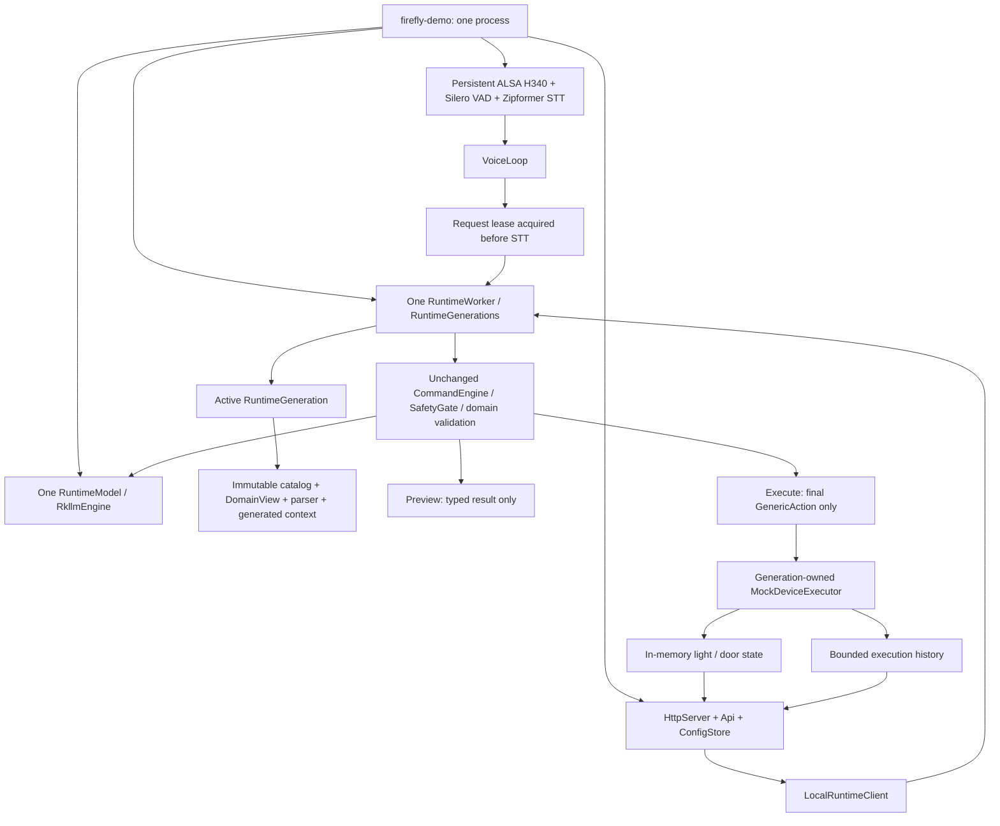

# Milestone 10: Unified Assistant Runtime + Mock Device Execution

> Historical frontend report. The current Vue Web Admin opens at `http://localhost:8080/`; legacy vanilla assets are removed. See [B4 delivery and rollback](web-admin-ux-v2-b4.md). Backend contracts below remain supported.

Resume baseline: `1ba63b877975cba1f7028564b7088c9380e29275` (Milestone 9).
Status: accepted by the user for commit on 2026-09-20. The recovered implementation
and all available automated/real-NPU checks have been audited. **Live voice smoke
with H340, including Bathroom execution after Apply, was not performed because the
headset was physically absent from USB/ALSA. This is a device-availability
limitation, not an observed implementation failure.** The single integrated-model
false reject is recorded as observed RKLLM variability, alongside three subsequent
48/48 passes and no unsafe execution.

## Work recovered at resume

The working tree already contained the implementation: `RuntimeGenerations` with
request ownership and mock state, `RuntimeWorker` shared by local HTTP and voice,
`MockDeviceExecutor`, extracted `VoiceLoop`, `firefly-demo`, state/history APIs,
Web Admin preview/execute and state/history views, and execution/HTTP/browser/replay
tests. There were 14 modified tracked files and 10 new source/test files.

Existing logs in `build/milestone-10/` confirmed clean core 25/25, clean full 37/37,
and focused `MockExecutionUnifiedRuntime` / `UnifiedHttp` passes. The first hardware
regression attempt had exited with signal 9 before producing results. Its logs and
summary have been preserved; it is not counted as a successful run. The report did
not yet exist, and real HTTP, browser and live voice verification remained unfinished.

Resume evidence is stored separately in
`build/milestone-10/resume-20260920/`, including the original status, diff and HEAD.
The old Milestone 9 `firefly-admin` on port 8080 is left alone. Real Milestone 10
smoke tests use port 18080 and private, separate configuration stores. Only one
real RKLLM model process is run at a time.

## Unified architecture



`firefly-demo` owns the store, model, worker, local client, API, HTTP server and voice
service lifetime. It launches no separate inference process. Text and voice use
the same `RuntimeGenerations` owner and the same active generation. The legacy
`firefly-admin` executable remains available but is not the unified entry point.

Each generation holds a catalog/domain, its parser and generated system context,
and its own mock registry. A request takes the runtime operation mutex and a
`shared_ptr` to that generation. Voice takes this lease before recognition and
retains it through understanding and execution. Apply waits for admitted voice
work, reconciles the completed old state, refreshes the same model's context, and
atomically publishes the new generation. Failed reconciliation or context
admission leaves the previous generation active. The next admitted request uses
the new generation. Old shared references remain valid until their owners release
them; execution never looks up a different global/current device registry.

The HTTP API retains its bounded concurrency policy: a second operation during an
existing HTTP command/Apply receives HTTP 409 `runtime_busy`. An Apply arriving
during voice processing waits on the runtime request lease. Read-only status,
state and history remain available during processing. These diagnostic snapshots
are observations, not a transaction across all endpoints.

The Milestone 8/9 interpretation path is preserved: original text, deterministic
parser, generated-domain RKLLM fallback if unresolved, strict structured decoder,
SafetyGate with the original input, and domain validation. Fast-path commands do
not invoke RKLLM. The reference model/runtime, static prompt rules, sampling,
template, STT/VAD configuration, DEV fixtures and compact CLI compatibility
boundaries are unchanged. No transcript correction is added.

## Execution and reconciliation

`ActionExecutor` accepts a typed `GenericAction`; `MockDeviceExecutor` checks the
action, target, capability, parameter type and range against its own domain before
mutation. Only a final validated action reaches it. Unsupported, invalid and unsafe
commands have no execution event and cannot change mock state.

- Light state is integer brightness. Existing baseline lights start at 0; a newly
  configured light with a nonzero minimum starts at that minimum.
- Entrance door state starts `CLOSED`; opening sets `OPEN`. Repeated open is
  idempotent. There is no close operation.
- Apply preserves state for retained stable IDs, initializes new devices, and
  removes deleted devices from the new registry.
- Apply rejects a retained brightness outside the proposed bounds with
  `state_conflict`. It does not clamp or silently reset it. Execute a value valid
  in both domains before applying the narrower range.
- State is volatile; a process restart initializes a fresh mock registry. The
  configuration store persists configuration/revisions, not execution state.

History contains the latest 100 execution attempts with sequence, timestamp,
generation ID, source, action/target IDs, previous/current state and success/error.
Sources are `admin-test` and `voice`. Preview and Unsupported do not enter history.

`VoiceLoop` retains continuous capture, one processing future, discard of speech
overlapping processing, discontinuity handling and quiet rearming. There is no
utterance backlog. Shutdown stops request admission and suppresses execution for
an admitted request when runtime stopping is observed. Voice work and HTTP clients
are joined before runtime/model destruction; no vendor worker is detached. The
existing RKLLM deadline is not a hard bound on a vendor hang.

## API and Web Admin

| Endpoint | Behavior |
| --- | --- |
| `GET /api/status` | Ready/busy, PID, generation/revision/hash, voice/microphone, device count, last command |
| `GET /api/config` | Stored configuration and identity |
| `GET /api/config/active` | Active configuration, generated context and generation ID |
| `POST /api/config/validate` | Draft validation and model context preflight |
| `PUT /api/config` | Save with expected revision/hash; does not Apply |
| `POST /api/config/apply` | Apply stored configuration to the shared runtime |
| `POST /api/test-command` | `{ "text": "…", "execute": false }`; omitted execute also means preview |
| `GET /api/devices/state` | Active mock devices and states |
| `GET /api/executions` | Bounded execution history |

Mutation requests require the existing `X-Firefly-Admin: 1` header. The execute
field must be a JSON boolean. Setting it to true executes the final safe action;
voice executes mock actions automatically. Responses retain raw RKLLM output,
candidate, safety result and final action separately from execution state.

The Web Admin provides Preview and Execute buttons, device states, execution
history and last-command diagnostics. It polls the shared runtime. Bathroom is
created through the existing room/device forms, then Validate → Save → Apply;
there is no Bathroom-specific parser or executor branch.

## Build and launch

From the repository root, using the already installed dependencies:

```sh
cmake -S . -B build/milestone-10/resume-20260920/clean-core \
  -DFIREFLY_BUILD_ASSISTANT=OFF -DFIREFLY_BUILD_VOICE=OFF \
  -DFIREFLY_BUILD_CONFIG_TOOLS=ON
cmake --build build/milestone-10/resume-20260920/clean-core -j2
ctest --test-dir build/milestone-10/resume-20260920/clean-core --output-on-failure

cmake -S . -B build/milestone-10/resume-20260920/clean-full \
  -DRKLLM_ROOT=/home/firefly/demo_Linux_aarch64 \
  -DFIREFLY_BUILD_VOICE=ON -DFIREFLY_BUILD_CONFIG_TOOLS=ON \
  -DSHERPA_ONNX_ROOT="$PWD/build/stt/sherpa-onnx-v1.13.7-linux-aarch64-shared-cpu" \
  -DSHERPA_ONNX_INCLUDE_DIR="$PWD/build/stt/vad-ab"
cmake --build build/milestone-10/resume-20260920/clean-full -j2
ctest --test-dir build/milestone-10/resume-20260920/clean-full --output-on-failure
```

Without voice:

```sh
mkdir -p -m 700 "$HOME/.local/share/firefly-demo-m10"
build/milestone-10/resume-20260920/clean-full/firefly-demo \
  --store "$HOME/.local/share/firefly-demo-m10" \
  --init-config config/current-m4.json \
  --model /home/firefly/demo_Linux_aarch64/Qwen3-4B_W8A8_RK3588_3core.rkllm \
  --admin-bind 0.0.0.0 --admin-port 18080
```

With voice (stop the preceding instance first):

```sh
build/milestone-10/resume-20260920/clean-full/firefly-demo \
  --store "$HOME/.local/share/firefly-demo-m10" \
  --init-config config/current-m4.json \
  --model /home/firefly/demo_Linux_aarch64/Qwen3-4B_W8A8_RK3588_3core.rkllm \
  --admin-bind 0.0.0.0 --admin-port 18080 \
  --voice --audio-device plughw:CARD=H340,DEV=0 \
  --stt-model-dir "$PWD/build/stt/model" \
  --vad-model "$PWD/build/stt/vad-ab/silero_vad.onnx"
```

Web Admin: <http://192.168.68.111:18080/> on this Firefly, or
<http://127.0.0.1:18080/> locally. LAN binding is explicit; the inherited development
server has no authentication/TLS. `--init-config` initializes only an absent store;
subsequent starts load its saved configuration. Stop with Ctrl+C / SIGINT.

## Verification evidence

### Real unified HTTP without voice

`unified-http-summary.json`, `unified-http-{stdout,stderr,driver}.log`, and
`unified-dev-{1,2,3}.json` record the real model run on port 18080.

- One PID `4118210`, no child inference process; real LAN Web Admin accessible.
- Exactly one model load across all HTTP requests and Applies;
  `model-ownership-evidence.json` also records one model load for the lifetime run.
- Initial status/config/device state/history: generation 1, five mock devices,
  brightness 0, door `CLOSED`, empty history, voice disabled.
- Preview of kitchen 40: action returned, execution null, states/history unchanged.
- Execute kitchen: `0 → 40 → 0`; entrance door: `CLOSED → OPEN`.
- Weather, incomplete door request and contradiction02: Unsupported, execution
  null, every device and history unchanged.
- Unified execution DEV: **3 × 48/48**, zero false accepts, false rejects or wrong
  actions. Each Unsupported result was individually checked for unchanged state.
- Validate → Save → Apply added Bathroom and Bathroom Light. PID stayed `4118210`;
  generation became 2, six devices, new light brightness 0. The generated context
  contained the new target.
- `В ванной поставь свет на 40 процентов`: deterministic, generation 2, `0 → 40`.
- `В ванне поставь свет на 30 процентов`: deterministic, generation 2, `40 → 30`.
- `Пожалуйста, в ванной свет 30 процентов`: real RKLLM fallback, generation 2,
  correct Bathroom action, `30 → 30`.
- Removing Bathroom and applying advanced the same process to generation 3/five
  devices. A subsequent Bathroom request became Unsupported without state changes.
- SIGINT exit code **0**, shutdown **1.666 s**.

### Browser forms

The existing `tests/execution/UnifiedWebUiTests.js` was exercised using installed
Node 22 and Chromium, without fetching dependencies. The stub-vendor run passed
Bathroom creation, Validate/Save/Apply, both Execute commands, displayed device
state/history, invalid input recovery, active context and zero uncaught JavaScript
exceptions. The same complete browser scenario also passed with the real RKLLM
runtime on Firefly. Evidence: `web-ui-stub.log`, `web-ui-real.log` and their PNG
screenshots. The browser test owns and stops its own process and temporary store.

### Generation lifetime and shutdown

`MockExecutionUnifiedRuntime` passed **127 checks**, including a held request and
a blocked STT recognizer:
Apply cannot publish N+1 until the request on N finishes execution; N+1 inherits
the completed state. The old generation remains readable through retained shared
ownership. The next voice request uses N+1. This is a deterministic concurrency
test, with mocked recognition/model, not a live microphone recording.

The real NPU/HTTP scenario is recorded in `lifetime-summary.json` and
`lifetime-{stdout,stderr,driver}.log`:

- PID `4125492`: a real fallback request was admitted on generation 1.
- Device-state reads remained available during inference (observed **11.41 ms**).
- Concurrent HTTP Apply returned **409 `runtime_busy`**, preserving the active
  generation and the in-flight request. The request executed kitchen 40 on N=1.
- Apply after completion succeeded on the same PID, published N=2, retained
  kitchen 40, and the next text request executed Bathroom 30 on N=2.
- SIGINT during another real fallback request joined inference and returned its
  typed result with **execution null**; the predicted kitchen 70 was not executed.
  Process exit **0**, measured shutdown **5.823 s**, with `RKLLM destroyed` logged.

### Fresh builds

Fresh build directories passed core **25/25** and full **37/37**, including
`MockExecutionUnifiedRuntime`, `UnifiedHttp` and the existing context-refresh
tests. Full configuration includes `FIREFLY_BUILD_CONFIG_TOOLS=ON`; an initial
default-options pass (20 core / 32 full) was supplemented with these five
configuration suites before the final counts were recorded. Logs retain both.

`binary-equivalence.json` confirms SHA-256 equality between the recovered clean
build and the resumed clean build for `firefly-demo`, `firefly-assistant`,
`firefly-regression` and all three speech replay executables. Real HTTP/browser
checks used those same binaries. Build/test logs are
`clean-{core,full}-{configure,build,complete-build,ctest}.log`.

### Live voice availability

The actual ALSA inventory contains only the onboard capture device; Logitech H340
is absent from both USB and ALSA enumeration (`usb-devices.txt`). A text request
to connect it was sent during verification.
Starting the real unified executable with `--voice` and
`--audio-device plughw:CARD=H340,DEV=0` loaded the production model/STT/VAD but
reported `Cannot get card index for H340` / `No such device`.

`voice-availability-summary.json`, `voice-availability-driver.log`,
`voice-unavailable.{stdout,stderr}.log` and `alsa-capture-devices.txt` record that
voice/microphone become `unavailable`, execution history remains empty until an
explicit text command, and HTTP/text execution still changes kitchen 0 → 40.
SIGINT exits with code 0 in **1.716 s**. This is a degradation test only.

**The live H340 smoke and live Bathroom speech after Apply have not been verified.**
The user accepted this limitation as caused by the absent device, not by an
implementation error.
Neither recorded WAV replay nor a mocked recognizer substitutes for those checks.
Connect the H340, run the documented voice command, speak a baseline command,
add Bathroom through Validate/Save/Apply on that same running process, then speak
`В ванной поставь свет на сорок процентов`. Record the recognized original text,
voice-sourced execution, generation ID, before/after state and unchanged PID.
For live Apply-during-STT evidence, save a new revision first and invoke Apply
while status shows voice processing; verify the old request/event retains N and
the next voice command uses N+1. No transcript correction is allowed.

### Hardware regression

The first resumed NPU DEV run passed 48/48. The first integrated assistant run
(`02-integrated`) returned **47/48**, with one false reject and no false accepts or
wrong actions. For `light18`, `В коридоре установи освещение на 10 процентов`, the
model itself returned `{"unsupported":true}`; decoder, SafetyGate and final result
all remained Unsupported instead of the expected `L|C|10`. This was not an HTTP,
mock executor or configuration-switch failure. `contradiction02` remained U.

The failed run and full traces are retained in `02-integrated.*`,
`hardware-summary.json` and `hardware-driver.log`. The runner stopped on that
failure. The remaining planned runs were continued separately, with one additional
fixed integrated run and one control using the preserved Milestone 9 executable.
This is a bounded diagnostic matrix; it does not discard failures or retry until
green. Model, sampling, context, input data and interpretation rules are unchanged.
The required three successful NPU runs and three successful integrated runs have
now been obtained. All four integrated attempts are reported:

| Run | Result | False accepts | False rejects | Wrong actions |
| --- | --- | --- | --- | --- |
| `01-npu` | 48/48 | 0 | 0 | 0 |
| `02-integrated` | **47/48** | 0 | **1** | 0 |
| `03-npu` | 48/48 | 0 | 0 | 0 |
| `04-integrated` | 48/48 | 0 | 0 | 0 |
| `05-npu` | 48/48 | 0 | 0 | 0 |
| `06-integrated` | 48/48 | 0 | 0 | 0 |
| `07-integrated` | 48/48 | 0 | 0 | 0 |
| `08-baseline-integrated` (M9 control) | 48/48 | 0 | 0 | 0 |

Each NPU run had 17 deterministic / 31 fallback requests, zero malformed JSON,
one decoder rejection, three SafetyGate rejections, zero runtime/input errors and
zero invalid final outputs. Mean command latency was **1508.57 / 1408.51 / 1393.94
ms**; deterministic means **0.261 / 0.255 / 0.245 ms**, fallback means **2335.71 /
2180.79 / 2158.22 ms**. These are observed DEV timings, not real-time guarantees.

Every run kept `contradiction02` final Unsupported/U. The unified HTTP executor
additionally checked state equality around it in all three DEV passes: a raw
brightness=50 candidate was rejected by SafetyGate, execution was null, and mock
state was unchanged. No prompt/parser/safety change was used to obtain the passes.

The successful M10 integrated runs had mean command latencies **1450.35 / 1389.80 /
1391.18 ms**, p95 **4044.68 / 4009.87 / 4021.21 ms**. The failed run averaged
1337.46 ms. The M9 control passed 48/48 (mean 1405.36 ms). At acceptance, the first
false reject is classified as observed RKLLM variability: the next three M10 runs
passed 48/48 and no unsafe execution occurred. Its raw trace and 47/48 result are
retained. No further investigation or model/prompt/parser tuning was performed
during the commit audit; this classification does not establish a vendor-level
root cause or turn the recorded failed run into a pass.

Evidence: `hardware-summary.json`, `verification-summary.json`, `01-npu.*` through
`08-baseline-integrated.*`, `hardware-driver.log`, `remaining-driver.log` and
`hardware-artifacts.json`. The latter records model/runtime/configuration/DEV and
binary hashes. Commands and relevant environment are captured per run. The M9
control executable SHA-256 was
`fc485976ee7b6f27190b7af9fd3b3a4b19f487afd94001cf585a3ae55af266b5`;
the M10 assistant was
`0b952e49aa61a8e351f401b1cffc5be9566c1a450e8ec9702a50cafc385bb746`.

### Recorded speech regression

| Suite | Speech | Silence | Exit | Elapsed |
| --- | --- | --- | --- | --- |
| `speech_replay_tests` | 8/8 exact transcripts | 2/2, no STT calls | 0 | 10.839 s |
| `generic_speech_replay_tests` | 8/8 exact transcripts and typed actions | 2/2, no commands | 0 | 46.387 s |
| `unified_speech_replay_tests` | 8/8 exact transcripts, typed actions and mock execution | 2/2, no commands | 0 | 58.527 s |

Unified replay also adds Bathroom by Apply, then sends an additional recorded
kitchen utterance through real VAD/STT and the shared runtime. It confirms
`generation=2 kitchen=40 devices=6 model_instance=1`, and history records
`source=voice` on generation 2. This proves the recorded voice path uses the new
generation. **It is a kitchen WAV replay, not live H340 or Bathroom speech.**
Bathroom voice through a mocked recognizer is separately covered by the 127-check
suite; live Bathroom remains the explicit pending check above.

Replay evidence is in `{speech-replay,generic-speech-replay,unified-speech-replay}`
JSON metadata and stdout/stderr logs. All use the existing eight H340 recordings
and the existing 2 s / 5 s silence fixtures. No recordings, transcripts, STT/VAD
settings or models were changed.

## Files and review state

The recovered tracked diff was preserved byte for byte during verification. No
working production implementation was rewritten. The resume work added this report
and completed/extended verification drivers and evidence under the ignored build
directory. `frozen-source-audit.json` verifies configuration, DEV data, parser,
SafetyGate, CommandEngine, RKLLM engine, STT, ALSA capture, VAD segmentation, context
generator, structured decoder and DomainView against HEAD.

Modified tracked files (14):

- `CMakeLists.txt`
- `include/firefly/admin/RuntimeGeneration.h`
- `include/firefly/admin/RuntimeWorker.h`
- `include/firefly/voice/VoiceProcessor.h`
- `src/VoiceMode.cpp`
- `src/VoiceProcessor.cpp`
- `src/admin/Api.cpp`
- `src/admin/CMakeLists.txt`
- `src/admin/RuntimeGeneration.cpp`
- `src/admin/RuntimeWorker.cpp`
- `src/admin/WorkerMain.cpp`
- `src/admin/web/admin.js`
- `src/admin/web/index.html`
- `tests/admin/AdminTests.cpp`

New files (11):

- `docs/milestone-10-unified-runtime-mock-execution.md`
- `include/firefly/execution/ActionExecutor.h`
- `include/firefly/voice/VoiceLoop.h`
- `src/VoiceLoop.cpp`
- `src/admin/DemoMain.cpp`
- `src/admin/RuntimeModel.h`
- `src/execution/MockDeviceExecutor.cpp`
- `tests/execution/ExecutionTests.cpp`
- `tests/execution/UnifiedHttpTests.py`
- `tests/execution/UnifiedSpeechReplayTests.cpp`
- `tests/execution/UnifiedWebUiTests.js`

No files were deleted and no model binaries/dependencies/credentials were added.
Real hardware execution and wake-word work are outside this milestone.

The pre-commit tracked diff was **14 files, 310 insertions, 122 deletions**, plus
the 11 new files listed above (ordinary `git diff --stat` excludes untracked files).
`git diff --check` and whitespace checks for all new files pass. The final status
and tracked patch are saved as `final-status.txt` and `final.diff` in the resume
evidence directory; these describe the earlier uncommitted verification checkpoint
at HEAD `1ba63b877975cba1f7028564b7088c9380e29275`.

At the end of verification, all owned smoke/regression processes had exited and
port 18080 was free; the pre-existing Milestone 9 Admin PID `4098133` still owned
port 8080. No unrelated process was stopped.

## Acceptance and commit audit

The user accepted Milestone 10 and authorized the commit message
`Milestone 10: unified runtime and mock device execution`.
The audit matched all 25 changed/new files to the manifest above and checked the
complete diff, new source/tests, saved verification results and frozen-component
hashes. No production-code issue requiring changes was found. The accepted code
and tests were preserved; only this report's acceptance status and the two
documented observations were clarified for the commit.

The commit contains only the listed source, tests and report. Build products,
generated logs, configuration smoke stores, recordings, model binaries and
credentials are excluded. Hardware executor and wake-word work were not started.
