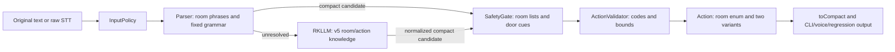
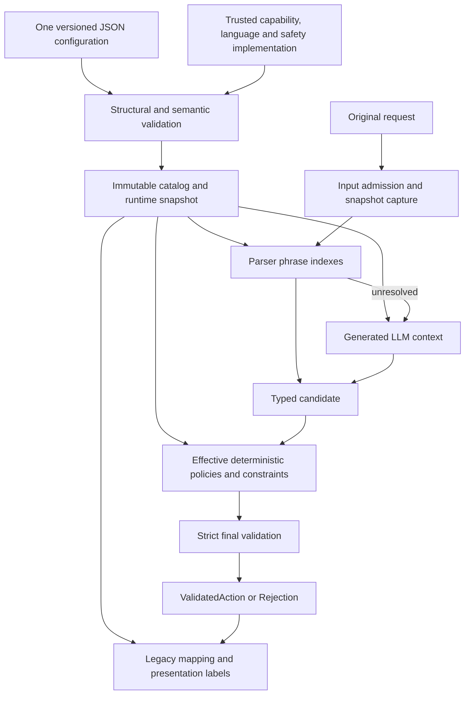
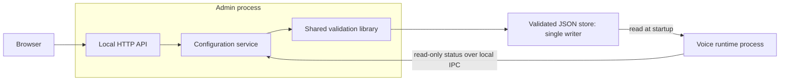

# Milestone 6.1 — dynamic configuration architecture

Date: 2026-09-14. Status: **design complete; implementation and runtime integration not started**.

Inspected repository checkpoint: `a76de5839c77c1c786e5eacd168ecfc19fc9cd9f`. The working tree was clean before this report. The [Milestone 4 baseline](milestone-4-baseline.md) remains authoritative for production behavior. Wake-word work is deferred. This milestone adds only this document: no parser, SafetyGate, validator, protocol, prompt, voice setting, model, hardware, HTTP service or dashboard change.

**Recommendation:** persist one UTF-8 JSON configuration, validate it into an immutable catalog, and derive every interpretation view from that catalog and a versioned, application-owned capability/language/safety implementation. Introduce a generic typed action behind a strict legacy adapter in later milestones. Keep the future admin service in a separate lightweight process; initially activate configuration through a controlled runtime restart.

The configuration describes the installation. Software defines what an operation means and the minimum conditions under which it is allowed. An administrator can configure more instances of supported capabilities without editing C++ or prompts. A genuinely new capability, such as controlling a thermostat, still needs a reviewed implementation and safety contract. A text field must never create executable semantics.

## 1. Current hardcoded dependency map

Locations below refer to the inspected checkpoint. “Future owner” describes a proposed migration, not a change made here.

| Current dependency | Exact location and present behavior | Future owner / migration boundary |
|---|---|---|
| Room and action types | [Action.h](../include/firefly/Action.h), lines 6–9: four `Room` enum members; `LightAction{room, brightness}`; targetless `OpenEntranceDoor`; two-alternative `Action` variant | Catalog room/device/action IDs; generic action with an explicit device target. Keep the existing types during compatibility work. |
| Compact serialization | [Action.cpp](../src/Action.cpp), lines 5–18: `K/B/G/C`, `L`, `D`, integer 0..100, unsupported enum rejection | `LegacyCompactCodec`; an explicit fixed mapping to catalog targets, never generated from array positions or display names |
| Strict candidate validation | [ActionValidator.cpp](../src/ActionValidator.cpp), lines 4–22: recognizes only `D` and four light forms; ASCII digits; no spaces/signs/extra fields; accepts leading zeros | Retain the old decoder. Future generic validator checks configured IDs, target capability, exact parameter set/types and effective bounds. |
| Parser locations | [DeterministicParser.cpp](../src/DeterministicParser.cpp), lines 25–27: `на кухне`, `в спальне`, `в гостиной`, `в зале`, `в коридоре` | Room location phrase index from the catalog |
| Parser grammar and value meanings | Same file, lines 8–14 and 29–78: outside trimming, Russian/ASCII lowercase, whole-input matches, fixed word orders, numeric 0..100, six on/off forms, half=50 and maximum=100; static precompiled regexes | Versioned generic Russian grammar with entity/argument slots; catalog supplies targets and bounds. Grammar and semantic meanings remain reviewed software. |
| Door routing | Parser lines 79–80 have no door production; [CommandEngine.cpp](../src/CommandEngine.cpp), lines 18–21, sends unresolved input to RKLLM | Preserve door fallback in compatibility mode. A deterministic door grammar would be a separate behavior change. |
| Room evidence in SafetyGate | [SafetyGate.cpp](../src/SafetyGate.cpp), lines 27–39: different, broader lists of exact whole-token room inflections than the parser's location phrases | Room mention index from the same catalog, with explicit match roles; keep original-input evidence |
| Light safety | Same file, lines 40–42: reject predicted zero if lowercased original contains `включ` | Mandatory operation policy; configuration may not remove or remap it |
| Entrance-door safety | Same file, lines 11–25: one of five opening tokens, substring `двер`, plus substring `входн` or adjacent tokens `на входе` in original input | Mandatory security operation policy, independent of editable device labels/aliases |
| Text normalization | [Text.cpp](../src/Text.cpp), lines 4–34: explicit ASCII/Russian case folding including Ё; fixed token separators | Shared, versioned text primitives retaining source byte spans; no transcript correction or automatic morphology in the compatibility profile |
| Input admission | [InputPolicy.h](../include/firefly/InputPolicy.h), line 8, and [InputPolicy.cpp](../src/InputPolicy.cpp): 192 UTF-8 bytes, nonblank, valid encoding/control-byte checks | Application invariant, outside ordinary installation configuration |
| Pipeline and result | [CommandEngine.cpp](../src/CommandEngine.cpp), lines 15–30: fast-path bypass; fallback removes all ASCII whitespace from model output; original goes to SafetyGate; validator runs after the gate. [CommandEngine.h](../include/firefly/CommandEngine.h), lines 7–16: optional action and `compact()` producing `U` on rejection | One snapshot per request; typed candidate, safety decision and validated result. Preserve original/raw/normalized/final diagnostics and existing routes during migration. |
| System prompt knowledge | Read-only `/home/firefly/demo_Linux_aarch64/prompt_compact_v5_short_system.txt`: lines 8–15 codes/range; 19–58 light vocabulary, room names and rejection rules; 62–67 entrance door; 71–80 examples | Future fixed instruction template plus catalog-derived context. Current v5 file remains unchanged. |
| Prompt loading and lifetime | [main.cpp](../src/main.cpp), lines 42–55; [VoiceMode.cpp](../src/VoiceMode.cpp), lines 51–73; [RegressionMain.cpp](../src/RegressionMain.cpp), lines 49–58, read `--system-prompt`. [RkllmEngine.cpp](../src/RkllmEngine.cpp), lines 146–179, installs it and bootstraps system KV | Future runtime assembly owns a generated context tied to a catalog revision. Admin edits data, never prompt text/path. |
| Model capacity and failure behavior | [RkllmEngine.cpp](../src/RkllmEngine.cpp), lines 90–93, 110–138, 155–178 and 188–199: bounded callback output, 16 generated tokens, 1024 context, fixed sampling/template, synchronous inference, KV clearing and restart after failure | Frozen platform/runtime policy. A bigger catalog or new model-output codec needs measured admission checks, not an automatic context/token increase. |
| Text/voice presentation | [main.cpp](../src/main.cpp), lines 69–76, writes compact stdout. [VoiceProcessor.cpp](../src/VoiceProcessor.cpp), lines 11–17, flattens `CommandResult` into a string; [VoiceProcessor.h](../include/firefly/voice/VoiceProcessor.h), line 7, defaults to `U`; [VoiceMode.cpp](../src/VoiceMode.cpp), lines 78–83, logs `ACTION` and emits compact stdout | Presentation adapters over the typed result. Preserve legacy output by default; future display labels resolve through the request's catalog. There is no separate localized room-label renderer today. |
| Regression tooling | [RegressionMain.cpp](../src/RegressionMain.cpp), lines 22–35 and 64–92, validates expected compact forms and scores exact strings | Keep legacy scorer; add a separate typed-action scorer only with the new runtime path |
| Tests and recorded expectations | [CoreTests.cpp](../tests/CoreTests.cpp), lines 27–190: enum/codec matrices, parser grammar and safety evidence; [CommandEngineTests.cpp](../tests/CommandEngineTests.cpp), lines 31–114: routes, whitespace, original input and failure behavior; [tests/data/dev.tsv](../tests/data/dev.tsv): 48 frozen compact cases | Preserve these independent oracles. Add separate configuration tests; never regenerate existing expected answers from the configuration under test. |
| Runtime and speech checks | [RkllmEngineTests.cpp](../tests/RkllmEngineTests.cpp), [FakeRkllmRuntime.cpp](../tests/FakeRkllmRuntime.cpp), [CliTests.py](../tests/CliTests.py), [VoiceTests.cpp](../tests/VoiceTests.cpp), [SpeechReplayTests.cpp](../tests/SpeechReplayTests.cpp) | Preserve fixed sampling/KV, output and raw-transcript contracts. Model-backed speech replay remains separate from pure unit tests. |
| Construction/build | [CMakeLists.txt](../CMakeLists.txt), lines 6–7, builds a configuration-free core; command components expose static entry points | Later add an isolated configuration library; inject immutable catalog dependencies only in an explicitly authorized integration milestone |

The prompt was inspected read-only. Its SHA-256 is `d1c977f28ec4f8e08e30ee362d108fed1482a690667d6af88776ce7c8442d02f`. No model binary, runtime library or other production-reference file was needed for this design.



### Compatibility facts that must not be lost

- The system has four supported light locations, including two names for the same living room. It has no bathroom light, multiple lights per room, thermostat, blinds or hardware binding.
- A light is currently a logical room-level target. The new sample gives each such target an ID without asserting that a physical fixture exists. The entrance door has no stored room association; assigning it to the corridor would invent information.
- The parser does not accept every SafetyGate room inflection or every formulation supported by the LLM. Number words and polite requests generally need fallback. The v5 prompt permits approximate numeric phrasing such as `примерно 40`; the fast path leaves it unresolved.
- `U` is absence of an action, not a third executable action type. The validator accepts `L|K|00050`; `toCompact` emits `L|K|50`. SafetyGate preserves the candidate spelling when it passes. Fallback currently removes whitespace even between digits. These are explicit legacy behaviors, not rules to inherit accidentally in a future codec.
- The current SafetyGate does **not** independently enforce every rejection rule described in v5: for example, general negation, multiple rooms/actions, and every brightness contradiction. Its room check asks whether the predicted room occurs, not whether it is the only room. Its door check establishes the three explicit cues, not complete sentence intent. These are inspection findings, not new exploit tests or changes. Future stronger deterministic checks need their own behavior review and regression cases.
- Preserve the recorded live failure `открыть дверь на входе` → raw STT `открытвер на входе` → `U`. Configuration aliases must not become transcript corrections.

## 2. Persistent format and schema contract

Use **one local JSON document**, provisionally `configuration.json`, encoded as UTF-8 and formatted with four-space indentation. JSON is easy to round-trip through a browser and a C++ service. We do not need YAML anchors, tags, implicit scalar conversions or a database for a small installation. Comments belong in documentation; display names belong in explicit fields. JSON storage does not change the compact command protocol. [JSON specification](https://www.rfc-editor.org/rfc/rfc8259.html).

Define a bundled JSON Schema using Draft 2020-12 for structure, required fields, primitive types and bounds. Disable remote schema resolution. Application semantic validation is additionally required for references, permissions and ambiguity. `uniqueItems` alone does not express uniqueness of the `id` property across differently shaped objects. [JSON Schema specification](https://json-schema.org/draft/2020-12), [validation vocabulary](https://json-schema.org/draft/2020-12/json-schema-validation).

### Identity and ownership

Every independently addressable domain object has an immutable ASCII `id` and editable human `name`: system, rooms, devices, actions, parameters, and future restrictions/bindings. IDs match `[a-z][a-z0-9_]{0,63}`. System/room/device/action/restriction/binding IDs are globally unique; parameter IDs are unique within their action. English-like IDs below are illustrative fixed IDs, not values to regenerate from Russian names. The future dashboard generates an ID once. Renaming or moving a device preserves identity; a replacement device gets a new ID. Deleted domain IDs are retained in the service-managed `retired_ids` collection in the same document and cannot be reassigned, even after old backups are pruned. Parameter slots belong to the immutable operation signature.

Spoken forms are explicit string values owned by an object, not separate entities requiring their own names and IDs. Containers such as `speech`, numeric bounds and codec lookup maps are value structures. A display name is **not automatically a spoken alias**. That prevents a cosmetic rename from changing command interpretation.

| Field | Contract |
|---|---|
| `schema_version` | Required integer storage-format version; initial value 1. Unsupported versions are errors, not invitations to guess. |
| `revision` | Positive, monotonically increasing integer assigned by the configuration service. Distinct from schema version. Each complete saved revision has a content hash outside the document. |
| `retired_ids` | Service-managed, unique domain IDs no longer in use. Append on deletion; no active object may use one. Edits cannot erase this history. |
| `system` | `id`, `name`, `locale`, `interpretation_profile`. Initially `ru-RU` and `legacy_m4_v1`. Profile is an application compatibility requirement, not a dashboard safety selector. |
| `rooms[]` | `id`, `name`, `speech.mentions` and `speech.locations`. Mentions are exact inflected token forms used for evidence; locations are exact prepositional phrases accepted in grammar slots. |
| `devices[]` | `id`, `name`, compiled `kind`, nullable `room_id`, `enabled`, `action_ids`, `spoken_aliases`. No inferred room, implicit default device or wildcard target. |
| `actions[]` | `id`, `name`, compiled `operation`, `enabled`, typed `parameters[]`, and `speech_aliases` grouped by allowed grammar role. An action describes one operation reusable by several devices. |
| `parameters[]` | `id`, `name`, `type`, `required`, `minimum`, `maximum`, `unit` for the current integer parameter. Other types require an operation contract supporting them; no string-to-number coercion or implicit values. |
| `safety.restrictions[]` | Additional typed, conjunctive restrictions. Initial implementation supports explicit `deny_action` records with `id`, `name`, `device_id`, `action_id`; unknown rule kinds fail validation. The current sample has none. Mandatory policies are derived from trusted operation/kind contracts. |
| `bindings[]` | Reserved collection of future physical binding objects. Schema v1 requires it to be empty: there is no executor today. A later version can introduce reviewed driver-specific records. |
| `compatibility` | Optional legacy codec mapping; required for `legacy_m4_v1`. One selected light action and four explicit code-to-target references, plus a door action/target. Fixed under legacy compatibility; not a UI remapping facility. |

All object fields are closed: unknown properties are errors. All current fields are required, including intentionally empty collections. Optional future fields need explicit defaults and versioned semantics, not scattered C++ fallback values.

The trusted capability registry initially knows `light` / `light.set_brightness.v1` and `entrance_door` / `entrance_door.open.v1`. It defines compatible device kinds, parameter slots, intrinsic ranges, semantic meanings and mandatory policy IDs. The document declares which instances and actions are configured, their labels and any tighter bounds. These are not two competing installation catalogs: the registry is the implementation of capabilities; the JSON is the only installation data.

The language profile owns generic Russian command structure and meanings such as on=100, off=0, maximum=100 and half=50. No room names or room codes belong in a future generic grammar. Additional action aliases can fill allowlisted roles such as `set_verb` or `light_subject`; they cannot contain regexes, assignments, prompt instructions or redefine the meaning of “off.” For the initial compatibility profile, device/action alias additions are disallowed and represented as empty collections. Configurable action-language extensions require a later profile and tests.

For integer brightness, effective permitted values are the intersection of the capability's intrinsic 0..100, the configured bounds, and any later trusted device limits. A request outside that intersection is rejected, never clamped. Restricting maximum brightness to 80 does not redefine “maximum” as 80 in the legacy profile: its 100 candidate becomes unsupported. A different semantic convention needs an explicit profile change.

## 3. Sample configuration: current behavior only

This is a **proposed data representation**, embedded in the report and not loaded by any application. It records current entity knowledge together with the pinned legacy grammar/policy contract. It cannot promise that a newly generated prompt reproduces every Qwen3 decision; that requires later evaluation. It introduces no aliases beyond the existing room lists and no new parser productions.

```json
{
    "schema_version": 1,
    "revision": 1,
    "retired_ids": [],
    "system": {
        "id": "system_home",
        "name": "Дом",
        "locale": "ru-RU",
        "interpretation_profile": "legacy_m4_v1"
    },
    "rooms": [
        {
            "id": "room_kitchen",
            "name": "Кухня",
            "speech": {
                "mentions": ["кухня", "кухне", "кухню", "кухни", "кухней"],
                "locations": ["на кухне"]
            }
        },
        {
            "id": "room_bedroom",
            "name": "Спальня",
            "speech": {
                "mentions": ["спальня", "спальне", "спальню", "спальни", "спальней"],
                "locations": ["в спальне"]
            }
        },
        {
            "id": "room_living",
            "name": "Гостиная",
            "speech": {
                "mentions": ["гостиная", "гостиной", "гостиную", "зал", "зале", "зала", "залу", "залом"],
                "locations": ["в гостиной", "в зале"]
            }
        },
        {
            "id": "room_corridor",
            "name": "Коридор",
            "speech": {
                "mentions": ["коридор", "коридоре", "коридора", "коридору", "коридором"],
                "locations": ["в коридоре"]
            }
        }
    ],
    "devices": [
        {
            "id": "device_kitchen_light",
            "name": "Свет на кухне",
            "kind": "light",
            "room_id": "room_kitchen",
            "enabled": true,
            "action_ids": ["action_set_brightness"],
            "spoken_aliases": []
        },
        {
            "id": "device_bedroom_light",
            "name": "Свет в спальне",
            "kind": "light",
            "room_id": "room_bedroom",
            "enabled": true,
            "action_ids": ["action_set_brightness"],
            "spoken_aliases": []
        },
        {
            "id": "device_living_light",
            "name": "Свет в гостиной",
            "kind": "light",
            "room_id": "room_living",
            "enabled": true,
            "action_ids": ["action_set_brightness"],
            "spoken_aliases": []
        },
        {
            "id": "device_corridor_light",
            "name": "Свет в коридоре",
            "kind": "light",
            "room_id": "room_corridor",
            "enabled": true,
            "action_ids": ["action_set_brightness"],
            "spoken_aliases": []
        },
        {
            "id": "device_entrance_door",
            "name": "Входная дверь",
            "kind": "entrance_door",
            "room_id": null,
            "enabled": true,
            "action_ids": ["action_open_entrance"],
            "spoken_aliases": []
        }
    ],
    "actions": [
        {
            "id": "action_set_brightness",
            "name": "Установить яркость света",
            "operation": "light.set_brightness.v1",
            "enabled": true,
            "parameters": [
                {
                    "id": "brightness",
                    "name": "Яркость",
                    "type": "integer",
                    "required": true,
                    "minimum": 0,
                    "maximum": 100,
                    "unit": "percent"
                }
            ],
            "speech_aliases": {}
        },
        {
            "id": "action_open_entrance",
            "name": "Открыть входную дверь",
            "operation": "entrance_door.open.v1",
            "enabled": true,
            "parameters": [],
            "speech_aliases": {}
        }
    ],
    "safety": {
        "restrictions": []
    },
    "bindings": [],
    "compatibility": {
        "codec": "compact_v1",
        "light_action_id": "action_set_brightness",
        "light_targets": {
            "K": "device_kitchen_light",
            "B": "device_bedroom_light",
            "G": "device_living_light",
            "C": "device_corridor_light"
        },
        "door_action_id": "action_open_entrance",
        "door_target_id": "device_entrance_door"
    }
}
```

The door is enabled for **interpretation**, matching today's ability to return `D`; an empty binding set conveys that no hardware execution exists. The compiled entrance-door policy supplies the exact existing lexical requirements. Empty configurable restrictions do not mean empty safety policy.

There is no `ванная`, `ванна`, new light noun or corrected STT spelling in this sample. Future dynamic mode could add a bathroom room, its explicitly entered inflections/location phrases and a compatible light instance. Legacy mode must reject activation of a catalog whose accepted target space cannot be represented by the fixed codec and v5 context.

## 4. Generic internal action and snapshot architecture

Use separate types for untrusted interpretation and authorized output. An illustrative C++17 design, not an implementation:

```cpp
using ArgumentValue = std::variant<std::int64_t, bool, EnumValue, DecimalValue>;

struct ActionCandidate {
    ActionId actionId;
    DeviceId targetId;
    std::map<ParameterId, ArgumentValue> arguments;
};

struct RequestContext {
    std::shared_ptr<const RuntimeSnapshot> snapshot;
    std::string originalInput;
    Evidence evidence; // Derived from originalInput; byte spans and match roles.
};

// Constructible only through the validation/safety pipeline.
class ValidatedAction;
// Rejection has a reason and diagnostics, and contains no ValidatedAction.
using Decision = std::variant<ValidatedAction, Rejection>;
```

Only integer brightness is initially supported. `EnumValue` would be a declared enum ID, not arbitrary text; a future `DecimalValue` should use an explicitly defined fixed scale/unit rather than implicit floating-point conversion. Unsupported types remain disabled until their operation contract and validation exist. No arbitrary nested action lists, target selectors, executable strings or “run command” action.

The example is `actionId=action_set_brightness`, `targetId=device_kitchen_light`, `arguments={brightness: int64(40)}`. The target's room is resolved from the snapshot. Do not duplicate a mutable room name or independent `roomId` in the authoritative action. `action_open_entrance` explicitly targets `device_entrance_door` with zero parameters. `U` is represented by `Rejection` and serialized only at an output boundary.

A future `RuntimeSnapshot` contains the validated catalog, room/device alias indexes, effective action contracts and policies, legacy mapping if applicable, generated context identity and build/profile versions. Persist only the source JSON and revision metadata. Indexes, rendered prompts and caches are reproducible derivatives, never separately editable configuration. Hashing the configuration alone is insufficient to identify semantics: diagnostics also record the capability/language/policy/context-generator versions.



Each request captures one complete snapshot. Evidence is computed by trusted code from the original input, even for an LLM candidate; model-supplied evidence is never trusted. A validated action carries snapshot/revision identity through diagnostics and any later execution boundary. A later executor must recheck enablement, binding identity and active revision immediately before a side effect and reject stale work; it must not translate old IDs using a new catalog.

## 5. Compact-protocol migration

**Keep compact v1 frozen as a legacy serialization adapter; eventually replace its role as the universal internal/model contract.** Do not add new room letters, overload `D`, or assign room codes by position. JSON configuration and internal typed actions do not require a JSON LLM protocol.

| Stage | Internal / external behavior | Compatibility condition |
|---|---|---|
| 6.1 and proposed 6.2 | Existing runtime and compact protocol unchanged; separate design/configuration tooling | No production configuration loading |
| Later adapter milestone | Old `Action` ↔ new typed action in isolated tests/tools; compact v1 still decodes/encodes existing forms | All 404 canonical light actions plus `D` round-trip; invalid forms stay invalid; leading-zero decode remains compatible |
| Later shadow interpretation | A separately constructed dynamic pipeline compares candidates, routes and final decisions against the old pipeline without becoming authoritative | Every behavioral difference is reported; frozen tests and DEV expectations remain independent |
| Authorized dynamic runtime | New internal action becomes authoritative only after acceptance. Old text/voice output remains selectable for fully representable catalogs. | `legacy_m4_v1` cannot silently advertise additional/unmapped entities or stale v5 knowledge |
| Later model/output contract | Introduce a separately versioned general codec after a focused Qwen3 feasibility evaluation | Explicit mode selection; no heuristic “try every codec” decoding and no silent fallback to the old prompt |

`LegacyCompactCodec::encode` returns an explicit `Unrepresentable` error for bathroom lights, a second light in a room, other operations or unknown IDs. It must not encode such an action as another room or claim that `U` is a successful serialization. The legacy presentation boundary may render a rejection as `U`, but it must first withhold the unsupported action and preserve the diagnostic reason. Legacy mode refuses activation of an incompatible catalog.

For a later general model codec, the candidate design is a small versioned delimited record containing a target token, action token and typed parameter values. Short tokens would be generated deterministically from one snapshot and resolved only within that snapshot, never used as persistent device IDs. This retains the compact approach without overloading old codes. Exact syntax, token budgets and error tests are a later protocol-design decision; **6.1 does not replace compact with JSON or emit a new production prompt**. Stable full IDs remain the internal/API representation regardless of a model codec's short tokens.

## 6. Deterministic parser migration

Replace per-room regex expansion eventually with one reviewed grammar over a bounded token stream and catalog phrase indexes. The dashboard supplies data, not regexes or grammar fragments. A trie or token-sequence lookup built once per snapshot can match room phrases and device aliases without compiling a regex per room/action combination.

| Remains generic, versioned software | Comes from configuration |
|---|---|
| Case folding, tokenization, source offsets and allowed outside punctuation | Explicit room mention forms and location phrases |
| Whole-command productions and permitted word order | Device IDs, kinds, locations, enablement and approved aliases |
| Russian command verbs and semantic slots; on/off/half/maximum meanings | Supported operation instances, allowed parameters and tighter bounds |
| Numeric token recognition, percent syntax and checked integer conversion | Additional synonyms in supported roles, only after the relevant language profile exists |
| Ambiguity/contradiction handling and refusal to invent missing values | Target membership and capability lookup |

Illustrative productions correspond to today's `LOCATION свет INTEGER`, `свет LOCATION INTEGER`, and `SET_VERB свет LOCATION на VALUE`. They are explanatory, not a new grammar specification. Extract the full current production matrix into independent fixtures before changing the implementation. Preserve exact whitespace and punctuation behavior in legacy comparisons; replacing regexes with a tokenizer must not silently accept extra internal spaces, misspellings or new inflections.

Parsing returns `Resolved(candidate, evidence)`, `Unresolved`, or, for a future strengthened profile, `Rejected(reason)`. A resolved command bypasses the LLM and still passes safety/validation. Unresolved grammar uses fallback once. A positively identified unsafe/contradictory request in the stronger profile must be terminally rejected; fallback cannot overturn that rejection. The frozen legacy pipeline's unresolved routing remains unchanged until that new behavior is authorized.

Resolve all possible relevant matches. Never choose the first room/device in an array, an alias's longest match without checking alternatives, a remembered room, or the only device globally when the command lacks required evidence. A room-scoped generic “light” target works only when exactly one enabled compatible device is present. Multiple lights in one room require explicit distinguishing aliases or an explicitly modeled, later-supported group; there is no implicit fan-out.

Russian inflection is entered as explicit forms in this first design. `зал` and `зале` may point to the same living-room ID; `ванна` and `ванная` could be configured for a future bathroom in a later dynamic profile. No morphology package, fuzzy match, substring correction or STT normalization is introduced. Legacy substring checks for door/security cues remain isolated mandatory policy code, not general alias matching.

## 7. Automatic LLM context generation

The future runtime creates context from **validated enabled catalog entries + a fixed application instruction template + the active codec contract**. The administrator sees rooms/devices/actions/aliases/limits and a read-only interpretation preview. There is no editable prompt field, prompt path, instruction suffix or model parameter field in the dashboard schema.

The generator walks enabled devices and their enabled, compatible, permitted actions; includes their configured rooms, explicit aliases, argument types/ranges/units and required evidence; excludes disabled/unreachable capabilities, bindings, credentials and unrelated display metadata. If an action is disabled or denied on one target, its permitted-target relation must reflect that exactly. Examples are generated only for valid configured targets and in-range values. Do not retain fixed kitchen examples after the kitchen is removed. Generic reject instructions may describe unsupported targets without teaching a catalog of unconfigured rooms/devices.

Sort records by stable IDs, deduplicate within the same semantic role, use deterministic escaping and unambiguous data delimiters, and record the generator/profile/catalog hashes. Names and aliases are data. Reject control characters, line breaks and chat-template control sequences in configurable text; bound each field and render it as a quoted value. This reduces injection opportunities but does not make LLM output trusted. Fixed instructions and deterministic safety remain authoritative.

Generate the smallest **complete** installation context that fits. Do not silently truncate rooms, aliases or mandatory constraints. Initially use the whole enabled catalog; request-specific subsetting/retrieval is deferred because a wrong subset can change interpretation. A future activation validator must account for rendered system tokens, Qwen3 chat-template overhead, the worst permitted 192-byte request and output allowance against the frozen 1024-token context. It must also prove the selected response grammar fits the current 16-token generation bound. Byte counts alone are not a token-budget proof. If a compatible tokenizer/bound cannot be established, activation is blocked rather than guessed. Structural JSON capacity and model-context capacity are separate limits.

The current v5 prompt remains loaded from its unchanged file throughout 6.2. Later generated-context work requires golden rendering tests, mock candidates (including malicious/unknown IDs), and a separately authorized real NPU evaluation with frozen model/sampling. Do not claim equality of model predictions merely because generated text contains equivalent facts.

Context activation is coupled to the runtime snapshot. With system KV retained in RAM, changing room data without rebuilding the system context would leave the LLM using stale knowledge. Initially stop admission, finish/join synchronous work and its watchdog, destroy the old RKLLM engine, then initialize once with the new context, bootstrap with an empty user prompt, clear KV keeping system, and keep the existing per-request clear. On initialization/KV failure the new runtime is not ready. No persistent serialized prompt cache; no in-place prompt swap; no second NPU model kept resident for configuration editing.

## 8. SafetyGate and administrative authority

The future gate can preserve a typed candidate or reject it. It cannot substitute a target, repair text, fill an omitted argument, clamp brightness, invent an action or reinterpret a failed candidate through another codec.

| Administrator may configure | Ordinary configuration cannot override |
|---|---|
| Room/device labels and explicit aliases in supported scopes | Valid original UTF-8, request size/control-byte policy and preservation of raw STT |
| Instances of installed, reviewed device kinds and operations | Intrinsic parameter type/range/unit and operation/device compatibility |
| Enable/disable targets/actions and tighten permitted ranges | Required original-input evidence, no guessing/repair, strict final validation |
| Additional supported deny restrictions | Mandatory operation safety class or deny rules; removing an additional deny cannot remove built-in safeguards |
| Future reviewed bindings through a separately authorized provisioning boundary | Reclassifying a security binding as an ordinary light, changing policy through a label, or creating shell/script actions |

Effective permission is the intersection of trusted capability policy, configuration restrictions and, later, trusted binding constraints. It is never “config overrides default policy.” The runtime version chooses its supported policy profile; editing `interpretation_profile` cannot downgrade it. Schema validation rejects `allow_unsafe`, `skip_safety`, unknown policy names or fake capability definitions.

Keep the exact current entrance rule as a mandatory floor for `entrance_door.open.v1`: original input must contain a whole opening token `открой`, `откройте`, `открыть`, `открывай` or `открывайте`, a `двер` substring and either `входн` or adjacent whole tokens `на входе`, case-insensitively with the existing tokenization. An alias such as “вход,” a renamed device or a model-produced `D` cannot satisfy missing cues. The malformed raw transcript `открытвер на входе` still fails.

Keep light room evidence from the **original** command and zero/`включ` rejection mandatory. Adding device-specific names later must not eliminate the explicit-room requirement by silently resolving a global alias. A change to that product contract needs separate authorization and tests.

Before a dynamic runtime could operate security-sensitive hardware, add deterministic checks for negation, multiple competing targets/actions, quoted/hypothetical commands and contradictory intent. Unknown intent/evidence must fail closed, even if the model predicts a valid ID. These strengthen the present gate and are **future behavioral work**, not claims about the baseline or additions to the sample. Confirmation or authenticated physical opening may also be required by that later execution design; voice recognition is not identity or authority.

Future bindings need a driver allowlist, typed address/channel fields, device/action compatibility and a trusted binding security class. Secrets stay in a separate protected credential store; configuration holds a credential reference only. New binding fields require a versioned implementation; generic free-form paths/URLs or process commands are not accepted today. If a future runtime has no eligible binding or lacks required authorization, it must not execute, even after successful interpretation. The admin API must never provide a “test door” execution shortcut.

## 9. Validation, persistence and activation

### Complete validation before publication

Proposed initial storage limits: 256 KiB per document, depth 16, 64 rooms, 128 devices, 32 action definitions, 16 parameters per action, 32 strings per alias role, 96 UTF-8 bytes per alias and 128 bytes per display name. These are defensive engineering limits, not measured RK3588S or LLM capacity. A later model-compatibility limit can be smaller. Validate bounded raw input before large allocations.

Validation order:

1. Read a regular file from the configured store, with bounded length and explicit I/O error handling. Reject invalid UTF-8, NUL/control characters in strings, trailing data, duplicate JSON member keys, nonfinite numbers and unsupported scalar representations. Reject duplicate keys before conversion to a map; never accept parser-dependent last-key-wins behavior.
2. Check `schema_version` and bundled structural schema: required/unknown fields, exact types and nonempty IDs/names. Require integer tokens for revision, version and integer parameter bounds: reject `40.0`, `4e1`, `"40"` and booleans in those slots. This deliberately tightens JSON Schema's mathematical `integer` semantics.
3. Check unique IDs, parameter IDs, active/retired ID disjointness, array references, existing room/action/device targets, compatible kinds/operations, required parameter signatures and `minimum <= maximum` within intrinsic limits. Reject an entire document with unknown capabilities, even if marked disabled; do not partially load recognized entries. On save, compare with the previous revision, preserve all retired IDs and append newly deleted domain IDs before validating the resulting document.
4. Check alias normalization/collisions and security-reserved vocabulary. Unknown or ambiguous role assignments are errors. No client-side-only validation.
5. Compute enabled target/action relations and effective restrictions; verify deny references. Check legacy mapping uniqueness, exact code set, operation types, one light per mapped room, correct stable target identity and the pinned legacy interpretation contract. Metadata edits may be valid; a graph/alias change incompatible with v5 cannot be activated as legacy mode.
6. Build all immutable indexes off the request path. Future runtime activation additionally checks language/policy versions, codec representability and context budget. Publish only the complete snapshot after every required check passes.

Storage validation and activation readiness are distinct results. A standalone future configuration tool may inspect a structurally valid proposed catalog, but it must not label it runtime-compatible without the profile/codec/context checks. In 6.2 every output explicitly says it has not been activated by production.

### Alias collisions and evidence

Normalize aliases using the same pinned case-folding and role tokenization used to build request indexes; preserve the original string for display. Initial compatibility aliases must be stored in canonical lowercase form with single internal spaces. Do not add Unicode equivalences, ё→е folding or transliteration as an incidental cleanup.

Reject duplicate normalized aliases within a role, including duplicates belonging to the same object, with both configuration paths in the error. A location phrase containing its own room mention (for example `на кухне` / `кухне`) is intentional overlap across roles, not a duplicate. Same-role room aliases across different rooms are invalid. Repeated display names may be allowed because names are not automatically aliases.

Device aliases may be scoped by room in a future dynamic profile; the same phrase in distinct rooms is allowed only when the grammar still requires an explicit room. Within a target-resolution scope, collisions between devices are rejected. Cross-role conflicts are checked wherever the same grammar slot could accept both roles. Shared generic vocabulary such as “свет” belongs to the operation/kind language contract, not a globally unique name assigned independently to every light. Prefix/phrase overlaps that yield multiple possible parses must be reported or rejected; no insertion-order precedence.

Reserve rejection/negation/control tokens and mandatory door-intent words from being reassigned as room/device/action aliases. Check for ambiguous matches at runtime too: startup collision checks cannot prove all possible natural-language input unambiguous. Errors use structured codes and JSON pointers, for example `duplicate_id`, `ambiguous_alias`, `dangling_reference`, `unsupported_operation`, `unsafe_constraint`, `legacy_incompatible` and `context_budget_exceeded`.

### Versioning and safe failure

`schema_version` changes when the storage contract changes. A content edit increments `revision`; application policy/language changes have independent compiled version identifiers. Store the source file hash and semantic-version tuple with diagnostics. Canonical output sorts domain arrays by ID and map keys, preserves typed values and uses a fixed formatting/newline policy; hash the exact canonical UTF-8 bytes. Do not put a self-referential hash inside the document.

Implement migrations as explicit pure `vN -> vN+1` transformations with versioned fixtures, full post-validation and a before/after diff. Preserve IDs and exclusions. No automatic migration on production startup, no best-effort downgrade and no silent insertion of an enabled door/action. Initially only schema 1 exists: accept it, reject unknown versions, and document that no conversion is necessary. Later migration tools create a new revision and preserve the original bytes as backup.

| Condition in a future configuration-aware runtime | Safe behavior |
|---|---|
| Missing, malformed, unsupported or inconsistent configuration at startup | Do not become command-ready or run inference; emit diagnostic startup failure. No default rooms, partial catalog or automatic backup activation. |
| Invalid edit submitted while a valid snapshot runs | Reject the edit; keep the complete existing active snapshot and report its revision. Invalid data was never installed. |
| Valid saved revision while old runtime runs | Report `restart_required`, saved revision and actual active revision separately. Saving is not activation. |
| New runtime fails snapshot/context initialization | Remain unavailable for commands; administrator can explicitly restore a known valid revision. Do not silently choose a different installation. |
| Uncertain persistent-store state after an I/O failure | Stop accepting store mutations until reconciliation; report actual readable durable state, never a false success acknowledgement. |

These are future runtime rules. Milestone 4 does not read this proposed store and is unaffected by its presence or absence.

### Atomic saves and backups

Use a single configuration-service writer, optimistic concurrency (`expected_revision` plus hash), and an advisory lock for any offline writer. Runtime has read-only store access. Proposed deployed location is `/var/lib/firefly/config/`; development tools require an explicit private scratch directory. Creating accounts/directories or installing a service is outside 6.1 and 6.2.

Save transaction:

1. Acquire the store lock, compare the expected current revision/hash, validate the entire candidate, and assign the next revision. A stale editor gets a conflict and must reread; do not merge fields automatically.
2. Preserve the previous committed JSON in `backups/<revision>-<hash>.json` using an exclusive temporary file and durable publication before changing the current file. If backup creation fails, abort the save. First initialization has no previous revision.
3. Write canonical new JSON to an exclusively created temporary regular file in the **same directory/filesystem** as `configuration.json`; use restrictive permissions, check all writes and `fsync` the file. Hold trusted directory file descriptors and reject symlinks/untrusted paths.
4. Atomically rename the temporary file over `configuration.json`, then `fsync` the containing directory. A local rename atomically replaces the destination; flushing the file alone does not ensure its directory entry is durable. Check every return value. [Linux rename](https://man7.org/linux/man-pages/man2/rename.2.html), [Linux fsync](https://man7.org/linux/man-pages/man2/fsync.2.html).
5. Acknowledge the exact saved revision/hash only after the durability boundary. If rename succeeded but the directory flush failed, report indeterminate durability, reread/reconcile the store and require recovery; do not claim that the old file necessarily remained current. Leave the running snapshot unchanged.

On restart, validate only the committed path; never promote orphan temporary files because their number is higher. Preserve the prior file and diagnostic information if the current file is corrupt. Backups are for explicit restore, not alternative sources scanned until something loads. A restore revalidates a chosen backup and saves its content as a **new revision**; it does not roll the revision counter backward or discard the current retired-ID set. A backup that would revive a retired ID is rejected with a precise conflict; recreating that object requires a new ID and an explicitly reviewed reference update. This conservative initial restore rule avoids resurrecting stale targets. Retain at least the last ten successful revisions plus backups required by a schema migration and any still-active revision. Prune only after a durable successful save. Test interrupted writes, ENOSPC, backup/fsync/rename failures and concurrent writers with fault injection; power-loss durability still depends on the actual local filesystem/storage honoring flushes.

### Activation initially requires restart

Do not implement file-watcher hot reload. The future runtime reads one complete revision at startup, builds the complete snapshot and matching RKLLM context, then announces readiness with their identities. The admin process stays available during inference stalls or runtime restart. A saved revision does not mutate a running request.

Eventually an explicit apply operation can request a controlled restart: close admission, discard queued/unstarted utterances, wait for synchronous work and abort watchdogs, suppress results after stop, and reconstruct the runtime from the committed revision. Report vendor hangs honestly; the existing deadline is not a hard stop bound. An urgent security-disable workflow must stop admission before claiming the disable is effective; a pending saved edit is not an emergency stop. Live reload, instant revocation and hardware command queues are later design work.

## 10. Future local web admin boundary

**Use two processes initially:** a small local HTTP/configuration service and the existing voice-runtime process. Both can link the same C++17 configuration validation library. Only the runtime loads STT/RKLLM. This avoids coupling HTTP responsiveness, config writes and authentication to synchronous vendor calls and audio lifecycle. On the 8 GB RK3588S, keeping the additional process free of models is a more useful simplicity boundary than sharing the heavyweight runtime. No resource benchmark is claimed here.



The store is the configuration transfer boundary. A later small Unix-domain control/status socket reports runtime build/profile support, active revision/hash, readiness, restart-required state and last activation error. There is no per-utterance HTTP/IPC dependency and no model loaded in the admin service. Bind IPC permissions to the two service identities. The admin process may not assume its own library version matches a separately running old runtime; activation compatibility is checked against the runtime's reported version and rechecked by the runtime itself.

Proposed HTTP surface, design only:

| Operation | Boundary semantics |
|---|---|
| `GET /v1/config` | Return the saved document, revision/hash and an ETag; also identify the separately active revision if known |
| `GET /v1/capabilities` | Read-only installed operation/parameter/language metadata and mandatory limits to drive forms; never an endpoint to define code or lower policy |
| `POST /v1/config/validate` | Validate a bounded candidate and return structured errors plus compatibility/readiness checks; no writes, inference or actions |
| `PUT /v1/config` with `If-Match` | Full-document transaction through the configuration service; validate again, atomically save, return saved identity and `restart_required` |
| `GET /v1/config/revisions` | List permitted backup metadata; no arbitrary filesystem browsing |
| `POST /v1/config/restore` | Explicit chosen revision and expected current ETag; revalidate and commit as a new revision |
| `GET /v1/runtime/status` | Active identity/readiness and actual restart status; a stopped/hung runtime is represented explicitly |

Prefer whole-document saves first; per-room CRUD still needs whole-graph validation and can otherwise create broken references between requests. Return validation failure separately from stale-write conflict and I/O failure. A future apply/restart endpoint is a lifecycle operation, not a device-action endpoint, and should arrive only with tested shutdown/startup behavior.

Initial networking binds to loopback. Access from a different administrator computer requires an explicitly configured authenticated channel; “local” does not mean unauthenticated LAN access. Use authenticated sessions, CSRF protection for mutations, Host/Origin checks and no permissive CORS. Render user labels as text, bound request sizes and rate-limit mutations. Secrets, prompt files, arbitrary paths and operating-system commands are not part of this API. Login/provisioning and deployment packaging are later implementation work; no HTTP/UI or system service is introduced by this report.

## 11. Exact proposed Milestone 6.2 implementation plan

**Milestone 6.2 should implement an offline configuration foundation only.** It must leave Milestone 4's build defaults, parser, prompt, gate, output, model settings and runtime construction unchanged. No generated production prompt, generic command migration, web server, hardware or wake-word work belongs in this increment.

1. **Freeze the v1 contract and current sample.** Add `config/schema-v1.json` and `config/current-m4.json` from this report, with explicit legacy-profile restrictions. Create independent fixtures for the four room/code mappings, current alias sets, five logical devices and two operation signatures. Inspect available JSON parser dependencies first; use a maintained strict parser with duplicate-key visibility, pin its version/source, and obtain permission before any dependency download. Do not write an ad hoc JSON parser or introduce runtime network schema fetching.
2. **Add an isolated C++17 target.** Proposed public headers: `include/firefly/config/Configuration.h`, `ConfigLoader.h`, `ConfigValidator.h`, `ConfigStore.h`. Implement under `src/config/` with RAII file descriptors, owned values and no global mutable catalog. Add `FIREFLY_BUILD_CONFIG_TOOLS=OFF` by default. The new library/tool must not be linked into `firefly_core`, `firefly-assistant`, `firefly_rkllm` or speech targets in 6.2. Names are proposed here, not created now.
3. **Implement bounded loading and semantic compilation.** Load schema v1 into typed configuration values, perform the complete checks in section 9, and produce `shared_ptr<const ValidatedCatalog>` with ID/reference/alias indexes and effective restrictions. Include the minimal trusted capability contracts and legacy mapping validation. Do not replace existing `Room`, `Action`, static parser or SafetyGate. Distinguish storage-valid from compatible with the exact current legacy installation; report unavailable future activation checks explicitly.
4. **Implement the isolated store.** Provide initialization, validate/save with expected revision/hash, backup listing and explicit restore. Use only a caller-specified scratch/store path, never a default production path. Implement the atomic transaction and failure classifications above. No watcher, runtime status socket, service installation, automatic migration or active-runtime modification. Schema 1 needs no migration; unknown versions fail with a supported-version diagnostic.
5. **Add a standalone `firefly-config` tool.** Proposed commands: `validate --file PATH`, `inspect --file PATH`, `init --store DIR --file PATH`, `save --store DIR --file PATH --expected-revision N --expected-hash HASH`, `restore --store DIR --revision N --expected-revision M --expected-hash HASH`. Inspection reports IDs, enabled target/action counts, limits, alias collisions and legacy compatibility. Every mutation/inspection result states that production has not loaded the file. No parsing user commands, LLM invocation or execution preview with side effects.
6. **Add meaningful unit and failure tests.** Under `tests/`, add configuration model/load/validation/store/tool suites. Cover duplicate JSON keys and IDs, invalid UTF-8, numeric representation/ranges, unknown fields/versions/kinds, dangling references, alias collision scopes, forbidden safety fields, nonempty bindings, incompatible legacy remapping, ID-preserving rename, and inability to revive a deleted ID through ordinary save. Store tests inject partial writes, stale edits, interrupted publication and I/O failures; verify exact prior/new bytes and revision/backup recovery semantics. Use temporary directories, no production files. Exercise unsupported-version rejection; real schema migration tests wait for a second schema.
7. **Verify isolation and stop.** Run the new configuration suites and existing core/voice mock suites in an isolated core-only build. Where the existing exact RKLLM header is available, run all eight existing unit suites using the established build plus the new tests. Verify old source/fixture/prompt hashes and that assistant target dependencies/defaults remain unchanged. No real NPU/STT run is required for this disconnected library. Report changed files, dependency choice, commands, results, sample validation and remaining integration work; stop at the offline tool.

Proposed commands for that future implementation, **not executed in 6.1**:

```sh
cmake -S . -B build/config-62-core -DFIREFLY_BUILD_ASSISTANT=OFF -DFIREFLY_BUILD_VOICE=OFF -DFIREFLY_BUILD_CONFIG_TOOLS=ON
cmake --build build/config-62-core
ctest --test-dir build/config-62-core --output-on-failure
build/config-62-core/firefly-config validate --file config/current-m4.json
cmake -S . -B build/config-62-unit -DRKLLM_ROOT=/home/firefly/demo_Linux_aarch64 -DFIREFLY_BUILD_VOICE=OFF -DFIREFLY_BUILD_CONFIG_TOOLS=ON
cmake --build build/config-62-unit
ctest --test-dir build/config-62-unit --output-on-failure
```

The core-only configuration build should retain the existing six available non-RKLLM suites; the header-enabled build should retain all eight: Action, ActionValidator, DeterministicParser, SafetyGate, CommandEngine, RkllmEngineFailures, CliRobustness and VoicePipeline, plus new configuration suites. SpeechReplayTests is a separate model-backed executable, not a ninth registered unit suite.

Later milestones, each needing new authorization, would add the generic action/legacy adapter, shadow parser/safety integration, generated-context and codec evaluation, controlled configuration-aware runtime activation, and finally the local web admin. Hardware execution and renewed wake-word work are independent milestones. A configuration foundation is not evidence that arbitrary dynamic catalogs are already safe or accurate on the frozen model.

## 12. Verification of this design milestone

Inspected source, public interfaces, relevant tests/build declarations, baseline documentation and the single necessary read-only prompt reference. Checked JSON/JSON Schema and local atomic-save semantics against the primary sources linked above. The embedded sample is checked as JSON and against the current room aliases/code mapping; document links and changed-file scope are checked separately. No application build, inference, recording, training, runtime restart or configuration activation is part of this report.

Deliverable: this architecture report only. Stop after Milestone 6.1 design.
