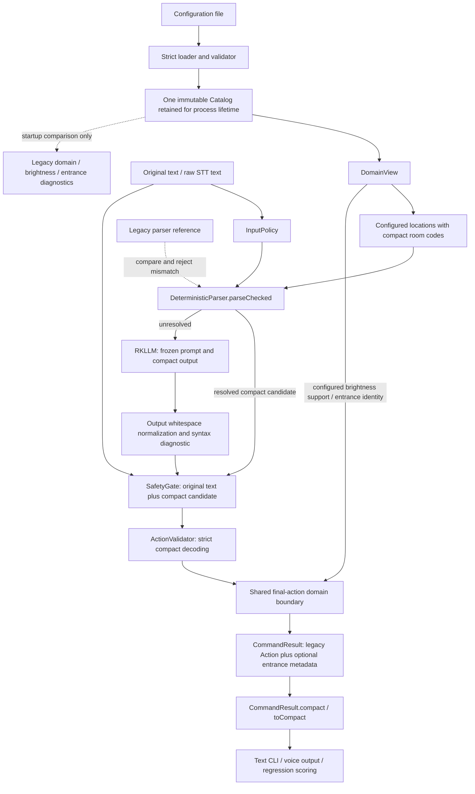

# Milestone 6.7 — remaining hardcode and Generic Action readiness audit

Audit checkpoint: `206290feb520eb97038f5aea69c41a97c1570317`.

The requested HEAD and a clean working tree were verified before analysis. This
milestone adds documentation only. It does not implement Generic Action, change
an authority boundary, activate configuration permissions, or alter language,
safety, protocol, model, prompt, audio, build or test behavior.

## Findings and recommendation

1. The three completed cutovers are real: configured parser locations, supported
   brightness bounds and the selected entrance target are production-authoritative.
   They still feed interfaces shaped around `K/B/G/C`, a two-alternative Action,
   and compact candidate strings. Configuration authority does not yet mean a
   generic action representation.
2. Schema v1 already supplies sufficient stable identity for a generic internal
   representation of **the current domain**. No schema expansion is needed for
   an offline candidate model and compatibility adapter. Arbitrary devices,
   aliases, parameter types and bindings are a separate product/schema change.
3. Keep compact v1 as an explicit compatibility codec around the eventual generic
   internal model. Do not extend its room alphabet or reinterpret `D`. Keep the
   frozen RKLLM prompt and compact wire output through the first internal stages.
4. SafetyGate still contains production-authoritative room-evidence vocabulary
   and deterministic language/state rules. A type conversion must preserve these
   rules. Moving evidence vocabulary into configuration, activating deny rules,
   or strengthening ambiguity handling each requires its own authorized change.
5. Start next with **proposed Milestone 6.8: offline Generic Action candidate and
   compact-v1 adapter foundation**. Follow with runtime shadow equivalence before
   changing the production representation. The roadmap below separates those steps.

This audit is based on current source, not just the intended 6.1 architecture.
Historical reports describe the authority at their own checkpoints:
[6.1 design](milestone-6.1-dynamic-configuration-design.md),
[6.2 foundation](milestone-6.2-configuration-foundation.md),
[6.3 startup shadow](milestone-6.3-runtime-configuration-shadow.md),
[6.4 room cutover](milestone-6.4-parser-room-cutover.md),
[6.4 RKLLM investigation](milestone-6.4-rkllm-contradiction-investigation.md),
[6.4.1 safety hardening](milestone-6.4.1-deterministic-safety-hardening.md),
[6.5 brightness cutover](milestone-6.5-brightness-domain-cutover.md), and
[6.6 entrance cutover](milestone-6.6-entrance-door-domain-cutover.md).
In particular, the original contradiction02 gap documented during 6.4 was
subsequently contained by 6.4.1; vendor-internal raw-output variation was not fixed.

## Current architecture and actual authority

The implementation of the design's ConfigSnapshot is
`config::Catalog = std::shared_ptr<const config::ValidatedCatalog>` in
[Configuration.h](../include/firefly/config/Configuration.h). There is no separate
class named ConfigSnapshot. `runtime::RuntimeConfig` owns the validated catalog,
the read-only `runtime::DomainView`, and startup comparison results.



Source entry points are [main.cpp](../src/main.cpp),
[VoiceMode.cpp](../src/VoiceMode.cpp), [RuntimeConfig.cpp](../src/runtime/RuntimeConfig.cpp),
[DomainView.cpp](../src/runtime/DomainView.cpp), and
[CommandEngine.cpp](../src/CommandEngine.cpp). Both actual application assemblies
load configuration and construct the configured parser before model initialization,
call `requireLegacyRoomDomain()`, and construct the four-argument CommandEngine
with the DomainView as both brightness and entrance-domain dependency.

Invalid configuration aborts startup, without another configuration or legacy
fallback. The owner outlives the parser, engine and voice worker. There is no live
reload, mutable global configuration, JSON loading in the parser, or hardware
executor. The core interfaces remain independent of the configuration library;
the runtime bridge supplies their implementations.

An important distinction applies to legacy comparisons:

| Mechanism | Current role |
|---|---|
| Configured parser `parseConfigured()` | Supplies the production room/location interpretation. |
| `parseChecked()` and startup `requireLegacyRoomDomain()` | Legacy answers never supply a replacement, but disagreement has a production veto: request or startup fails closed. |
| Configured `supportsBrightness()` | Supplies the supported range decision at the shared final-action boundary. |
| Configured `resolveEntranceDoor()` | Supplies accepted door target ID and display metadata. |
| Startup brightness/entrance comparisons | Diagnostic only; a difference does not select the old answer or automatically reject a request. |
| Schema-v1 legacy compatibility validation | Still authoritative for which mappings may be loaded. It pins the old IDs and codec contract. |

Thus “legacy answers are shadow-only” is correct about **answer selection**, but
does not mean every legacy compatibility check can be removed without changing
admission behavior.

## Exact current light-command flow

Original text: **`На кухне поставь свет на 40 процентов`**.
Expected/final compact result with current M4: **`L|K|40`**.
The same text occurs in the frozen DEV fixture as `light09` and `light21`.

| Stage | Actual representation and operation |
|---|---|
| Input | Original UTF-8 string; InputPolicy checks nonblank valid UTF-8, control restrictions and the 192-byte bound. ORIGINAL input is retained for safety. |
| Startup parser dependency | `DomainView::parserLocations()` joins `locationIndex()["на кухне"] = room_kitchen` to the configured light target whose `roomId` is that room, yielding `{phrase: "на кухне", code: 'K'}`. The target is `device_kitchen_light`. |
| Parser | `parseRules()` trims outside whitespace/trailing `. ! ?`, lowercases supported ASCII/Russian characters, and matches the existing whole-input pattern for location + `поставь свет на` + numeric brightness. Internal spacing is not generally normalized. It constructs the string `L\|K\|40`. |
| Room shadow | `parseChecked()` compares this optional string against `DeterministicParser::parse(original)`, which uses the frozen locations. Both produce `L\|K\|40`; the configured answer is returned. A mismatch throws, becoming U without inference or repair. |
| Route | `CommandPath::FastPath`. RKLLM is bypassed; raw/normalized model output fields remain empty. |
| SafetyGate | `ActionValidator::validate("L\|K\|40")` inside the gate produces `LightAction{Room::Kitchen, 40}`. No explicit ON/OFF/max/half state is present, so the 6.4.1 state-intersection rule imposes no extra numeric equality. The original token `кухне` grounds Kitchen in the gate's existing room list. The candidate string is preserved. |
| Strict decoding | CommandEngine validates the gated string again, obtaining the same legacy LightAction. A compact-valid action is not yet a configured-domain acceptance. |
| Configured domain | The strict decoder made `gated[2]` a valid room code. `supportsBrightness('K', 40)` joins the snapshot compatibility mapping to `device_kitchen_light` and `action_set_brightness`; its effective configured bounds are 0..100. The decision is true. |
| Result | `CommandResult.action = LightAction{Kitchen, 40}`; `entranceTarget` is absent; error is empty. The configured device/action IDs used by domain validation are **not retained in this light Action**. |
| Serialization/caller | `CommandResult::compact()` calls `toCompact()`, which encodes Kitchen as K and returns `L\|K\|40`. Text stdout prints one line. Verbose stderr can include route, result and timing. |

There is no call to the permission-aware `allowsBrightness(deviceId, value)`
on this production path. A narrower valid configuration, such as 10..90, changes
the domain decision without changing the compact syntax envelope or the meanings
of OFF, ON, half and maximum.

## Exact current entrance-door flow

Original text: **`Открой входную дверь`**. Expected/final compact result: **`D`**.
This is `door01` in DEV. The trace below describes a successful raw D candidate;
the parser does not itself guarantee what the model will return.

| Stage | Actual representation and operation |
|---|---|
| Input | Same InputPolicy; unmodified original text remains available to SafetyGate. |
| Parser | Neither configured nor legacy parser has a door production. Both return `std::nullopt`; the shadow check agrees. |
| RKLLM route | `CommandPath::LlmFallback`. `infer(original)` sends the original string as a user prompt under the frozen system prompt/template and existing per-request KV lifecycle. Callback chunks accumulate into a raw string. |
| Candidate | For raw `D` or whitespace-wrapped D, CommandEngine removes ASCII whitespace and saves normalized `D`. This normalization removes whitespace anywhere, not merely at the ends. The diagnostic strict syntax check accepts D. |
| SafetyGate | Decodes `D` to empty `OpenEntranceDoor`. The original input supplies a whole opening word `открой`, a `двер` stem, and a `входн` stem. The gate preserves D. It would return U for `дверь` or `открой дверь`, regardless of configured display name. |
| Strict decoding | CommandEngine decodes the gated D again to `OpenEntranceDoor{}`. No target ID exists in that legacy type. |
| Configured domain | `resolveEntranceDoor()` reads `compatibility.doorTargetId`, resolves `device_entrance_door`, checks roomless EntranceDoor kind and the effective action selected by `doorActionId` with OpenEntranceDoor operation. It returns the configured ID and name. |
| Result | `action = OpenEntranceDoor{}` and `entranceTarget = {deviceId: "device_entrance_door", displayName: "Входная дверь"}`. These are two separate result fields. The metadata is owned by the result, not a dangling view. |
| Serialization/caller | `toCompact(OpenEntranceDoor{})` returns D and omits the target metadata. Text CLI prints D. VoiceProcessor also retains only the compact action string in VoiceResult. |

Missing/throwing entrance resolution clears the action and returns U with a
diagnostic; the engine never selects an alternative door or a legacy target.
Model U, invalid syntax, or a rejected candidate also ends in U. The selected
target's name is not evidence of user intent. `entranceAvailable()` is the
separate permission-aware observational helper, not this identity resolver.

## Where compact representations are created and consumed

| Location | Creation, interpretation or exposure |
|---|---|
| [DeterministicParser.cpp](../src/DeterministicParser.cpp), `parseRules` | Creates `L\|code\|decimal`; returns no candidate for unresolved input. It does not create D or a U action. Configured/legacy parser candidates are compared as optional strings. |
| [RkllmEngine.cpp](../src/RkllmEngine.cpp), callback and `infer` | Produces raw model bytes. No Action interpretation occurs in the transport. Frozen prompt requests L/D/U. |
| [CommandEngine.cpp](../src/CommandEngine.cpp), `process` | Normalizes model output; checks raw normalized syntax; passes compact candidate to gate; decodes gate output; uses a code character for the brightness dependency. Catches errors without reusing previous output. |
| [SafetyGate.cpp](../src/SafetyGate.cpp), `apply` | Parses candidate through ActionValidator; preserves exactly that candidate or creates U. It neither constructs an alternative action nor repairs numeric/target choices. |
| [ActionValidator.cpp](../src/ActionValidator.cpp), `validate` | D becomes an empty door variant; four L forms become enum/int LightAction. U and malformed strings both return no Action. |
| [Action.cpp](../src/Action.cpp), `toCompact` | Creates canonical D or L strings from the legacy variant; checks the percentage envelope and maps four enum values to letters. |
| [CommandEngine.h](../include/firefly/CommandEngine.h), `CommandResult::compact` | Maps absent action to U; otherwise serializes. Public result also exposes old Action, raw and normalized model strings, route, diagnostic fields and optional entrance metadata. |
| [main.cpp](../src/main.cpp), [CliSupport.h](../src/CliSupport.h) | Compact stdout is the external text contract. Diagnostics go to stderr; startup failure also emits U and exits nonzero. `quit`/`exit` are CLI controls, not device actions. |
| [VoiceProcessor.cpp](../src/VoiceProcessor.cpp), [VoiceMode.cpp](../src/VoiceMode.cpp) | Raw STT text goes into the same CommandEngine. VoiceResult stores `command.compact()`; voice logs and stdout expose it. Default/error action is U. Typed action and entrance metadata do not survive this projection. |
| [RegressionMain.cpp](../src/RegressionMain.cpp) | Loads compact expected labels, scores final compact results, distinguishes false accept/reject/wrong action, and logs raw/normalized/final separately. It uses the legacy one-argument CommandEngine. |
| Runtime/config shadow comparisons and tests | Compare codec values, enum identities, canonical strings, alias results and expected absence/U. Startup summaries expose ordered mismatches rather than an executable action. |

The current repository has no persistent action journal or hardware command
store. [ConfigStore.cpp](../src/config/ConfigStore.cpp) persists configuration,
backups and transaction metadata, not interpreted commands. DEV labels and test
goldens are persisted expectations; generated regression logs may contain actions
and transcripts. A future action audit format must include stable IDs and snapshot
identity rather than relying on D or K alone.

## Remaining hardcode inventory

Categories used below:

- **A — migration residue:** obsolete descriptions or temporary historical APIs;
  this category is not blanket permission to remove their guards.
- **B — representation/compatibility:** compact syntax, enum/code mappings and
  legacy-profile admission restrictions.
- **C — safety/security invariants:** mandatory deterministic rejection and
  original-input evidence rules, outside ordinary editable configuration.
- **D — product/language semantics:** supported operations, numeric meanings,
  grammar, normalization and currently supported language coverage.
- **E — migrated configuration domain:** installation data already authoritative
  in the specified production consumer.

Mixed rows deliberately separate policy from its data or representation. The
milestone labels below refer to the **proposed**, unapproved roadmap later in this
report; “later” requires a separate scope decision.

| Location | Current hardcode/dependency | Category | Still production-authoritative? | Future owner | Migration risk | Recommended milestone |
|---|---|---|---|---|---|---|
| `Action.h`: Room | Four enum values, no stable installation ID | B | Yes, legacy light Action and gate dispatch | Snapshot target IDs; enum only in compact adapter/reference | Wrong target after code conversion | 6.8 foundation; 6.10 result cutover |
| `Action.h`: variant | LightAction room/int; empty OpenEntranceDoor | B/D | Yes, final typed result today | Generic candidate/validated decision; operation registry | Door identity loss; type mistaken for safety proof | 6.8–6.10 |
| `Action.cpp` | K/B/G/C and D encoding; 0..100 representation bound | B | Yes, all compact rendering | Versioned compact-v1 codec | Changed bytes or narrowing/clamping | 6.8 adapter; 6.13 consolidation |
| `ActionValidator.cpp` | Exact D/L syntax, four codes, ASCII integer 0..100 | B | Yes, structural decoding; not configured range authority | Compact codec decoder | Misclassifying domain rejection as malformed model output | 6.8 / 6.13 |
| `ParserRoomDomain.h`, DomainView `parserLocations` | Read-only location payload includes a `char` code; join uses compatibility light targets | B/E | Yes; locations come from snapshot | Stable target/location view plus codec mapping at boundary | Alias roles or target identity change | 6.12 |
| Parser `compileRules` | Whole-command regex productions, light noun/verbs, explicit location; numeric syntax bounded to 0..100 | D/B | Yes; syntax coverage, not supported device bounds | Versioned generic grammar using typed slots | New accepts/rejects or changed fallback route | Preserve through 6.12 |
| Parser `parseRules` | Emits `L\|...`; on/max=100, off=0, half=50 | B/D | Yes | Typed candidate producer; compiled language semantics | Treating “maximum” as configurable bound would change semantics | 6.12, no semantic expansion |
| Parser `legacyLocations`, static `parse` | Frozen five location phrases/four codes | A/B, oracle | No answer authority in configured parser; yes in explicit reference path | Independent frozen regression oracle | Removing startup/request veto without replacement | Retain until cleanup gate |
| Parser `parseChecked`, `requireLegacyRoomDomain` | Exact configured-vs-legacy equality | B, migration guard | Yes, admission/rejection only | Explicit versioned activation contract after equivalence | Accidentally admitting aliases outside reviewed semantics | Retain through initial generic stages |
| `Text.cpp`, InputPolicy | Supported case folding/token delimiters; 192-byte valid-input contract | C/D | Yes | Versioned text/ingress utilities | Silent normalization or transcript repair | No change in generic foundation |
| `CommandEngine.cpp` | Compact candidate transport, whitespace deletion, `gated[2]`, repeated strict decoding | B | Yes, orchestration and diagnostics | Explicit codec boundary and typed pipeline | Route changes; malformed-output metric drift | 6.10–6.13 |
| `CommandEngine.cpp`, LightBrightnessDomain | Code-based range query; actual limits from snapshot | B/E | **Config** supplies supported brightness domain | Typed domain validator by target/action ID | Hidden fallback or losing narrowed bounds | 6.9 shadow / 6.10 |
| `CommandEngine.cpp`, EntranceDoorDomain | Door variant selects configured singleton resolver | B/E | **Config** supplies selected target | Typed candidate resolution/validation | Empty D becoming an arbitrary door selector | 6.8 mapping / 6.10 |
| `CommandEngine.h`: result | Optional old Action plus independent door metadata, public mutable fields | B | Yes, caller contract; not an execution capability | Validated generic decision, typed rejection and diagnostics | Action/metadata inconsistency; forged “validated” values | 6.10 |
| CommandEngine 1/2/3-argument constructors | Intentionally omit some/all configured consumers | A/B, reference | Not used by actual text/voice assembly; used by tests/harness | Explicit reference harness adapter | Accidental reuse in production or misleading regression coverage | Retain; isolate at cleanup gate |
| SafetyGate room switch | 23 explicit mention forms grouped by Room enum | C rule + D lexicon | **Yes**, original-input grounding still uses these lists | Mandatory grounding policy plus read-only room evidence data | Confusing parser locations with mention vocabulary | Typed port 6.11; separate evidence-data gate later |
| SafetyGate state intersection | OFF=0, ON nonzero, max=100, half=50; incompatible requirements reject; bounded numeric safety vocabulary | C/D | **Yes**, including 6.4.1 | Compiled operation-specific safety policy | Reintroducing contradiction02 or making OFF configurable | Preserve unchanged in 6.11 |
| SafetyGate entrance branch | Five explicit opening words, `двер`/`входн` stems or adjacent `на входе` | C/D | **Yes** | Compiled entrance-opening policy | Display alias mistaken for entrance intent | Preserve unchanged in 6.11 |
| SafetyGate API | Compact in, compact-or-U out; variant dispatch | B | Yes | Typed candidate + original input -> preserve/reject | Repairing candidate during conversion | 6.11 |
| DomainView `legacyLightTarget`, `entranceTarget`, effectiveAction | Snapshot compatibility IDs select devices/actions | E/B | **Yes**, despite the “legacy” method name | Generic ID lookup; compact selection stays in adapter | Deleting a currently authoritative lookup as “legacy” | 6.10 / 6.13 |
| DomainView `brightnessBounds`, `allowsBrightness`, `entranceAvailable` | Permission-aware observational helpers alongside active range/identity helpers | D, staged policy | **No** permission authority today | Separately activated permission boundary | Silent enable/deny behavior change during type migration | Later permission activation gate |
| Configuration enums/Parameter | Two kinds, two registered operations; required integer percent only | D/C | Yes, supported configuration contract | Versioned compiled capability registry | Arbitrary admin-defined operations or types | Keep for current-domain generic work |
| Schema v1 / ConfigValidator | `legacy_m4_v1`, `compact_v1`, exact K/B/G/C mapping and pinned action/device/room IDs | B/D | Yes, startup admission | Explicit legacy profile, later new activation profile | Storage-valid extra entities mistaken for addressable runtime targets | Later profile expansion gate |
| ConfigValidator `legacyRooms` | Expected IDs/aliases/counts | B plus oracle | IDs/mappings constrain admission; alias differences also feed diagnostics | Keep profile contract separate from historical oracle | Removing validation while deleting a duplicate table | Cleanup only after profile design |
| ConfigValidator reserved aliases | Grammar/security tokens cannot become room aliases | C/D | Yes, validation | Versioned collision/lexical contract | Intent negation/operator aliases bypass policy | Preserve; review alongside future alias expansion |
| ConfigValidator effective actions | Compiled mandatory-policy identifiers; enabled/deny calculations | C/D metadata | Bounds used; permission not activated; policy list is not gate dispatch | Typed policy registry and separate activation contract | Treating metadata as complete/enforced safety | Later activation gate |
| Frozen RKLLM system prompt | Four rooms/aliases, L/D/U, percent meanings, door/ambiguity instructions | B/C instructions/D | Yes for fallback inference guidance; **not deterministic enforcement** | Eventually generated bounded context plus fixed policy instructions | Raw hallucination/variation; context overflow | Later LLM gates, no prompt change now |
| `RkllmEngine.cpp` | String transport, fixed template/sampling, 16 output tokens, 1024 context, synchronous/cache lifecycle | B/D operational contract | Yes | Same transport; explicitly versioned response codec later | Truncation, lifecycle regression, unsupported constrained-decoding assumptions | Preserve until separately verified LLM wire gate |
| `main.cpp`, CliSupport | Compact stdout, U on failure, route diagnostics | B | Yes, external interface | Presentation codec around typed result | Breaking callers or leaking vendor stdout | Preserve interface at 6.10 |
| VoiceResult / VoiceProcessor / VoiceMode | Action flattened to compact string; default U | B | Yes, downstream result/output | Typed decision retained through voice; codec only at presentation | Losing configured target/snapshot identity | 6.10 caller contract; no STT/VAD change |
| RegressionMain / DEV / mock CLIs | Compact expected labels and U-based error categories | B, regression contract | Test authority, not runtime domain | Frozen compatibility suite plus new semantic suite | False confidence from legacy-only assembly | Keep; supplement from 6.8 |
| `ShadowComparison.cpp` | 1,364 baseline, 668 brightness, two entrance probes against frozen references | A/B, oracle | Diagnostic except explicit test `requireEquivalent` | Independent compatibility regression tools | Circular oracle, accidental legacy fallback | Keep until cleanup gate |
| CMake/runtime diagnostic descriptions | “startup shadow” wording; scoped `authoritative=legacy` baseline diagnostic | A | Labels only, not actual consumer authority | Accurate scoped diagnostics/documentation | Misreading historical label as active path | Optional documentation/label cleanup later |
| Config summary `production_activated: false` | Offline tool activation status; not live process status | A/D boundary | Does not switch running consumers | Separate validated/stored/active status model | UI claims activation based on offline inspection | Later admin/activation design |

The 0..100 occurrences are not all duplicate installation constraints. The
compact codec's representable envelope, parser's frozen percentage grammar,
SafetyGate's OFF/ON/max/half semantics, and schema's supported percent capability
remain different contracts. The **supported installation range** is supplied by
the snapshot. A future generic decoder must preserve this distinction.

## Generic Action design options

| Option | Benefits | Limitations / decision |
|---|---|---|
| Keep compact string canonical everywhere | Small, already tested with the fixed model | Implicit target identity, four-room ceiling, D singleton, repeated parsing, no extensible argument schema. Reject as long-term internal model. |
| Extend the existing C++ variant with target IDs | Strong typing for today's two operations | Every new capability expands shared variant consumers; transitional duplicate room/code/ID state is easy to create. Useful as an adapter implementation detail, not the extensible canonical model. |
| Stable configured action ID + target ID + typed arguments | Fits current schema and separates installation identity from wire spelling | Requires explicit validation and operation dispatch; arbitrary maps are not intrinsically safe. **Recommended minimal model.** |
| Store arbitrary JSON as Action | Easy transport interchange | Untyped numbers, unknown keys, duplicate-key ambiguity and accidental authority from model data. Reject as the internal domain object; JSON may later be a strictly decoded wire format. |

### Recommended minimal model

Conceptual design only; these types are not implemented in this milestone:

```text
ActionCandidate {
    actionId: ActionId
    targetId: DeviceId
    arguments: ordered map<ParameterId, int64>
}

InterpretationContext {
    immutable snapshot reference
    original input
    route/provenance
}

Decision = ValidatedAction | Rejection(reason)
```

Current instances would be:

```text
actionId = action_set_brightness
targetId = device_kitchen_light
arguments = { brightness: 40 }

actionId = action_open_entrance
targetId = device_entrance_door
arguments = {}
```

Use the actual schema IDs, not invented `kitchen/light` paths or Russian labels.
There is no separate `capabilityId` in v1: `actionId` selects an ActionDefinition,
whose compiled `Operation` supplies semantic dispatch. Do not trust a second
model-supplied operation selector that can disagree with it. Target room, kind,
name, bounds and operation are derived from the snapshot. They are not additional
independent fields in the candidate.

Only integer arguments are needed today. Keep them typed and checked for overflow;
do not introduce unchecked JSON values or speculative coercions. A later reviewed
parameter-type expansion can add a closed typed value variant. Unknown IDs,
duplicate wire arguments, missing/extra arguments, wrong types and unsupported
target/action relationships reject; no default value, target substitution or clamp.

Separate an untrusted candidate from a validated decision. The latter should be
constructible only through the approved validation boundary and retain a snapshot
reference or an associated identity containing system ID, revision and content
hash. Record the interpretation/safety implementation version as well: config
hash alone does not identify compiled policy. Do not allow a result validated
against one snapshot to be reused against another implicitly.

U is a rejection/unsupported serialization, **not** an action ID, device or
executable operation. Parser “unresolved, try fallback” is also distinct from
final rejection. Preserve diagnostic distinctions between malformed model output,
unsafe candidate, unsupported domain and runtime failure without changing compact
stdout. A validated interpretation is not permission to execute hardware; that
separate capability does not exist today.

### Compatibility adapter contract

The first adapter should reuse existing strict decoding/encoding as its frozen
reference and map through the **snapshot's** compatibility object:

- L code -> configured light target; configured light action ID; integer brightness.
- D -> configured entrance target and door action ID; empty arguments.
- U -> explicit unsupported result; malformed strings -> distinct decode error.
- Generic -> compact only if the exact target/action/argument tuple has a unique
  mapping in that snapshot's compact-v1 contract.

Do not copy the four device IDs into a new table. Isolate unavoidable legacy
Room-enum conversion with the existing codec at the adapter boundary. Never infer
that any light can be encoded as K or any entrance-like device as D. An
unrepresentable candidate is an error, not a successfully encoded U action.

Round-trip the 404 current light tuples and one door tuple. Preserve accepted
noncanonical numeric input such as `L|K|00050` decoding to 50 and canonical
serialization as `L|K|50`; signs, decimals, unknown codes and out-of-envelope
numbers remain invalid. Existing model whitespace normalization is a separate
compatibility step and must not be generalized into future JSON/ID normalization.

For a 10..90 snapshot, compact `L|K|0` remains **syntactically representable** but
fails supported-domain validation. Decoding must not conflate that with malformed
wire syntax. Encoding a candidate does not authorize it; external successful
results are rendered only after the safety/domain decision.

## Configuration and schema readiness

The source of identity is [current-m4.json](../config/current-m4.json), interpreted
by [schema-v1.json](../config/schema-v1.json),
[ConfigLoader.cpp](../src/config/ConfigLoader.cpp), and
[ConfigValidator.cpp](../src/config/ConfigValidator.cpp).

| Concept | Current support | Consequence for Generic Action |
|---|---|---|
| Rooms | Stable ASCII IDs, display names, separate mention and location aliases | A target's room can be derived; no Russian text as identity. Do not merge the two alias roles. |
| Device instances | Stable IDs, kind, nullable room, enabled flag, action ID references | `targetId` can name the actual installation instance. Door is deliberately roomless. |
| Actions | Stable IDs, versioned registered operations, enabled flag | `actionId` selects reusable definition; the current four lights share one action definition. |
| Parameters | Scoped stable parameter IDs, required integer percent, min/max | Enough for `{brightness: int64}`. Bounds belong to the action definition; there is no per-device override field. |
| Entrance | Configured compatibility target/action references | Enough for current D mapping and explicit generic target identity. Stable legacy IDs remain pinned. |
| Snapshot | Immutable owned typed data, indexes, effective actions, canonical JSON/hash | Safe request context and deterministic mapping; no parser-owned persistence. |
| Restrictions | Device/action enablement and typed deny relationships compiled into `permitted` | Represented and observable, but **not activated by current range/identity consumers**. Generic validation must not silently change this. |
| Safety | Compiled mandatory policy metadata, not editable policy implementations | IDs describe contracts; actual SafetyGate remains mandatory code. |
| Device/action speech aliases | Required empty `spoken_aliases` / `speech_aliases` fields | No general configurable device/action language exists yet. Typed Configuration does not retain arbitrary alias payloads. |
| Bindings | Required empty array | No execution address, driver contract or hardware authority exists. |

V1 is deliberately a restricted legacy profile. The validator pins
`action_set_brightness`, `action_open_entrance`, `device_entrance_door`, and the
four light-code/device/room mappings. It requires known operations/kinds and exact
argument contracts. Alias collision, reserved-word, reference and immutable-ID
rules constrain what can be stored. Some extra entities or metadata can be
storage-valid while not addressable by the active compact profile; parser alias
drift can additionally fail the runtime room-admission guard.

**No missing stable identity blocks Generic Action for current M4.** What is
missing for a general admin-configured product is a broader activation profile,
nonempty supported device/action aliases, additional reviewed operation/parameter
contracts, a bindings model, and corresponding runtime consumers. Those require
explicit loader/domain/schema evolution as applicable, not merely a new struct.
Storage limits (64 rooms, 128 devices, 32 actions) do not imply that the fixed
prompt or codec can interpret that many objects.

The effective-action `mandatoryPolicies` metadata currently names the original
room/zero-with-enable and entrance-opening policies. It does not enumerate the
entire 6.4.1 state-intersection implementation. Therefore it must not be treated
as a complete executable policy registry or proof that a candidate passed safety.
Future typed safety dispatch needs an explicit reviewed implementation contract,
including contradiction hardening, independent of admin-supplied fields.

## Parser readiness

The parser is already data-injected, so it does not need JSON access or a new
store. Its remaining representation dependencies are `ParserRoomLocation::code`,
compiled `RoomRules::room`, compact construction, and optional-string equality.
Its grammar and semantic constants are separate from those dependencies.

First adapt its existing compact candidate at the orchestrator boundary. This
gives a typed candidate without changing grammar, normalization, route selection,
or lookup admission. After typed downstream validation is proven, let the same
matched slots construct a candidate using the configured stable light target and
action ID directly. Compare against the frozen parser through the adapter.

Do not use that change to add a door fast path, numeric word parsing, synonyms,
regex variants, multiple-device selection, or “maximum = configured maximum.”
The existing meanings are absolute percentages. A narrow domain can reject a
syntactically valid 100 request; it must not silently replace it with 90.

The future location interface should carry stable target/room identity sufficient
for the same grammar. The compatibility adapter owns letters. Ambiguous or absent
resolution stays unresolved/rejected according to the existing route contract,
and a shadow disagreement remains a failure without legacy repair.

## SafetyGate readiness and limits

SafetyGate must remain a preserve-or-reject boundary over ORIGINAL input. The
model, parser or admin configuration cannot certify its own evidence. In a typed
API it should receive the candidate and trusted read-only interpretation context,
derive target kind/room and operation, and apply compiled rules without parsing
compact strings. Display names are not authorization or intent evidence.

The policy invariants that must survive include:

- Ground the selected light target's room in original input; never use a
  model-asserted room mention as evidence.
- Preserve 6.4.1's intersection of explicit light-state requirements. OFF means
  zero, ON requires nonzero, max is 100 and half is 50 under current semantics.
  Incompatible requirements reject before publishing any action, including a
  candidate of another action type.
- `На кухне выключи свет на 50 процентов` + U, `L|K|50`, or a guessed `L|K|0`
  must all end in U. Rejection cannot repair the original contradiction.
- Preserve the existing additional zero-with-`включ` rejection.
- Entrance opening needs one of the five existing whole opening words, a door
  stem and explicit entrance evidence (`входн` or adjacent `на входе`). A configured
  label/alias must not turn `дверь` or `открой дверь` into explicit entrance intent.
- Reject unknown operation/target combinations. Do not infer missing arguments,
  reconcile conflicting candidate fields, or guess among ambiguous targets.

The initial typed API port should retain the frozen room-evidence vocabulary as
a clearly named compatibility policy dependency. It can derive the corresponding
legacy room through the existing mapping without rebuilding a compact string.
Consuming configured mention aliases is a later, separate data-consumer cutover;
the mandatory grounding rule remains code in either case.

### Do not overstate current deterministic coverage

Source inspection shows boundaries beyond the contained contradiction02 issue:

- The light room check asks whether the **predicted room** occurs. It does not
  independently prove that exactly one room occurs across the whole input.
- `requestedLightState()` deliberately returns early for numeric-only requests
  without ON/OFF/max/half. It is not a universal requested-number versus candidate
  equality check.
- The gate is not a general negation, multiple-command or linguistic ambiguity
  detector. Door policy tests explicit cues, not a complete intent grammar.
- Light-noun detection scopes the state-intersection rule; it is not a universal
  light-intent recognizer for every candidate.

The frozen prompt and conservative fast path contain additional restrictions,
but prompt instructions are not a deterministic guarantee on arbitrary RKLLM
candidates. These are source-level coverage observations, not new NPU experiment
results or a claim of additional measured DEV failures. A generic type cannot
close them by itself. Review them as separate semantic safety work before broader
catalog activation or hardware execution, with directly injected unsafe candidates
and positive controls. Do not silently broaden policy during a representation port.

## Validator readiness and duplicated checks

Current `ActionValidator` is primarily a strict compact **decoder**, despite its
name. It cannot establish original-input safety, configured target identity,
installation range support, enable/deny permission or executable binding validity.
Even successful `D` decoding only means that the token denotes the legacy door
operation. U and malformed syntax both yield `nullopt` in this API.

| Responsibility | Current boundary | Proposed owner |
|---|---|---|
| Wire syntax / exact code / decimal representation | ActionValidator, plus toCompact's structural checks | Explicit versioned codec; retain independent frozen oracle |
| Registered kind/operation/argument contract | Config validation plus legacy variant assumptions | Typed capability contract validation, closed supported operations |
| Target/action existence and relationship | Snapshot validation; runtime bridges select legacy mappings | Generic domain validator against the request snapshot |
| Supported brightness range / entrance identity | Shared CommandEngine boundary with DomainView | Same authority through typed target/action IDs |
| Original-input consistency and contradiction rejection | SafetyGate | Typed mandatory SafetyGate; no codec dependence |
| Enable/deny permission | Computed in snapshot, observational in current production | Separately authorized activation boundary, not an incidental type change |
| Execution bindings / authorization | Not implemented | Future execution boundary; never inferred from syntax validity |

Fallback currently can invoke strict decoding three times: normalized-output
diagnostic, SafetyGate entry, and post-gate final decoding. Fast path invokes it
twice. Serialization checks again that a manually constructed legacy light Action
fits its representation. Parser numeric bounds, codec bounds, safety percentage
semantics and schema percent bounds overlap numerically but are not all removable
duplicates of the configured range check.

Eventually decode untrusted wire input once into a typed candidate, preserve a
distinct syntax diagnostic, run deterministic safety and domain validation, and
publish only a validated decision. Retain reject reasons rather than deducing all
failure categories from U. Consolidation should follow dual-path equivalence;
do not remove independent checks before their responsibilities have an owner.

## RKLLM and prompt migration implications

The frozen read-only prompt is
`/home/firefly/demo_Linux_aarch64/prompt_compact_v5_short_system.txt`.
It contains the room/alias vocabulary, percentage semantics, single-action and
ambiguity instructions, entrance rules, and exact D/L/U response forms.
`RkllmEngine` itself returns a string and need not know the internal Action type.

The actual transport remains synchronous with per-instance callback state,
bootstrap and per-request KV clearing, fixed Qwen template, max-new-tokens 16 and
context length 1024. The callback collects raw bytes before CommandEngine
normalization. No response grammar/schema constraint is currently installed in
the vendor runtime. Strict post-decoding must not be described as constrained
generation or a guarantee that raw output is safe.

| Future wire option | Assessment |
|---|---|
| Frozen compact v1 -> generic adapter | Safest first step. No model, prompt, token budget, lifecycle or regression-label change. Limited to current legacy-addressable domain. |
| Full stable IDs in a delimited format | Simple deterministic mapping and readable identity; longer output and escaping/version questions. Do not assume it fits 16 output tokens. |
| Strict structured JSON | Explicit keys and extensibility, but more tokens and strict duplicate-key/type/unknown-field handling. Current runtime does not guarantee schema-constrained generation. Not the default next step. |
| Snapshot-generated short action/target tokens | Potentially small output; application translates tokens to stable IDs. Requires a deterministic collision-free table, codec version, exact snapshot association and measured context/output fit. Recommended option to evaluate later, not an approved wire change. |

Do not make array position an action identity, accept a token from a different
snapshot, or auto-detect multiple codecs until one happens to parse. Select one
explicit response codec per initialized interpretation context; unknown/extra
tokens fail closed. Candidate IDs are still untrusted until validated.

Later context generation should use only the active supported catalog, aliases
needed for interpretation and applicable constraints, with fixed non-editable
instructions for mandatory policy. Admin names must be safely encoded as data,
not concatenated as instructions. Fit must be established for the complete active
domain; silently dropping objects would create inconsistent authority. Generated
context and token tables must be built from the same immutable snapshot and
activated together before model initialization. There is no live-reload plan here.

First evaluate generation offline, then in a separately authorized compatibility
experiment, before changing production output format. Do not reopen model
selection, tune the current prompt, automatically increase token/context limits,
or alter the KV lifecycle as part of Generic Action. Preserve raw-output diagnostics
and score final deterministic results, including injected contradiction candidates.

## Legacy/shadow cleanup inventory

| Structure | Classification now | Future disposition and prerequisite |
|---|---|---|
| Parser `legacyLocations()` and static `parse()` | Temporary migration oracle; reference API | Keep through typed-parser equivalence. Remove from the production request path only after a new admission contract and independent frozen oracle exist. Retain reference coverage separately. |
| Parser request/startup equality guards | Still required migration guard | Not obsolete merely because config selects answers. Replacing/removing guards is an explicit activation change with fail-closed rollback. |
| Room enum and old Action/toCompact/ActionValidator | Still required production representation; future regression adapter | Keep a compact-v1 codec and frozen compatibility tests after generic cutover. Remove their role as internal authority incrementally. |
| CommandEngine legacy constructor overloads | Regression/reference adapters | Isolate/name explicitly when callers migrate; do not silently wire them as production defaults. Frozen NPU harness must remain identifiable as reference assembly. |
| ConfigValidator `legacyRooms()` | Mixed compatibility admission contract and oracle | Separate those responsibilities before deletion. Pinned mappings still constrain loaded config. Keep a v1 compatibility contract for v1 files. |
| Config catalog `legacyDifferences` / `matchesCurrentLegacyDomain` | Temporary migration diagnostic | Keep while legacy profile comparisons are meaningful; do not equate a mismatch with malformed storage or universal runtime rejection. |
| `compareLegacyDomain()` | Temporary broad baseline oracle, 1,364 probes | Useful frozen regression adapter after live startup diagnostic removal. Some checks observe permissions that production has not activated. |
| `compareLegacyBrightness()` | Temporary range oracle, 668 probes | Keep current-profile equivalence; narrowed valid ranges deliberately differ. Remove live comparison only after typed domain proof; preserve boundary regression coverage. |
| `compareLegacyEntranceDoor()` | Temporary singleton-domain oracle, two probes | Compares presence/entity set, not a legacy stable ID that never existed in old Action. Preserve codec singleton tests after cleanup. |
| DomainView `legacyLightTarget()` / compatibility mappings | **Still required active adapter data**, not obsolete oracle | Keep with compact-v1 boundary while that codec is supported. Generic consumers can use IDs directly later. |
| Permission-aware versus range/identity-only DomainView methods | Staged activation boundary, not accidental duplication | Consolidate only after explicit permission activation with tests. Do not substitute `allowsBrightness` or `entranceAvailable` during a representation change. |
| Door target result metadata | Required 6.6 bridge | Absorb into the generic target field only when result and downstream callers preserve identity. No loss through D serialization. |
| CMake “startup-only shadow” description and baseline diagnostic wording | Obsolete broad wording / intentionally scoped baseline label | Safe label cleanup after confirming callers/tests; never infer a code switch from the wording. No edit in this audit. |

No functional table is authorized for deletion in 6.7. In particular, the
`CONFIG_SHADOW ... authoritative=legacy scope=legacy_domain_baseline` diagnostic
describes its historical comparison scope. Other domain diagnostics identify
configured authority. Reading that one label as the whole runtime's authority
would be incorrect.

## Tests, harnesses and caller impact

Use four complementary test responsibilities: **A** generic semantics/identity,
**B** compact adapter syntax/serialization, **C** deterministic safety,
**D** RKLLM compatibility transport/output. Preserve frozen expectations and add
semantic assertions; do not regenerate expected actions from the same mapping
implementation being tested.

| Existing suite/harness | Current coupling / coverage | Future allocation |
|---|---|---|
| `tests/CoreTests.cpp` | Enum/variant round trips; compact validator; static legacy parser; direct gate candidates | Retain B and C frozen reference cases; add A as separate generic suite. |
| `tests/CommandEngineTests.cpp` | One-argument reference engine, compact mocks, whitespace/error/input handling | Keep reference orchestration proof; add fully configured typed-result A/C tests. |
| `tests/SafetyHardeningTests.cpp` | Actual SafetyGate injection across candidate forms and routes; contradiction matrix | Preserve C independently of real model behavior; add typed equivalents before gate port. |
| `tests/config/ConfigTests.cpp` / golden summary | Strict schema/graph, immutable snapshot, store, normalized configuration output | Keep storage/domain contract tests; add candidate-to-snapshot reference/type checks in A. |
| `tests/config/ConfigShadowTests.cpp` | Hardcoded domain equivalence, all room values and door token | Keep independent frozen domain oracle; add A identity equivalence rather than replacing expectations. |
| `tests/config/ConfigCliTests.py` | Also reads source enum and literal parser/gate lists; compares documented current config | Source-shape coupling will need an explicit later transition to stable contract tests. Do not delete to hide a failed migration. |
| RuntimeConfig C++/CLI/voice-startup suites | Ownership, startup failure, retained snapshot, broad legacy shadow; some C++ calls use reference constructors | Keep lifetime/admission tests; ensure A uses actual production dependency assembly. |
| ParserRoomCutover C++/CLI suites | Compact equality, aliases, mismatch rejection, config-driven remap, assembly | Preserve location authority and route checks; compare typed targets plus B rendering after parser port. |
| BrightnessCutover C++/CLI suites | Five valid range fixtures, boundary/state matrix, shared final check, actual CLI | Carry A range decisions across all four targets and both routes; keep C state constraints separate. |
| EntranceDoorCutover C++/CLI suites | D plus retained ID/name, metadata remap, missing resolver/no fallback, safety matrix | A checks target identity directly; B remains D; C door requirements unchanged. |
| `tests/RkllmEngineTests.cpp`, FakeRkllmRuntime | Fixed template/parameters, callback faults, lifecycle, deadlines, raw string transport | D remains unchanged through internal generic work; fake D is a codec fixture, not device authority. |
| `tests/CliTests.py` and configured mock CLI suites | Exact compact stdout, input boundaries and startup failures | B compatibility contract; supplement A through a typed test interface rather than changing stdout. |
| `tests/VoiceTests.cpp` | Mock STT/engine path, raw transcript, compact action/route, no stale output | Add typed decision/target retention assertions when caller contract changes; preserve audio/state-machine tests. |
| `tests/SpeechReplayTests.cpp` | Native VAD/STT replay: eight speech recordings and two silence cases | This test alone does **not** exercise CommandEngine or final NPU actions. Keep unchanged; pair with integrated end-to-end replay. |
| `src/RegressionMain.cpp`, `tests/data/dev.tsv` | Frozen 48 expected compact results; legacy one-argument engine | D/B plus existing deterministic gate. It scores **final** actions, not raw-only model output, but does not validate current config-backed assembly. |
| Integrated assistant DEV/replay runs | Actual four-argument engine, config startup, compact final output | Necessary production A/B/C/D composition evidence; retain route/raw/final diagnostics where available. |

For proposed 6.8, exhaustive adapter coverage is small and deterministic: all
404 light values/rooms and D, U, malformed syntax, accepted leading-zero forms,
unknown/unmapped identities, missing/extra arguments, wrong operation/target,
unrepresentable stored entities, narrowed valid bounds, and immutable/snapshot
association checks. Compare generic tuples as well as encoded strings. Preserve
the selected door ID and the config-remapped display metadata where presented.

For later runtime stages, shadow the **same** request/candidate; never run a second
inference to compare representations. Test injected unsafe candidates through the
real safety boundary. Unsupported-input tests whose fake LLM always returns U do
not alone prove safety against an unsafe plausible candidate. Test no fallback,
no repair, no stale result and unchanged failure classifications explicitly.

The historical 6.6 report records clean core/full builds, 16/16 and 26/26 CTest
suites, three frozen and three integrated 48/48 DEV runs, and replay verification.
Those are prior-checkpoint results, **not new test runs for this documentation
milestone**. Future implementation acceptance must rerun the relevant complete
suites; raw RKLLM variability is acceptable only while final deterministic safety
and frozen expected outputs hold.

## Future Web Admin implications

Generic Action makes stable installation identity possible throughout the runtime;
it does not by itself make configuration editing safe or active. Retain the 6.1
boundary: browser -> local API in a separate lightweight admin process -> single
configuration writer/validator -> durable store -> explicitly restarted runtime
with a new validated snapshot. No HTTP or reload work is proposed for 6.8.

Future editable data can include rooms, supported device instances, reviewed alias
roles, assignment of registered capabilities, constraints within capability limits,
and eventually typed action bindings. Admins select supported operations; they do
not upload arbitrary code, policy expressions, shell commands, model instructions
or new operation semantics. Binding schemas and execution authorization need a
separate design before hardware work.

Explicitly keep mandatory grounding, contradictions, entrance evidence,
ambiguity rejection, protocol/version checks and fail-closed behavior outside
ordinary editable configuration. Names/aliases are untrusted data for prompt
construction, not instructions. Constraints may narrow support without redefining
OFF or other compiled semantics.

The admin UI must distinguish stored/validated, compatible with the active profile,
and actually active. Today's `enabled`/deny metadata is not enforced by the active
range/identity consumers; a future UI must not promise that toggling it disables an
action before an explicit permission cutover. Likewise, offline summary
`production_activated: false` is not live runtime status. Current RuntimeConfig
loads a file; it is not yet an admin activation service consuming all ConfigStore
transaction/recovery state. Runtime status, durable activation, revision/hash
agreement and restart handling must be designed before exposing edits.

## Recommended incremental roadmap

All stages below are proposals requiring new authorization. Each production
cutover should have its own checkpoint and complete regression evidence. Rollback
means deploying a prior compatible checkpoint/profile and restarting with a
validated snapshot, **never** a per-request fallback to whichever answer succeeds.

### Current-domain internal representation stages

| Proposed milestone | Exact scope | Authoritative representation | Shadow/oracle | Acceptance criteria | Rollback boundary |
|---|---|---|---|---|---|
| **6.8 — offline candidate and compact adapter foundation** | Add minimal typed candidate, explicit unsupported/decode error, snapshot-bound compact-v1 mapping and deterministic tests. No production wiring, policy/schema/prompt changes. | Existing production Action/compact path unchanged | Existing strict validator/serializer, frozen mappings and independent expected tuples | All 405 canonical actions round-trip; malformed/unknown/unrepresentable cases fail closed; leading-zero behavior retained; 10..90 syntax/domain distinction; no runtime dependency change | Revert isolated foundation; production remains on 6.6 behavior |
| **6.9 — runtime dual representation in shadow** | Decode the same actual candidate/final result into generic form; add a typed evaluator for only the already-active room/brightness/entrance contracts; retain snapshot association. No enable/deny activation. | Old candidate/gate/result path still authoritative | Existing result, configured bridges, safety and compact codec | Zero current-M4 differences across exhaustive deterministic coverage and full regressions; injected mismatches observable and fatal in tests; no second inference or repair | Remove observer; no stored/config format transition |
| **6.10 — typed domain validation and result publication** | Use the proven typed domain evaluator and publish generic final target/action/args; retain the existing compact SafetyGate through a compatibility boundary. Carry typed decision through voice caller objects; keep external compact rendering. | Generic final decision/identity and configured domain; legacy gate still safety authority | 6.9 evaluator/old result path and compact serialization equivalence | All current commands/routes/output bytes unchanged; both route range checks; configured door identity retained through callers; missing/stale target fails; disabled/deny scope deliberately unchanged | Revert result/caller boundary together with matching binaries; config and wire still v1 |
| **6.11 — typed SafetyGate API, same policies** | Port current gate to typed candidate/original-input context; retain frozen evidence vocabulary and compiled state/door semantics. No new aliases or safety-policy broadening. | Typed mandatory gate; generic domain/result | Frozen gate receiving adapter-encoded current-domain candidates | Exhaustive injected-candidate equivalence, 6.4.1 matrix, door matrix, no candidate repair, same invalid/unsafe distinction and full regressions | Revert the typed gate as a unit, preserving 6.4.1 hardening; no weakened policy version |
| **6.12 — parser produces generic candidates** | Replace only compact construction/code-bearing slots with stable identity slots; preserve grammar, numeric parsing, room cutover and route behavior. No door fast path. | Typed configured parser | Frozen parser + adapter and existing room mismatch guard | Full alias/grammar equivalence, config-driven isolated lookup proof, ambiguity/unsupported behavior, same fast/fallback routes and compact outputs | Revert producer to compact plus adapter; downstream typed contract remains equivalent |
| **6.13 — consolidate codec/validator boundary** | Decode RKLLM compact output once at ingress; keep syntax diagnostics separate from safety/domain rejection. Remove redundant internal string decoding only after responsibility checks. Keep compact output adapter and reference validator. | Typed pipeline internally; compact v1 at compatibility ingress/egress | Frozen strict decoder, serializer and normalization fixtures | Byte-compatible accepted/rejected wire set, metrics unchanged, all typed safety/domain tests and real-runtime regressions | Restore compatibility decoding boundary as a unit; no alternate-format auto-fallback |

The apparent temporary duplication in 6.9 is deliberate verification, not a new
permanent configuration abstraction. 6.10 must not relabel an unchecked generic
map as a validated action. 6.11 must port all existing compiled safety, including
the global contradiction check before action-specific dispatch. Each stage must
leave a complete fail-closed production route at its checkpoint.

### Subsequent gates, with scope chosen after the internal stages

These are not all one milestone, nor automatic follow-on work:

| Proposed gate | Exact scope | Authority after cutover | Oracle | Acceptance criteria | Rollback boundary |
|---|---|---|---|---|---|
| Room evidence data | Migrate SafetyGate's mention vocabulary to snapshot data while retaining mandatory policy; keep location/mention roles separate | Configured evidence data plus compiled grounding | Frozen 23 mentions and adversarial alias/collision controls | Current-M4 equivalence; genuine isolated data-driven proof; no broadening through display names; original-input safety retained | Prior evidence view/profile; fail startup if edited aliases cannot be enforced |
| Deterministic safety coverage review | Separately specify and harden any established unique-target, numeric-only consistency, negation/multiple-action gaps with positive controls | Reviewed compiled safety policy | Frozen safe controls plus direct unsafe-candidate tests | General semantic invariants, no phrase repairs, complete final-output regressions; prerequisite before expanded catalog/hardware | Retain strongest accepted safety policy; stop unsupported activation rather than silently downgrade |
| Permission activation | Enforce device/action enabled and deny restrictions at one shared boundary; do not alter mandatory SafetyGate | Configured restrictive permission layer plus non-editable invariants | Existing observational `permitted` data and new injection tests | Both routes and all operations reject disabled/denied actions; default M4 unchanged; no admin claim before actual activation | Do not roll back into ignoring accepted restrictions; stop admission or restore a reviewed prior snapshot with compatible enforcement |
| Generated LLM context, offline then controlled runtime | Generate bounded data/context for the current supported domain; immutable policy text and encoding rules; no new wire in same cutover | Old prompt remains authority during offline phase; approved generated context only at separate runtime promotion | Frozen v5 and independently expected interpretation cases | Complete catalog coverage within measured budgets, data escaping, no truncation, final safety/regression evidence; explicit approval for prompt change | Restore frozen prompt only with its compatible current-M4 domain; restart model/context together |
| LLM response representation | Evaluate and promote one versioned ID/token codec, only after typed consumers are authoritative | Selected new wire decoder -> same typed safety/domain pipeline | Compact-v1 compatibility runs and semantic expected actions | Strict decoding, unknown/stale token rejection, measured token budget/latency, multiple real final-action runs plus injected candidates | Revert prompt/context/codec atomically; never opportunistically retry another codec |
| Broader schema/profile activation | Deliberately unpin legacy-only addressability; add only reviewed aliases/kinds/parameter types/bindings as separately scoped | New validated profile with complete consumer/context coverage | Legacy-v1 adapter plus independent new-domain contract tests | Every admitted object addressable and safe; ambiguity/permissions enforced; explicit migration/recovery; no hidden half-activated metadata | Keep old v1 snapshot and binaries; do not reinterpret new IDs under old code |
| Legacy cleanup | Remove live migration comparisons/old internal paths after their replacements have independent tests; preserve compact-v1 regression/compatibility adapter | Generic runtime; explicit legacy codec support | Retained independent frozen fixtures and reference harness | No active consumer uses deleted tables; startup admission replacement tested; no loss of regression coverage | Restore comparison/reference layer without changing the selected answer |

A future admin milestone follows an explicit activation/store/status design; it
does not follow automatically from Generic Action. Hardware execution and binding
authorization remain separate work. No proposal here changes the fixed model or
authorizes expanding the current accepted command language.

## Audit verification and change scope

This report was checked against production source, runtime assembly, configuration,
tests and all 6.1–6.6 reports. The current checkpoint and clean initial status were
verified, and hashes of all 110 pre-existing tracked files were captured for a
post-audit byte-for-byte comparison. No audit helper, generated log or build
artifact is added to git.

Final checks passed: all 110 pre-existing tracked files have identical SHA256
hashes; HEAD is unchanged; the tracked diff is empty; git status lists only this
new report; all 31 local document links resolve. `git diff --check` and the
additional untracked-document whitespace check found no errors.
No build, deterministic suite, NPU inference or speech replay was run for this
documentation-only audit; no new runtime verification result is claimed. Production
C++, configuration/schema, current-M4 data, tests, CMake, prompt/model and runtime
settings are unchanged. The report remains uncommitted for review.
