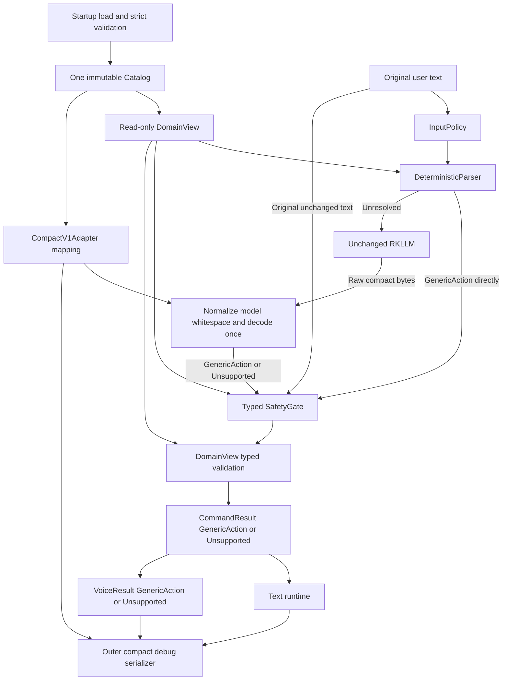

# Milestone 7 — Generic Action runtime cutover

Milestone 6.8 was inspected, its report checked against the implementation and
dedicated tests, and committed separately as
`3fbecc8cf35ea6cd584539c8ef819a01e2425f58`
(`Milestone 6.8: generic action foundation and compact adapter`). The working tree
was clean immediately afterward. That commit is the base for this implementation;
Milestone 7 remains uncommitted for review.

The production runtime now has **one canonical semantic representation**:
`actions::CandidateResult`, containing either `GenericAction` or `Unsupported`.
This is a complete internal cutover, not another shadow stage. Compact v1 remains
at RKLLM ingress and external compatibility/debug boundaries. No executor exists.

## Architecture before and after

The actual pre-cutover path was:

```text
immutable ConfigSnapshot -> DomainView
                            | room location -> legacy room code
                            | brightness support by legacy code
                            | entrance identity sidecar

text -> deterministic parser -> optional compact string
          unresolved -> RKLLM -> normalized compact string
       -> string SafetyGate -> legacy ActionValidator
       -> optional<legacy Action> + optional entrance metadata
       -> CommandResult::compact()
       -> text output / VoiceResult.action string -> voice output
```

Production still contained the old parser/SafetyGate room vocabulary, legacy
reference constructors, startup shadow probes and per-request room comparison.
The regression executable used a legacy-only CommandEngine constructor. These
were all inspected along with the [6.7 audit](milestone-6.7-generic-action-readiness-audit.md),
[6.8 foundation](milestone-6.8-generic-action-foundation.md), earlier domain-cutover
reports and actual tests before choosing the implementation.



There is no production legacy-answer comparison, veto, repair, or fallback.
Configuration owns domain data; compiled safety rules own semantic restrictions.
Startup still loads once, validates before model initialization, and keeps the
snapshot for process lifetime. Parser rule construction also rejects an ambiguous
or missing light target for any configured location before initializing models.
No consumer loads JSON, reloads a file, or mutates shared configuration.

## Canonical model and ownership

The 6.8 value model needed no field or schema extension:

```text
GenericAction {
    actionId: owned stable ActionDefinition ID
    targetId: owned stable Device ID
    arguments: ordered map<parameter ID, IntegerArgument>
}
IntegerArgument = exact signed int64 value
CandidateResult = variant<Unsupported, GenericAction>
```

Accessors are const, equality compares the complete semantic tuple, and there is
no default GenericAction that could invent a command. Unsupported is the default
result alternative and contains no action. IDs are not Russian names, enum room
letters, display metadata, or compact strings. Values own their IDs/arguments and
survive the engine/snapshot lifetime. Action does not own or load configuration.

GenericAction is a *candidate value*, not an execution permission. Only the final
CommandEngine result has passed the shared safety/domain boundary. Future hardware
execution must consume that validated result; decoding a model candidate alone is
not authorization to execute it.

CommandEngine explicitly receives `LlmEngine&`, `const DeterministicParser&` and
`const runtime::DomainView&`; these dependencies outlive it. Its model adapter uses
the same immutable Catalog. The historical constructors that bypassed configured
domain checks were removed. `CommandResult.action` and `VoiceResult.action` both
store CandidateResult. The old empty-door Action plus entrance metadata sidecar
was replaced by one action carrying the selected target ID. Human metadata stays
in the snapshot and is resolved by that ID when needed.

## Exact command flows

### Deterministic light

For `На кухне поставь свет на 40 процентов`:

1. InputPolicy checks the unchanged UTF-8/192-byte/nonblank limits.
2. Parser matches the existing whole-input grammar. Its precompiled location
   rule carries action/target/parameter IDs obtained by joining configured room
   locations, devices and registered action definitions.
3. It directly constructs
   `GenericAction("action_set_brightness", "device_kitchen_light", {brightness: int64(40)})`.
   There is no intermediate `L|K|40` and no decoder call on this route.
4. SafetyGate resolves the operation/target from the immutable domain, checks
   original-text state requirements and explicit room grounding, and preserves
   or rejects the typed candidate.
5. DomainView verifies the exact action/target/argument relationship and effective
   configured brightness bounds. The final CommandResult owns that same tuple.
6. Text output, or the final voice emitter after VoiceProcessor has carried the
   typed result, renders `L|K|40` for the existing external interface.

`В спальне выключи свет` follows the same path with target
`device_bedroom_light`, brightness int64(0). RKLLM is not called for either phrase.

### RKLLM light fallback

A phrase outside the frozen deterministic grammar, such as
`Пожалуйста, на кухне свет 40`, reaches the unchanged RKLLM wrapper. If its raw
result is `L|K|40`, CommandEngine preserves raw diagnostic bytes, applies the same
model-whitespace normalization as before, and calls CompactV1Adapter **once**.
The adapter strictly decodes syntax and reads Catalog compatibility references to
produce the stable semantic tuple. SafetyGate and domain validation then receive
only the typed value. Unknown/malformed wire data becomes Unsupported with an
invalid-output diagnostic; it cannot become a guessed/default action.

`rawOutput` and `normalizedOutput` remain diagnostic fields in CommandResult.
Neither is used to recover semantics after decoding, and neither is a final action.

### Entrance door

`Открой входную дверь` remains outside the light-only parser grammar and takes
the existing RKLLM route. `D` decodes immediately to
`GenericAction("action_open_entrance", "device_entrance_door", {})` using configured
IDs. SafetyGate requires all three frozen cues in the original text: one of the
five explicit opening words, the door stem, and an explicit entrance reference.
DomainView requires the selected configured entrance target/action, not merely
any device of door kind. The final typed value contains that target ID and no
numeric arguments. The outer serializer renders `D`.

`Открой дверь` + raw D becomes Unsupported. `открыть дверь на входе` + raw D
remains valid. Other configured entrance-like entities cannot replace the selected
target, and missing/unknown targets do not receive a legacy fallback.

### Unsupported and contradiction

`Какая сегодня погода` is unresolved by the parser. Model U decodes to
Unsupported; an injected D or kitchen-light candidate also fails the relevant
grounding policy. The final typed result contains no executable action. Only the
outer renderer writes `U`. Invalid input and inference exceptions also initialize
or reset the typed result to Unsupported without replaying a stale action.

For the exact contradiction02 input,
`На кухне выключи свет на 50 процентов`, parser remains unresolved. Raw U,
`L|K|50`, guessed `L|K|0`, and D all end as Unsupported: the original request has
incompatible OFF/explicit-nonzero requirements. No candidate repair is allowed.
See the [6.4.1 safety report](milestone-6.4.1-deterministic-safety-hardening.md) and
[RKLLM investigation](milestone-6.4-rkllm-contradiction-investigation.md) for the
original diagnosis, rather than treating a raw model U as proof of safety.

## Parser, safety and domain validation

The parser's numeric syntax, verbs, punctuation/case handling, conservative
whole-input matching, OFF=0, ON/maximum=100 and half=50 meanings are unchanged.
`ParserRoomLocation` now carries `phrase`, `actionId`, `targetId`, `argumentId`.
There is no legacy code in the rule or result. Configured device/action relations
select a unique light per location; ambiguity is an explicit error, never
iteration-order target selection.

SafetyGate now consumes CandidateResult and a read-only DomainView. Its 6.4.1
state-constraint detector, percentage/number vocabulary and door cue predicates
are unchanged. It inspects the configured operation, target and int64 brightness
instead of parsing a compact string or switching on a legacy room enum.

The old 23-token room table was replaced with Catalog mention lookup. The rule
itself remains compiled: the target's room must be explicitly present in the
original input. Multiple **different** known room IDs now reject an injected
single-target candidate deterministically. This closes an ambiguity previously
left to the model; the old gate merely checked whether the predicted room occurred
anywhere. Repeating aliases of the same room is not a different-target ambiguity.
This explicit fail-closed check is required by the milestone's ambiguous-target
contract; it is not a claim of byte-identical gate internals. Existing current-M4
positive/negative matrices and DEV expectations remain unchanged.

DomainView separates two concerns:

- `describe(GenericAction)` verifies existing IDs, membership of the action on
  the device, device/operation compatibility, room relationship and the exact
  configured argument key set. Schema v1's integer wrapper makes coercion/type
  mismatch impossible. It supplies borrowed read-only semantic metadata.
- `validate(CandidateResult)` rejects unknown or structurally invalid tuples,
  checks effective configured brightness bounds, and requires the selected
  entrance identity. It returns the original value or Unsupported only.

The gate uses structural description before applying policy; the final shared
boundary owns installation range/target support for **both** parser and model
candidates. A valid compact string is not a safe or supported action.

No range clamping, alternate target, retry, or legacy answer is used on rejection.
Named arguments must match exactly: light without brightness, wrong/extra keys,
door with brightness, unknown action/target, and incompatible device kind reject.
Protocol integer/0..100 encoding remains in the codec. Frozen grammar and light
state meanings use the same percent envelope, while installation range support
comes from effective Catalog bounds. The isolated 10..90 fixture still rejects
0/9/91/100 without changing their compact representability or OFF semantics.

Enablement/deny metadata is **not newly activated** by this representation change,
matching Milestones 6.5/6.6. These fields and mandatory-policy summary strings do
not dispatch, disable or rewrite SafetyGate. They remain a separately scoped
policy-activation concern. No claim of general admin editing support is made.

## Compact boundary audit

All remaining production compact uses were inspected in `src/` and public
headers, followed by the actual assistant link command and symbols:

| Location | Remaining role | Why this is not canonical runtime semantics |
|---|---|---|
| `src/RkllmEngine.cpp`, `LlmEngine`/`RkllmEngine` interfaces | Raw model byte transport, callback bounds and frozen prompt format | Unchanged vendor boundary; returns bytes, not an authoritative action |
| `src/CommandEngine.cpp`, `include/firefly/CommandEngine.h` | Own ingress adapter, normalize/decode model output once; retain raw/normalized diagnostics | Parser route never encodes; all subsequent decisions use CandidateResult |
| `include/firefly/actions/CompactV1Adapter.h`, `src/actions/CompactV1Adapter.cpp` | Decode/encode mapping and final `render(CandidateResult)` convenience | Explicit compatibility module; U is translated only here, not stored as an Action |
| `include/firefly/legacy/{Action,ActionValidator}.h`, `src/legacy/{Action,ActionValidator}.cpp` | Frozen wire grammar, K/B/G/C Room enum, empty D payload, integer envelope and serialization | Used only inside adapter or codec tests; namespace/target isolate these transient wire values |
| `src/main.cpp` | Serialize final typed result to stdout and verbose final-action diagnostic; fatal CLI error still emits U | Outermost text presentation; strings do not re-enter semantic layers |
| `src/VoiceMode.cpp` | Serialize the final typed VoiceResult once in its emitter for stdout/diagnostics | VoiceProcessor, worker future and result carry CandidateResult up to this boundary |
| `src/RegressionMain.cpp` | Read frozen compact DEV expectations, serialize final result, classify/print regression outcomes | External test/scoring boundary, now using the actual configured typed engine |
| `include/firefly/config/Configuration.h`, `src/config/ConfigLoader.cpp`, `src/config/ConfigValidator.cpp`, existing schema | Persist and validate v1 compatibility bindings and frozen profile identities; compute offline legacy-difference summary | Storage/protocol contract, not parser/SafetyGate target selection; unchanged |
| `src/runtime/DomainView.cpp` | Reads `compatibility.doorTargetId` / `doorActionId` as stable selected-entrance references | Schema v1 stores selection here; no D token or legacy enum is inspected |

There are no compact-token comparisons or legacy Action/Room references in the
production parser, typed SafetyGate, DomainView validation or VoiceProcessor.
CommandEngine does not expose `compact()` or an alternate legacy constructor.
The only production imports of the legacy model are in CompactV1Adapter and the
legacy codec's own files. ConfigValidator's retained frozen table validates the
v1 compatibility profile and describes drift; it neither repairs a runtime answer
nor runs a second semantic pipeline. Schema v1 already provides all required IDs.

CompactV1Adapter's new `render` renders Unsupported as U, encodes a GenericAction
canonically, and throws on an unrepresentable typed action. Encoding errors are
not successful U conversions. Current-M4 finals are fully representable. A future
expanded domain will need a separately designed external representation, not silent
substitution of a supported legacy target.

Legacy Room/LightAction/empty-door structures were moved without semantic edits:
only namespace and include paths changed. The enum is no longer part of the
production semantic API. `EntranceDoorDomain`, `LightBrightnessDomain`,
`ShadowComparison`, parser legacy helpers and historical CommandEngine constructors
were removed. The independent old parser/gate implementations remain under
`tests/reference/` for offline grammar/vocabulary checks only. No such symbols or
reference library appear in the assistant binary/link command.

## Tests and configuration-driven proof

Existing compact expectations are retained at **test presentation boundaries**
using `tests/TestSupport.h`. It constructs an explicit validated fixture and calls
the real typed parser/gate/engine; it does not duplicate safety policy. The old
leading-zero gate test compares semantic identity and preserves the original wire
spelling only inside this compatibility assertion. Actual external output is
canonical, as before. New runtime tests directly assert actionId, targetId, int64
brightness or empty door arguments and the Unsupported alternative.

Historical runtime-shadow API assertions were replaced because those APIs and
production comparisons no longer exist. In particular, isolated room alias edits
now follow config instead of failing the old migration veto. Moving `в зале` and
its five hall mentions from living room to bedroom produces the bedroom GenericAction
and external `L|B|40`; the independent frozen parser still says `L|G|40` and cannot
choose the answer. Current `config/current-m4.json` was not edited.

The remapped-range fixtures cover 0..100, 10..90, 0..0, 100..100 and 50..50 across
all five current locations / four rooms. Every value -1..101 is tested against
typed domain support; representable values are also tested on both engine routes.
Int64 extremes, malformed model syntax and missing/wrong arguments reject. The
40-row entrance safety matrix, including six existing door-related DEV rows,
remains intact and is exercised with different immutable display metadata and
multiple model outputs. Selected-door identity survives runtime destruction;
extra/unknown door targets cannot substitute for it.

The new GenericRuntime suite independently checks all 404 light tuples on fast
and fallback routes, explicit door identity, the required six command examples,
injected contradiction candidates, every ordered pair of ambiguous room IDs,
positive controls for all 23 repeated same-room aliases, and all 48 unchanged DEV
labels. Voice tests inspect a semantic door result and reject
an injected contradiction candidate through the real VoiceProcessor boundary.

## Build and regression verification

Both build directories started clean. After resolving stale test-only API calls,
both were rebuilt with `--clean-first`; the final build logs contain no compiler
warnings/errors. Configuration and commands:

```sh
cmake -S . -B build/milestone-7/clean-core \
  -DFIREFLY_BUILD_ASSISTANT=OFF -DFIREFLY_BUILD_VOICE=OFF \
  -DFIREFLY_BUILD_CONFIG_TOOLS=ON -DCMAKE_EXPORT_COMPILE_COMMANDS=ON
cmake --build build/milestone-7/clean-core --clean-first -j2
ctest --test-dir build/milestone-7/clean-core -V

cmake -S . -B build/milestone-7/clean-full \
  -DFIREFLY_BUILD_CONFIG_TOOLS=ON -DCMAKE_EXPORT_COMPILE_COMMANDS=ON \
  -DRKLLM_ROOT=/home/firefly/demo_Linux_aarch64 -DFIREFLY_BUILD_VOICE=ON \
  -DSHERPA_ONNX_ROOT=/home/firefly/FireflyVoiceAssistantLinux/build/stt/sherpa-onnx-v1.13.7-linux-aarch64-shared-cpu \
  -DSHERPA_ONNX_INCLUDE_DIR=/home/firefly/FireflyVoiceAssistantLinux/build/stt/vad-ab
cmake --build build/milestone-7/clean-full --clean-first -j2
ctest --test-dir build/milestone-7/clean-full -V
```

The GenericAction/config/adapter libraries are now required runtime dependencies,
not opt-in foundation targets. `FIREFLY_BUILD_CONFIG_TOOLS` still controls the
offline inspection tools/tests. No new dependency was downloaded or installed.

| Suite / check | Result |
|---|---|
| Clean core build / CTest | Passed, 19/19 suites |
| Clean full voice-enabled build / CTest | Passed, 29/29 suites |
| Frozen codec Action / ActionValidator | 408 / 431 checks, original expectations retained |
| Parser / SafetyGate / CommandEngine | 707 / 98 / 170 checks, original command/output expectations retained |
| SafetyHardening 6.4.1 | 157,283 checks; all four frozen contradictions and injected candidates pass |
| RKLLM failure wrapper | 70 checks, frozen settings/bootstrap/KV lifecycle, abort/fault/no-stale-output checks pass |
| CLI robustness / VoicePipeline | Passed, including ten CLI scenarios and typed voice result checks |
| Config validation / snapshot / store / offline consistency | 98 / 13 / 56 / 1,389 checks; configuration CLI passed |
| GenericAction foundation | 22 checks plus compile-time exact integer/value/type guarantees |
| CompactV1Adapter | 72,819 checks; all 405 actions round-trip both ways; 18,684 malformed wire cases reject |
| GenericRuntime | 2,976 typed semantic/compatibility checks |
| RuntimeConfig ownership | 41 checks; immutable retention, no reload, failure before model startup |
| Parser room cutover | 30,406 checks; frozen grammar equivalence and config-driven semantic target selection |
| Brightness cutover | 11,452 checks; current/narrowed domains across all rooms and both routes |
| Entrance cutover | 2,487 checks; 40-row safety matrix, configured identity, no substitution |
| Runtime/room/brightness/door CLI and voice startup suites | Passed; one pre-existing text-only brightness test remains skipped in the voice-startup invocation |

Counts for the migrated runtime suites intentionally differ from old shadow-probe
counts: removed-reference/diagnostic assertions were replaced with semantic tests.
No current-M4 production expectation, frozen DEV label, door safety expectation or
contradiction expectation was weakened.

After final test review, the same-room-alias positive controls were added and the
GenericRuntime target rebuilt/retested in both core and full directories (1/1
suite each). Five affected CLI suites were rerun after removing obsolete shadow
diagnostic helper arguments (5/5 passed). Production source/binaries were unchanged
by these test-only follow-ups; hardware-run binary hashes were rechecked afterward.

### Real Firefly hardware runs

All six scheduled runs completed successfully, with no retries or retuning.

| Run | Final correct | False accepts / rejects / wrong actions | contradiction02 raw | contradiction02 final | Process wall time |
|---|---|---|---|---|---|
| 01-npu | 48/48 | 0 / 0 / 0 | `L|K|50` | U | 46.83 s |
| 02-integrated | 48/48 | 0 / 0 / 0 | not traced | U | 45.83 s |
| 03-npu | 48/48 | 0 / 0 / 0 | `U` | U | 44.94 s |
| 04-integrated | 48/48 | 0 / 0 / 0 | not traced | U | 44.84 s |
| 05-npu | 48/48 | 0 / 0 / 0 | `U` | U | 44.45 s |
| 06-integrated | 48/48 | 0 / 0 / 0 | not traced | U | 45.89 s |

Each NPU harness run reported 17 fast-path / 31 fallback commands, 24 valid
actions and 24 Unsupported results correctly classified, and zero invalid final
outputs or runtime/input errors. Mean command latencies were 478.027, 450.186 and
447.431 ms respectively (model startup excluded). RKLLM reports runtime 1.3.0,
RKNPU driver 0.9.8 on RK3588, the same pinned libraries.

Raw variability was observed during these actual runs: contradiction02 produced
`L|K|50` on the first NPU run and U on the next two. **All final results were U.**
The first result therefore exercises actual typed SafetyGate rejection, in addition
to the deterministic injected-candidate proofs. Integrated runs preserve final
output diagnostics but do not claim an unrecorded raw model result.

Both replay executables passed: the existing VAD/STT replay and the added full
GenericAction voice replay each processed eight speech recordings and two silence
cases. Exact transcripts remained 8/8; typed final actions in the integrated replay
were 8/8. Both silences emitted zero utterances and zero commands.

| Recording | Full typed-runtime compatibility output |
|---|---|
| 01_door.wav | U |
| 02_open_door.wav | U |
| 03_open_entrance_door.wav | D |
| 04_light_on.wav | U |
| 05_light_off.wav | U |
| 06_kitchen_40.wav | `L\|K\|40` |
| 07_bedroom_half.wav | `L\|B\|50` |
| 08_corridor_off.wav | `L\|C\|0` |
| silence-2s.wav / silence-5s.wav | No command |

Commands use the unchanged model/prompt and current-M4 configuration. Each DEV
run is a fresh process, loads one model, keeps the existing bootstrap/system-KV
lifecycle and clears request KV as before. Runs are interleaved NPU/integrated
three times, sequentially on the same device; no performance setting is changed.

```sh
build/milestone-7/clean-full/firefly-regression \
  --model /home/firefly/demo_Linux_aarch64/Qwen3-4B_W8A8_RK3588_3core.rkllm \
  --system-prompt /home/firefly/demo_Linux_aarch64/prompt_compact_v5_short_system.txt \
  --data /home/firefly/FireflyVoiceAssistantLinux/tests/data/dev.tsv

build/milestone-7/clean-full/firefly-assistant \
  --model /home/firefly/demo_Linux_aarch64/Qwen3-4B_W8A8_RK3588_3core.rkllm \
  --system-prompt /home/firefly/demo_Linux_aarch64/prompt_compact_v5_short_system.txt \
  --config /home/firefly/FireflyVoiceAssistantLinux/config/current-m4.json --verbose
# stdin: all 48 original DEV input fields, one per line, in frozen order.

build/milestone-7/clean-full/speech_replay_tests \
  build/stt/model build/stt/vad-ab/silero_vad.onnx build/stt
build/milestone-7/clean-full/generic_speech_replay_tests \
  build/stt/model build/stt/vad-ab/silero_vad.onnx build/stt \
  /home/firefly/demo_Linux_aarch64/Qwen3-4B_W8A8_RK3588_3core.rkllm \
  /home/firefly/demo_Linux_aarch64/prompt_compact_v5_short_system.txt \
  config/current-m4.json
```

The regression executable now exercises the same configured typed production
engine; its previous legacy-only constructor no longer exists. It still uses all
48 frozen inputs/expectations, the same model/lifecycle, and reports raw model
bytes separately from final results. It is not a raw-model-only acceptance test.
No successful runs are selected by retrying failed ones.

The existing replay tests VAD/STT; the added opt-in GenericSpeechReplay test feeds
the same WAVs through real VAD, real STT, VoiceProcessor, real CommandEngine and
RKLLM, then compares **typed** final results and the compatibility serialization.
These are recording replays, not a new live microphone accuracy benchmark.

Recorded fixed artifact SHA-256 values:

| Artifact | SHA-256 |
|---|---|
| Qwen3-4B W8A8 model | `d806976a3d77f2252a6abe40a5fd7d9b1006a90f671992923ac2c1542456ba8b` |
| System prompt v5 | `d1c977f28ec4f8e08e30ee362d108fed1482a690667d6af88776ce7c8442d02f` |
| RKLLM runtime library | `6a9e4fc5324c68921c3a900340361e107af7599fe34dc8fa7759b2c5ae22a6e6` |
| Frozen DEV TSV | `b9a882c4ea6f7c0b956ca47ad4d2ff320fbdf4eabecb5a378449e34efd23dff0` |
| current-m4.json | `110e92d62e677eba03caec2bdc131bfec0203d7c462971af5c07636ccc4e1133` |

Ignored evidence is retained under `build/milestone-7/`: configure/build/CTest
logs, `run_hardware.py`, exact command/environment/clock metadata, per-run stdout
and stderr, hardware summary and artifact hashes, speech replay logs and protected
source hashes. These generated binaries/logs are not proposed for git.

## Changed files and scope

Final scope: 38 modified tracked files, 8 deleted old paths, and 12 added paths. Four deletions/additions are the codec moves to
`legacy/`; the other deletions remove migration-only interfaces/oracles.
All changes below belong to the runtime cutover, its tests/build wiring or this report.

```text
 M CMakeLists.txt
 D include/firefly/Action.h
 D include/firefly/ActionValidator.h
 M include/firefly/CommandEngine.h
 M include/firefly/DeterministicParser.h
 D include/firefly/EntranceDoorDomain.h
 D include/firefly/LightBrightnessDomain.h
 M include/firefly/ParserRoomDomain.h
 M include/firefly/SafetyGate.h
 M include/firefly/actions/CompactV1Adapter.h
 M include/firefly/runtime/DomainView.h
 M include/firefly/runtime/RuntimeConfig.h
 D include/firefly/runtime/ShadowComparison.h
 M include/firefly/voice/VoiceProcessor.h
 D src/Action.cpp
 D src/ActionValidator.cpp
 M src/CommandEngine.cpp
 M src/DeterministicParser.cpp
 M src/RegressionMain.cpp
 M src/SafetyGate.cpp
 M src/VoiceMode.cpp
 M src/VoiceProcessor.cpp
 M src/actions/CMakeLists.txt
 M src/actions/CompactV1Adapter.cpp
 M src/main.cpp
 M src/runtime/CMakeLists.txt
 M src/runtime/DomainView.cpp
 M src/runtime/RuntimeConfig.cpp
 D src/runtime/ShadowComparison.cpp
 M tests/CommandEngineTests.cpp
 M tests/CoreTests.cpp
 M tests/RkllmEngineTests.cpp
 M tests/SafetyHardeningTests.cpp
 M tests/VoiceTests.cpp
 M tests/actions/CompactV1AdapterTests.cpp
 M tests/config/ConfigCliTests.py
 M tests/config/ConfigShadowTests.cpp
 M tests/runtime/BrightnessCutoverCliTests.py
 M tests/runtime/BrightnessCutoverTests.cpp
 M tests/runtime/EntranceDoorCutoverCliTests.py
 M tests/runtime/EntranceDoorCutoverTests.cpp
 M tests/runtime/ParserRoomCutoverCliTests.py
 M tests/runtime/ParserRoomCutoverTests.cpp
 M tests/runtime/RuntimeConfigCliTests.py
 M tests/runtime/RuntimeConfigTests.cpp
 M tests/runtime/RuntimeConfigVoiceStartupTests.py
?? docs/milestone-7-generic-action-runtime-cutover.md
?? include/firefly/legacy/Action.h
?? include/firefly/legacy/ActionValidator.h
?? src/legacy/Action.cpp
?? src/legacy/ActionValidator.cpp
?? tests/GenericSpeechReplayTests.cpp
?? tests/TestSupport.h
?? tests/reference/FrozenParser.cpp
?? tests/reference/FrozenSafetyGate.cpp
?? tests/reference/FrozenSemantics.h
?? tests/runtime/GenericRuntimeTests.cpp
?? tests/runtime/TypedRuntimeChecks.h
```

Protected source/config/fixture comparison against the 6.8 checkpoint found 29
selected files byte-for-byte unchanged, covering configuration/schema/validator,
DEV data, vendored dependency, RKLLM wrapper/settings interfaces, text/input helpers,
STT, VAD/segmenter, ALSA capture and the existing pure speech replay. No model or
prompt tuning, serialized prompt cache, new transcript repair, schema expansion,
admin/HTTP, live reload, hardware execution, wake word or new inference backend
was introduced. Door/state policy stays compiled, not ordinary editable data.

The 6.8 foundation commit is retained as a separate checkpoint. Milestone 7 is
left uncommitted after verification; no later feature or milestone is started.
