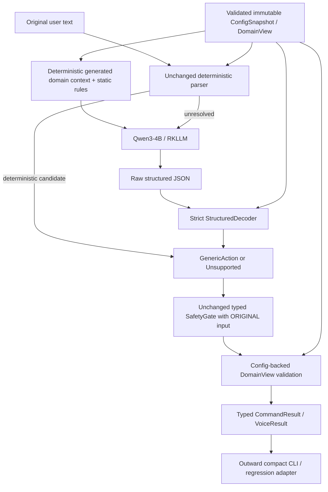

# Milestone 8: config-driven LLM and structured GenericAction output

Status: implemented and verified on RK3588S; left uncommitted for review.

The accepted Milestone 7 was audited against its report and saved verification
artifacts, then committed separately as
`4dd8d7ff2938be171367dd0577a2dc704e0efd45`
(`Milestone 7: generic action runtime cutover`). Its working tree was clean
before this work. Milestone 8 is intentionally uncommitted.

## Architecture

Before: immutable ConfigSnapshot supplied parser/domain validation, but RKLLM
loaded a manually selected external compact prompt. CommandEngine decoded model
`L|K|N` / `D` / `U` through CompactV1Adapter before the typed SafetyGate.

After:



There is one production path, no shadow pipeline or compact fallback. The
DeterministicParser, SafetyGate, DomainView, GenericAction and VoiceProcessor
implementations are unchanged from M7. The same startup RuntimeConfig owns the
snapshot throughout process lifetime. Text, regression and voice assembly all
generate the system prompt from that snapshot; `--system-prompt` is rejected
explicitly. The reference compact-v5 prompt is left untouched and is no longer
loaded by a production entry point.

## Context generation

`llm::generateContext(const runtime::DomainView&)` returns a value object with
`rules` and `domain` strings. The final prompt places quoted domain data first
and the static interpretation/output rules last. The generator enumerates the
validated, canonically sorted catalog; it contains no current room names, room
IDs, device IDs, compact letter mapping or installation-specific action IDs.

The dynamic portion includes:

- Action IDs, display names, parameter IDs, required integer-percent bounds.
- Every configured room ID, display name, mention alias and location alias.
- Its configured device/target ID, display name and supported action IDs.
- The selected entrance target and its actual configured action relationship,
  shown as a complete argument-free JSON shape.

Grouping targets beneath rooms removes redundant repeated room references; it
does not omit aliases. Schema v1 only permits the registered integer brightness
and argument-free entrance-opening capabilities. Their parameter forms, target
associations and names are sufficient for the current domain. Empty device/action
speech-alias fields are required by v1; unsupported future bindings, retired IDs,
revision metadata and compatibility letter mappings are not LLM interpretation
data. Pre-existing enablement/restriction policy remains inactive in DomainView;
M8 does not activate another configuration policy consumer.

Catalog validation sorts identities, aliases and action references. Rendering
uses ordered containers, JSON-quoted display strings and the classic numeric
locale. The same snapshot creates byte-identical output. Configuration rejects
chat-template control sequences before prompt generation. The generator has a
16,384-byte resource ceiling, separate from actual token admission.

Static rules describe the output shape and current product interpretation:
explicit single room, absolute brightness, ON/maximum=100, OFF=0, half=50,
relative/qualitative brightness unsupported, negative/out-of-range values,
alternatives, ambiguity and contradictions unsupported, explicit entrance-door
opening only, no guessing or repair. These constants describe language/state
semantics; the supported numeric range is read from configuration. Safety remains
compiled deterministic policy, never administrator-editable prompt policy.

## Structured result contract

Executable light example:

```json
{"actionId":"action_set_brightness","targetId":"device_kitchen_light","arguments":{"brightness":40}}
```

Entrance example:

```json
{"actionId":"action_open_entrance","targetId":"device_entrance_door","arguments":{}}
```

Non-executable result:

```json
{"unsupported":true}
```

There is no action representing Unsupported. The decoder constructs the existing
GenericAction directly: stable action ID, stable target ID, ordered named int64
arguments. It never encodes or decodes compact text.

`StructuredDecoder` requires exactly one complete JSON object, allowing ordinary
JSON whitespace and property order. It rejects:

- Empty/oversized input, BOM, invalid UTF-8/JSON, excessive nesting, duplicate
  members (including equivalent escaped keys), trailing prose or documents,
  markdown fences and compact-v1 strings.
- Missing/extra root members; mixed executable/Unsupported objects; unsupported
  false, numeric or string flags.
- Unknown action/target IDs, unsupported target/action relationships, wrong
  argument names, missing/extra arguments, strings, booleans, floating-point
  numbers, null/containers and integer overflow.
- Values outside the supplied config-backed capability range.

No defaults, trimming inside IDs, clamping, syntax repair or inferred argument
is applied. Invalid decode returns Unsupported plus a diagnostic reason.
DomainView owns the domain checks; using it at ingress rejects invalid model
candidates early, while the existing shared final validation still covers the
deterministic parser route. A syntactically valid, domain-valid action is **not**
authorization: it must still pass SafetyGate against the original input.

## Diagnostics and safety proof

CommandResult retains raw bytes, DecodeStatus, typed candidate, typed post-gate
candidate, typed final action, rejection indicators, route, error and latency.
Text `--verbose` emits JSON-quoted TRACE fields. The regression harness records
original input, raw structured response, decoding, candidate, gate result and
final result separately. Neither diagnostics nor compact serialization feeds a
candidate back into the engine.

Dedicated tests inject literal JSON through the real CommandEngine/SafetyGate.
For `На кухне выключи свет на 50 процентов`, Unsupported, light brightness 50,
guessed light brightness 0 and a door candidate all end Unsupported. Executable
candidates are explicitly reported as SafetyGate rejections. Wrong-room grounding
also rejects. A valid kitchen/40 candidate survives, 101 is rejected by the
decoder's config-domain check, and deterministic kitchen/40 bypasses the LLM.
Legacy `D`, `U`, `L|K|40` and whitespace-repaired variants are rejected at ingress.

The previous [RKLLM investigation](milestone-6.4-rkllm-contradiction-investigation.md) remains applicable: structured syntax does not remove raw-model semantic variability.

Existing gate/parser safety expectations and `tests/data/dev.tsv` labels are
unchanged. Mock LLM fixtures now supply the new model protocol; old compact
expectations remain at the test compatibility boundary. The only old
normalization-specific mock scenario was changed to valid JSON with outer JSON
whitespace: accepting whitespace inserted into a legacy compact response is
intentionally no longer a production feature. No user-transcript normalization
or safety expectation was weakened.

## Context size and runtime budget

The exact local RKLLM 1.3.0 header exposes no query to tokenize a string with the
embedded tokenizer before inference. `LLMTokenizerCallback` supplies a custom
external tokenizer; it is not an internal tokenizer query. We use actual
`RKLLMPerfStat` token counts and `rkllm_get_kv_cache_size`, not a character/token
estimator.

The old response ceiling of 16 tokens demonstrably truncates the required JSON:

```text
{"actionId":"action_set_brightness","targetId":"device_kitchen_light","
```

The isolated 16-token probe reported 15 generated tokens and an incomplete
object; the same prompt with the structured budget produced a complete 23-token
light action. Therefore **only the response ceiling changes from 16 to 128** at
initialization and request time. This is necessary representation capacity, not
sampling/model tuning. Model, quantization, RKLLM version, NPU cores, template,
max_context=1024, top_k=1, top_p=1, temperature=0.1, penalties, flash embedding,
bootstrap and per-request keep-system KV clearing remain unchanged.

Admission is conservative and fail-closed:

1. Reject prompt bytes over 16,384 before model initialization (resource limit).
2. Bootstrap with the existing empty-user lifecycle; before READY require actual
   prefill in 1..640 and valid KV size within 1024. Reserve 256 request tokens and
   128 output tokens.
3. On every real request require actual prefill in 1..256, valid KV count, and
   bootstrap prefill + request prefill + 128 <=1024 before returning any response.
4. Reject missing/invalid telemetry and output that reaches the observed vendor
   generation ceiling (`generate_tokens >=127`). A budget/runtime fault poisons
   the engine until restart, using the existing failure lifecycle.

The SDK reports lazy KV clearing: an immediate size read after clear need not
shrink. No extra cache clear or false equality assertion was introduced. The size
read occurs after completed synchronous inference. The joined watchdog is
unchanged.

There is no independent preflight tokenizer proof of vendor internals. Admission
uses the vendor's documented telemetry after bootstrap/request; no response from
an over-budget request is exposed. Actual oversized prompt probes were rejected
explicitly by RKLLM (2,565 input tokens >1,024) or by our startup check (642/660/691
prefill >640), rather than silently accepted. A future tokenizer API would allow
an earlier exact admission check; a byte estimator would not replace it safely.

## Configuration-driven proof

Deterministic tests hold static rules constant and prove:

- Reordered valid rooms/devices/actions/aliases yield byte-identical context.
- Changing entrance display metadata changes exactly that quoted metadata.
- A valid 10..90 fixture changes exactly the domain's 0..100 range text; the
  decoder accepts 10/40/90 and rejects 0/9/91/100 against that catalog.
- Adding a room alias changes only dynamic context.
- Adding a schema-v1-valid office room/light produces its actual new stable IDs
  in context. The expanded-catalog decoder accepts its action; the original
  catalog rejects the same JSON as unknown target.
- An additional valid brightness action ID on that office target is accepted
  only by its supplied catalog; neither generator nor decoder has a fixed
  installation action-ID list.
- A large but schema-valid catalog is rejected by the prompt byte resource limit;
  reserved template text is already rejected by config validation.

No change to `config/current-m4.json`, schema v1, configuration loader/validator,
model, STT or VAD is involved. The generator source is checked for current
installation IDs and compact-mapping dependencies.

## Verification results

Clean builds from new directories:

```sh
cmake -S . -B build/milestone-8/clean-core \
  -DFIREFLY_BUILD_ASSISTANT=OFF -DFIREFLY_BUILD_CONFIG_TOOLS=ON \
  -DCMAKE_EXPORT_COMPILE_COMMANDS=ON
cmake --build build/milestone-8/clean-core -j2
ctest --test-dir build/milestone-8/clean-core --output-on-failure

cmake -S . -B build/milestone-8/clean-full \
  -DFIREFLY_BUILD_CONFIG_TOOLS=ON -DFIREFLY_BUILD_VOICE=ON \
  -DRKLLM_ROOT=/home/firefly/demo_Linux_aarch64 \
  -DSHERPA_ONNX_ROOT=/home/firefly/FireflyVoiceAssistantLinux/build/stt/sherpa-onnx-v1.13.7-linux-aarch64-shared-cpu \
  -DSHERPA_ONNX_INCLUDE_DIR=/home/firefly/FireflyVoiceAssistantLinux/build/stt/vad-ab \
  -DCMAKE_EXPORT_COMPILE_COMMANDS=ON
cmake --build build/milestone-8/clean-full -j2
ctest --test-dir build/milestone-8/clean-full --output-on-failure
```

Core **22/22**, full **32/32** suites pass, including every configuration,
room/brightness/entrance cutover, existing production, voice, foundation and
compatibility suite. Representative deterministic counts:

| Suite | Result |
|---|---:|
| StructuredOutput | 55,627 checks; all 405 executable actions; 54,545 malformed/unsupported fixtures rejected |
| StructuredPipeline | 26 literal-candidate checks |
| LlmContext | 162 ordering, metadata/range/alias/ID and size checks |
| GenericAction | 22 |
| CompactV1Adapter | 72,819 checks; 405 exact round trips in both directions; 18,684 malformed compact cases |
| SafetyHardening | 157,283 |
| GenericRuntime | 2,976 |
| ParserRoomCutover | 30,406 |
| BrightnessCutover | 11,452 |
| EntranceDoorCutover | 2,487 |
| ConfigShadow | 1,389 |
| RuntimeConfig | 41 |
| Config validation / snapshot / store | 98 / 13 / 56 |
| RKLLM wrapper fault/lifecycle | 111 |
| CLI | 11 scenarios plus cutover/startup suites |

Structured tests include all 405 complete JSON actions, every proper prefix
truncation, prose/fence/document suffixes, escaped duplicate members, all 256
leading-byte values and 10,000 fixed-seed malformed byte fixtures. The random
cases complement schema/domain tests; they are not a coverage-guided fuzzer.

### Final hardware series

Six consecutive fresh processes, interleaved NPU harness / integrated CLI, all
using the same final generated prompt, config, frozen DEV file, model and runtime:

| Run | Final actions | FA / FR / wrong | Valid structured / fallback | JSON malformed | Decoder rejects | Gate rejects |
|---|---:|---:|---:|---:|---:|---:|
| 01-npu | 48/48 | 0 / 0 / 0 | 30/31 | 0 | 1 | 3 |
| 02-integrated | 48/48 | 0 / 0 / 0 | 30/31 | 0 | 1 | 3 |
| 03-npu | 48/48 | 0 / 0 / 0 | 30/31 | 0 | 1 | 3 |
| 04-integrated | 48/48 | 0 / 0 / 0 | 30/31 | 0 | 1 | 3 |
| 05-npu | 48/48 | 0 / 0 / 0 | 30/31 | 0 | 1 | 3 |
| 06-integrated | 48/48 | 0 / 0 / 0 | 30/31 | 0 | 1 | 3 |

**288/288 final actions; 0 false accepts, false rejects or wrong actions.**
Each run uses 17 deterministic and 31 RKLLM routes. Across the series:

- 186/186 model responses are syntactically valid JSON (no fences/prose).
- 180/186 are accepted structured results: 60 executable candidates and 120 Unsupported.
- Six are invalid light-action/entrance-target combinations, rejected by the decoder.
- Eighteen accepted structured candidates are semantically wrong for the original
  request and are rejected by SafetyGate. Final domain rejection/runtime-error
  counts are zero in current-M4 DEV.
- Every contradiction02 raw candidate is kitchen brightness=50; every post-gate
  and final result is Unsupported/U. Direct injection also covers raw Unsupported
  and guessed zero, so this proof does not depend on a lucky raw U.

Representative actual raw outputs:

```json
{"actionId":"action_set_brightness","targetId":"device_kitchen_light","arguments":{"brightness":30}}
{"actionId":"action_open_entrance","targetId":"device_entrance_door","arguments":{}}
{"unsupported":true}
```

The three lines are separate responses, not a multi-document accepted format.
For `Свет на максимум`, the model instead repeatedly returned brightness=100
with `action_set_brightness` and `device_entrance_door`; the strict target/action
check rejected it. Structured syntax is therefore reported separately from
domain validity and semantic correctness.

NPU average command times: 1,434.35 / 1,396.94 / 1,397.72 ms; fallback averages
2,220.75 / 2,162.89 / 2,164.07 ms. These are observations, not latency guarantees.

Both pure speech replay and real VAD → STT → CommandEngine → RKLLM replay pass:
**8/8 recordings and 2/2 silences**. The typed replay asserts exact transcripts
and GenericAction equality, plus unchanged compact presentation:

| Recording | Final compatibility display |
|---|---|
| door | U |
| open door without entrance | U |
| explicit entrance door | D |
| light on without room | U |
| light off without room | U |
| kitchen, STT “сорок процентов” | L\|K\|40 |
| bedroom half | L\|B\|50 |
| corridor off | L\|C\|0 |
| 2-second / 5-second silence | zero utterances, zero commands |

This is recorded replay; no new microphone recording or tuning was performed.

### Real config A/B and admission checks

The same fallback input `Пожалуйста, на кухне свет 95 процентов` was run in
fresh processes with A=current-M4 and B=isolated 10..90. Context B differs
byte-for-byte from A only by `0..100` → `10..90`; static rules are identical.
Both raw model candidates were brightness=95. A decodes and validates to the
kitchen action; B reports `outside_domain` and final Unsupported/U. This exposes
the model ignoring the narrower limit while proving that the decoder uses the
passed Catalog and cannot silently fall back to the old range.

A separate schema-valid fixture changing only a display name increased actual
bootstrap prefill to 649. Startup exited 1, emitted U and the explicit context
budget error, destroyed the handle and never reached READY. The final current-M4
prompt is 2,604 UTF-8 bytes, 637 actual bootstrap-prefill tokens, KV size 642 after
the five-token bootstrap response. It has only three tokens of admission margin;
larger valid configurations can require prompt compaction and currently fail
startup explicitly rather than silently dropping domain entries.

Final unit review adds the additional action-ID proof and removes a test-only
range-loop copy warning. The two affected suites were rebuilt/retested in both
core and full trees (2/2 each). No production semantics changed during this review. A final rebuild confirmed
that assistant, regression and typed speech-replay binaries remain byte-for-byte
identical to those used by all six hardware runs and replay.

### Reproduction and retained evidence

From the repository root:

```sh
build/milestone-8/clean-full/firefly-regression \
  --model /home/firefly/demo_Linux_aarch64/Qwen3-4B_W8A8_RK3588_3core.rkllm \
  --config config/current-m4.json --data tests/data/dev.tsv --verbose

build/milestone-8/clean-full/firefly-assistant \
  --model /home/firefly/demo_Linux_aarch64/Qwen3-4B_W8A8_RK3588_3core.rkllm \
  --config config/current-m4.json --verbose
```

The integrated invocation receives the 48 unchanged fourth TSV fields on stdin,
in order. Each command was run three times in a fresh process; the checked runner
`build/milestone-8/run_hardware.py` stops on the first failed complete run.
That directory retains exact argv/cwd, relevant environment, frequencies/thermal
readings, stdout/stderr, structured traces, per-run JSON summaries, all prompt
development artifacts, and config A/B/overflow proof fixtures and commands.
Clock/performance settings were observed, not changed.

RKLLM reports runtime/toolkit 1.3.0, RKNPU driver 0.9.8, RK3588, W8A8, three cores.
Key SHA-256 identities:

| Artifact | SHA-256 |
|---|---|
| `Qwen3-4B_W8A8_RK3588_3core.rkllm` | `d806976a3d77f2252a6abe40a5fd7d9b1006a90f671992923ac2c1542456ba8b` |
| `final-generated-prompt.txt` | `a8ffb93d4111edb39f6a8d483d6b0386e17f6b4ec2ea372c524e5820779ba80c` |
| `dev.tsv` | `b9a882c4ea6f7c0b956ca47ad4d2ff320fbdf4eabecb5a378449e34efd23dff0` |
| `current-m4.json` | `110e92d62e677eba03caec2bdc131bfec0203d7c462971af5c07636ccc4e1133` |
| `librkllmrt.so` | `6a9e4fc5324c68921c3a900340361e107af7599fe34dc8fa7759b2c5ae22a6e6` |

No generated logs, binaries or model data are added to git. This report preserves
the significant results and identities; detailed local evidence remains under
`build/milestone-8/`.

### Development experiments retained

Each prompt revision was generated once and tested in a complete run when startup
admission allowed it. Failed runs were retained, not replaced by lucky retries.
No DEV label or safety policy was changed to obtain a pass.

| Prompt revision | Final pass | False accepts | False rejects | Observation |
|---|---:|---:|---:|---|
| 01 | 42/48 | 6 | 0 | English rules insufficient for qualitative brightness, alternatives and negative values |
| 02 | startup rejected | — | — | Actual prefill 642 >640 |
| 03 | 46/48 | 0 | 2 | Two ordinary light paraphrases rejected |
| 04 | 45/48 | 2 | 1 | Qualitative/alternative input and one lighting paraphrase |
| 05 | startup rejected | — | — | Russian rules plus redundant table: 691 tokens |
| 06 | startup rejected | — | — | Grouped targets: 660 tokens |
| 07 | 45/48 | 2 | 1 | Door JSON syntax, qualitative brightness, alternative |
| 08 | 45/48 | 1 | 2 | Door syntax and one lighting paraphrase, alternative |
| 09 | 47/48 | 1 | 0 | Model chose first number in an alternative |
| 10 | 48/48 | 0 | 0 | Final general instructions; no policy/decoder repair |

The resulting short Russian rules cover the same command classes as the old
prompt. A complete config-derived door output shape removed the malformed empty
arguments example; placing rules after grouped domain data preserved ordinary
light paraphrases; an explicit general alternative-choice instruction removed
first-number selection. No exact DEV sentence, room-specific hand-coded example,
or candidate repair was introduced. Final prompt byte identity is verified
between the development artifact and clean production context tool.

This is DEV/regression evidence, not hidden evaluation or proof of arbitrary
natural-language safety. The model can still return semantically wrong structured
candidates; the deterministic boundaries are essential.

## Remaining compact references

- `src/main.cpp`: output adapter and startup-error `U` for the established CLI.
- `src/VoiceMode.cpp`: output adapter after typed VoiceProcessor results.
- `src/RegressionMain.cpp`: frozen DEV expectation decoding, outward serialization
  and legacy final-result error categories.
- `src/actions/CompactV1Adapter.cpp`, its header and `src/legacy/*`: dedicated
  compatibility implementation; no model ingress or business-policy use.
- `src/config/ConfigValidator.cpp` / schema compatibility fields: unchanged v1
  storage and frozen-reference compatibility validation, not a generated LLM
  room/letter table. DomainView still selects the configured entrance identity
  from the existing v1 field, independently of compact wire tokens.
- Tests/reference fixtures and historical reports: preserved legacy regression
  evidence; active mock LLM responses are structured JSON.

`firefly_core` and `firefly_rkllm` no longer link the compact adapter transitively.
Only outward executables and compatibility tests request it explicitly. No
compact-v5 filename, compact parser, K/B/G/C/D/U semantic decision or
CompactV1Adapter reference remains in CommandEngine, RkllmEngine or the new
LLM protocol module. The administrator has no manual prompt path.

No Web Admin, HTTP, live reload, hardware execution, wake word, microphone tuning,
schema redesign or model research was started.

## Final source and repository audit

37 protected source/config/fixture/dependency files are byte-for-byte identical
to the M7 checkpoint (manifest: `build/milestone-8/protected-files.json`). This
includes schema/current-M4, configuration implementation, GenericAction/compact
adapter, parser, SafetyGate, DomainView, RuntimeConfig, VoiceProcessor, STT, VAD,
ALSA, input/text normalization, frozen DEV and vendored header/license.
The public RKLLM API/header, model and reference prompt remain read-only.

Source scanning and `nm -C` find no CompactV1Adapter/legacy Action references in
`firefly_core`, `firefly_rkllm` or `firefly_llm_protocol` archives. Remaining uses
are classified above. Changes are limited to M8; no files were deleted. Working
tree changes are intentionally retained for review; HEAD remains the M7 commit.
`git diff --check`, whitespace checks for all new files and local documentation
link checks pass. The index is empty; no M8 changes are committed.

### Modified files (28)

```text
CMakeLists.txt
README.md
docs/live-voice.md
include/firefly/CommandEngine.h
include/firefly/RkllmEngine.h
src/CommandEngine.cpp
src/RegressionMain.cpp
src/RkllmEngine.cpp
src/VoiceMode.cpp
src/main.cpp
tests/CliTests.py
tests/CommandEngineTests.cpp
tests/FakeRkllmRuntime.cpp
tests/FakeRkllmRuntime.h
tests/GenericSpeechReplayTests.cpp
tests/RkllmEngineTests.cpp
tests/SafetyHardeningTests.cpp
tests/TestSupport.h
tests/VoiceTests.cpp
tests/data/README.md
tests/runtime/BrightnessCutoverCliTests.py
tests/runtime/EntranceDoorCutoverCliTests.py
tests/runtime/GenericRuntimeTests.cpp
tests/runtime/ParserRoomCutoverCliTests.py
tests/runtime/RuntimeConfigCliTests.py
tests/runtime/RuntimeConfigVoiceStartupTests.py
tests/runtime/TypedRuntimeChecks.h
third_party/nlohmann/README.md
```

### Added files (10)

```text
docs/milestone-8-config-driven-llm.md
include/firefly/llm/LlmContext.h
include/firefly/llm/StructuredOutput.h
src/llm/CMakeLists.txt
src/llm/ContextMain.cpp
src/llm/LlmContext.cpp
src/llm/StructuredOutput.cpp
tests/llm/LlmContextTests.cpp
tests/llm/StructuredOutputTests.cpp
tests/llm/StructuredPipelineTests.cpp
```
