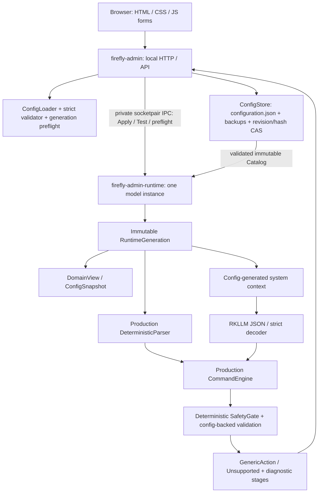

# Milestone 9 — Local Web Admin, immutable live Apply, Test Command

Milestone 8 was audited and committed separately as
`bb57730b75ec63e1d970689b2a4a100954e1622a` (`Milestone 8: config-driven structured LLM actions`).
Its 38-file review manifest, recorded hardware results, whitespace and local documentation links
matched the accepted implementation. The tree was clean before this work. Milestone 9 is uncommitted.

## Scope and architecture

A working form-based local administrator now owns a text inference worker. This follows the
separate-process recommendation in [6.1](milestone-6.1-dynamic-configuration-design.md).
The configuration domain, atomic store, GenericAction pipeline and generated prompt from
[6.2](milestone-6.2-configuration-foundation.md),
[7](milestone-7-generic-action-runtime-cutover.md) and
[8](milestone-8-config-driven-llm.md) are reused. There is no second persistent admin format.



Previously CLI and voice each constructed one startup `RuntimeConfig`, parser, generated prompt
and `CommandEngine`. They still do. The new admin-owned text runtime uses the **same production
parser, decoder, SafetyGate, DomainView and CommandEngine**, with immutable generation ownership
around them. No web-only interpretation path exists. `CommandEngine` is constructed against the
captured generation for each request; it has no persistent request state.

Apply controls the worker owned by this admin process. It does not broadcast configuration to
independently launched CLI/voice processes. Live microphone orchestration was not changed.
There is no executor or hardware side effect in Test Command.

The HTTP process does not link RKLLM or speech libraries. Its status, static resources and
configuration store remain usable while the worker loads, infers, rejects admission or is unavailable.
The native POSIX HTTP implementation has no downloaded dependencies; the existing pinned
nlohmann/json v3.12.0 is used privately for JSON API/IPC envelopes.

## Start and open the browser

The targets are `firefly-admin` and, in a full build, `firefly-admin-runtime`.
`FIREFLY_BUILD_ADMIN=ON` is the default; core-only builds include the real editor without a model.
Static assets are loaded at startup from the repository path embedded by CMake, so keep the source
checkout available next to this development build. There is no Node/npm build step.

```sh
cmake -S . -B build/admin \
  -DRKLLM_ROOT=/home/firefly/demo_Linux_aarch64 \
  -DFIREFLY_BUILD_CONFIG_TOOLS=ON
cmake --build build/admin -j4
install -d -m 700 /home/firefly/.local/share/firefly-admin
./build/admin/firefly-admin \
  --store /home/firefly/.local/share/firefly-admin \
  --init-config config/current-m4.json \
  --model /home/firefly/demo_Linux_aarch64/Qwen3-4B_W8A8_RK3588_3core.rkllm \
  --admin-bind 127.0.0.1 --admin-port 8080
```

Open `http://127.0.0.1:8080/` on Firefly. To access it from a trusted development LAN, explicitly
replace the bind argument with `--admin-bind 0.0.0.0`. `hostname -I` gives the board addresses.
The verified LAN address in this session was `192.168.68.111`; the corresponding browser URL at
port 8080 is `http://192.168.68.111:8080/`. LAN smoke used the board's LAN address from the board,
not a separately available laptop. IPv4 bind addresses are supported, not hostnames or IPv6.

`--init-config` only seeds a missing committed store; it never replaces an existing file or repairs
an invalid/pending store. The source `config/current-m4.json` is read-only input to initialization.
The directory must exist, be owned by the service user and not writable by group/others. Store
files/backups, permission checks, symlink rejection and retired-ID rules are unchanged.

Omit `--model` for configuration editing without inference. A missing worker executable also
leaves the editor available with an explicit unavailable runtime. Apply/Test then report errors;
Validate reports whether exact model admission was available. The worker executable defaults to
`firefly-admin-runtime` alongside `firefly-admin`; `--runtime-worker PATH` is an explicit process
startup option, never an HTTP-controlled executable path. Stop with Ctrl-C/SIGTERM; the parent
closes IPC and reaps its owned worker. Service startup prints `ADMIN_LISTEN http://address:port`.

## Schema and editing boundary

**Schema v2 was unnecessary.** Inspection and tests show schema v1 already supports additional
rooms, light devices and instances of its registered brightness action. No configuration/schema
files changed. The original four light targets/rooms and single entrance target are pinned by
v1's compatibility contract. Additional identities are real domain entries, not display-name
substitutions. ID deletion preserves the existing tombstone/retired-ID rules.

Forms edit:

- Room stable ID, display name, spoken mention forms and complete location phrases.
- Light target stable ID/name, room relationship and registered action assignment.
- Brightness action stable ID/name and required integer brightness minimum/maximum within v1's
  intrinsic percentage envelope. A separate action instance can provide a per-target range.
- Entrance target display metadata; its v1-pinned target/action identity is shown read-only.

Existing M4 identity fields are protected in the forms and independently enforced by the validator.
New rooms, lights and brightness actions can be added/removed; dangling references or ambiguous
multiple light targets are rejected. Room and device creation is one draft, then Validate/Save.
Aliases are explicit inflected words and location phrases; the UI does not infer Russian morphology.
Device/action spoken-alias fields are reserved empty by v1 and are not exposed as working features.
No arbitrary new operation, argument type or device kind can be invented through the UI.

`enabled`/deny restrictions already exist in the foundation, but the current production domain
consumers have not migrated that policy. Admin runtime admission therefore **rejects disabled
or denied effective actions** (`unsupported_runtime_policy`), instead of silently accepting an
ineffective policy setting. Additional door targets are also rejected at admin runtime admission;
v1 has only one supported configured entrance target. No SafetyGate policy became editable. Light contradiction and explicit
entrance requirements remain compiled deterministic rules. Bindings stay empty; no hardware exists.

The UI shows active/stored revision, busy/readiness, dirty draft and validation messages. Raw JSON
is a read-only Advanced view. Errors are rendered with `textContent`, not HTML injection. Test
Command displays semantic IDs/arguments first, then candidate, decode, safety and final diagnostics;
raw RKLLM JSON is shown only on the fallback route. A failed request clears the previous display.

## API contract

Every mutation uses `Content-Type: application/json` and `X-Firefly-Admin: 1`. Browser mutations must
also have a matching same-origin Origin when present; cross-site requests/CORS are not enabled.
An expected identity is `{ "revision": 2, "hash": "<64-character canonical SHA256>" }`.
Full configuration objects use the existing schema unchanged.

| Method and path | Request | Result / state effect |
|---|---|---|
| `GET /api/status` | none | active/stored identities, needs_apply, runtime_ready/busy, worker PID, store/runtime error |
| `GET /api/config` | none | stored configuration, revision/hash |
| `GET /api/config/active` | none | last confirmed active configuration, revision/hash and generated context; null before activation |
| `POST /api/config/validate` | `{configuration: ...}` | strict candidate/generation checks; exact runtime preflight when ready |
| `PUT /api/config` | `{configuration: ..., expected: ...}` | atomically saved new revision; `applied:false` |
| `POST /api/config/apply` | `{expected: ...}` | admit and publish the exact stored revision; no implicit Save |
| `POST /api/test-command` | `{text: "..."}` | real CommandEngine stages and typed final result, exact generation identity |
| `GET /api/config/revisions` | none | retained backup revision/hash list |
| `POST /api/config/restore` | `{revision: 1, expected: ...}` | backup saved as a new revision, not silently activated |
| `POST /api/config/reconcile` | `{}` | explicit recovery of an interrupted store transaction; no Apply |
| `GET /`, `/admin.js`, `/admin.css` | none | fixed static UI assets |

Example command test:

```sh
curl --noproxy '*' -sS http://127.0.0.1:8080/api/test-command \
  -H 'Content-Type: application/json' -H 'X-Firefly-Admin: 1' \
  --data '{"text":"В ванной поставь свет на 40 процентов"}'
```

Errors are structured: `{"ok":false,"errors":[{"code":"...","path":"...","message":"..."}]}`.
Validation reports configuration paths; C++/vendor exceptions are logged server-side, not displayed
verbatim in the UI. Status codes distinguish malformed envelopes (400), unknown path (404), wrong
method (405), revision conflict/runtime busy (409), invalid configuration/admission (422), and
unavailable worker/store (503). A valid Unsupported interpretation is a successful command result,
not an HTTP transport failure. Invalid/oversized input returns Unsupported plus an explicit error.

## Validate, Save, Apply and persistence

**Validate** parses the whole candidate with the existing strict loader/validator and constructs
its DomainView/parser/context. It never saves or publishes a generation. When the model is ready
and idle, it temporarily bootstraps the candidate context using real RKLLM counts, then restores
the active context. `runtime_preflight:"verified"` and `apply_ready:true` mean this exact check
succeeded. Without inference it reports `runtime_preflight:"unavailable"`, `apply_ready:false`;
this is not a token estimate or an admission promise. A concurrent runtime operation returns 409.

**Save** performs the same offline schema/domain/generation/byte-resource checks and uses
`ConfigStore::save` with revision **and** content hash. Store mutation is independent of NPU
inference. Schema-valid storage is intentionally separate from model token admission: a candidate
below the byte cap but too large for the actual tokenizer can be saved for editing and recovery,
but cannot become active. Save never reports `apply_ready`. UI text explicitly says a saved
configuration still requires Apply. The real smoke verifies this rejected-Apply scenario.

**Apply** requires the stored identity the admin actually loaded. It builds a complete immutable
generation, admits its model context, and only then atomically publishes the shared pointer.
Repeated Apply of the same prompt does not clear/rebuild its context unnecessarily. A failed
Apply retains the old active revision. Stored can consequently differ from active; this is always
shown in status. Save does not need to be undone merely because a model cannot admit it.

The existing store assigns revisions, canonicalizes JSON, checks stale writers under `flock`,
retains backups and retired IDs, fsyncs data/directories and atomically renames. Its transaction
marker requires explicit reconciliation after an indeterminate save. The API reuses that mechanism,
including restore-as-new-revision. It never promotes temporary files or silently falls back to a
backup. Tests inject write/fsync/rename/directory-sync failures and recover a complete old or new
snapshot. Failed saves never change the active runtime.

HTTP Save/Restore/Apply operations are serialized around captured stored state. Independent store
users still participate in the existing cross-process revision/hash lock. If an external writer
saves another revision while a captured Apply is in progress, active records the exact admitted
snapshot and status shows the newer stored revision as needing Apply; no partial generation or
lost overwrite occurs.

## Generation ownership and RKLLM refresh

`RuntimeGeneration` owns const DomainView, production parser and generated prompt. DomainView
owns the shared immutable validated Catalog. `RuntimeGenerations::current()` uses the C++17
atomic shared_ptr free functions; no mutable global configuration exists.

Request processing captures and retains one generation. A per-worker operation mutex serializes
synchronous RKLLM inference, preflight and Apply. Already admitted requests finish on the old
generation before its model context can change; the next request sees the new generation. Tests
hold an inference at a barrier, start Apply, verify the old generation remains active, release the
request and verify atomic publication. Old references remain valid after publication.

The model is shared across generations without ordinary reinitialization. The actual RKLLM 1.3.0
header and runtime were inspected. The explicit refresh lifecycle is:

1. Hold the engine request lock and mark it not ready.
2. `rkllm_clear_kv_cache(handle, 0, nullptr, nullptr)` to remove the old system/user KV.
3. Set the complete generated system context with the unchanged Qwen template.
4. Bootstrap with the existing empty-user synchronous request and check actual perf/KV evidence.
5. `rkllm_clear_kv_cache(handle, 1, nullptr, nullptr)` and mark ready.
6. Publish the new generation only after this succeeds.

On admission failure the same full lifecycle restores the prior context and the new generation
is discarded. A failure to restore marks the engine unavailable, never ready with stale state.
The worker can reinitialize a faulted engine on the next context-dependent request; ordinary Apply
and the tested oversize rollback do not reload the model. Bound fallback requests always ensure
the captured generation's exact context before inference, including after failed preflight.
Normal inference still clears KV keeping system before every request; no persistent prompt cache.

The HTTP parent communicates through a private inherited socketpair with bounded length-prefixed
JSON, not a public runtime port. It permits one runtime RPC at a time and returns busy for additional
inference/Apply/preflight calls. Status/store operations use separate locks. IPC has a 120-second
response deadline; on a broken/timed-out channel the parent closes it and terminates its worker,
so a late reply cannot satisfy another request. Restart the admin service after this transport
failure. Vendor-internal hangs cannot be made reliable by pretending the previous model is healthy;
editing remains available, readiness is false, and no action is replayed. This is process isolation,
not a hard realtime guarantee about vendor shutdown.

## Context size admission

No new token estimator was added. The public API still lacks a preflight tokenizer. Generated
contexts retain M8's 16,384-byte resource cap; actual bootstrap token/KV counts determine admission.
The model, W8A8 file, max_context=1024, response budget=128, NPU cores, sampling and runtime library
remain unchanged. The current-M4 generated prompt is byte-identical to M8:
SHA256 `a8ffb93d4111edb39f6a8d483d6b0386e17f6b4ec2ea372c524e5820779ba80c`, 637 bootstrap tokens.

Admin explicitly reserves 128 request tokens instead of the standalone CLI's unchanged 256. Its
bootstrap ceiling is therefore 768, within the same 1024-token model context; current-M4 637 and
Bathroom 687 fit. This is an admission allocation, not a sampling/model retune. Actual request
counts must fit 128 and `bootstrap + request + 128 <= 1024` before any response is exposed. Input
still has the existing 192-UTF8-byte validation. A request exceeding the reservation fails closed;
there is no truncation or transcript repair. Standalone CLI/voice keep their previous reservation.

A schema-valid enlarged-alias fixture below the byte cap was rejected by the actual runtime during
Validate and Apply. Old Bathroom context was rebuilt, the active revision remained unchanged, and
a subsequent real Bathroom fallback again returned the correct target. No model reload occurred.
See `build/milestone-9/web-real.json` and `.stderr.log` for exact requests/counts/rollback lifecycle.

## Bathroom acceptance and safety

The automated API and browser tests start from unmodified current-M4, add:

- `room_bathroom`, name `Ванная`, mentions `ванная`, `ванна`, `ванной`, `ванне`;
  locations `в ванной`, `в ванне`.
- `device_bathroom_light`, kind `light`, room `room_bathroom`, action `action_set_brightness`,
  with the existing 0..100 capability.

After Validate → Save revision 2 → Apply, both generation identity and generated context contain
the new entities. No C++ or prompt-source edit occurs between these steps.

| Original input | Route | Final semantic result |
|---|---|---|
| `В ванной поставь свет на 40 процентов` | deterministic | brightness action, `device_bathroom_light`, integer 40 |
| `В ванне поставь свет на 30 процентов` | deterministic | brightness action, same target, integer 30 |
| `Пожалуйста, в ванной свет 40 процентов` | real RKLLM | brightness action, same target, integer 40 |

Actual raw RKLLM output for the third command, before and after oversized-context rollback:

```json
{"actionId":"action_set_brightness","targetId":"device_bathroom_light","arguments":{"brightness":40}}
```

The real admin safety smoke also preserves:

| Input | Raw fallback | Final |
|---|---|---|
| `дверь` | Unsupported JSON | Unsupported |
| `открой дверь` | entrance action JSON | Unsupported, SafetyGate rejection |
| `открой входную дверь` | entrance action JSON | configured entrance action |
| `открыть дверь на входе` | entrance action JSON | configured entrance action |
| `На кухне выключи свет на 50 процентов` | kitchen brightness 50 JSON | Unsupported, SafetyGate rejection |

These use the unchanged production safety logic, not a web filter. The deterministic test matrix
also injects guessed brightness zero for the contradictory OFF request and verifies rejection.
It checks narrow ranges across all five rooms and an independently assigned new brightness action
ID/range for Bathroom, leaving original targets' ranges intact.

## Verification and artifacts

The accepted M8 code is the baseline. Tests do not weaken frozen DEV labels or production unit
expectations. New tests use inference seams only where explicitly indicated.

- Clean core build: 24/24 CTest suites passed.
- Clean full build with RKLLM and native speech: 35/35 CTest suites passed.
- Admin generation/API tests: 143 checks passed; immutable lifetime, in-flight ordering, coherent context/parser/domain,
  validation, CAS, saves/backups/recovery, policy admission, failed Apply and Bathroom integration.
- HTTP tests: 3 integration tests passed; real listener + child IPC + production API/engine, only model replaced by a test seam;
  static assets, strict envelopes, methods/paths, body/header limits, cross-origin rejection and
  configuration editing with a missing worker.
- RKLLM context-refresh tests: 12 checks passed; exact full-clear/template/bootstrap/keep-system sequence, reuse,
  rollback, token boundary and not-ready behavior on failed restoration; existing wrapper fault
  tests remain unchanged in their expectations.
- Installed Chromium on X11: forms create room/light, Validate/Save/Apply, both Bathroom commands,
  active generated context; no uncaught JavaScript errors. Screenshot retained in build artifacts.
- Real curl smoke on Firefly: UI/assets, status, config, validation, Save/Apply, stale revision,
  Bathroom deterministic and NPU commands, door/light safety, oversized admission rollback,
  backup/restore and explicit LAN bind. One worker and one model initialization throughout.

All six scheduled full hardware runs completed without retries:

| Run | Route | Final correct | False accepts | False rejects | Wrong actions | contradiction02 |
|---|---|---:|---:|---:|---:|---|
| 01 | frozen NPU DEV | 48/48 | 0 | 0 | 0 | U |
| 02 | integrated assistant DEV | 48/48 | 0 | 0 | 0 | U |
| 03 | frozen NPU DEV | 48/48 | 0 | 0 | 0 | U |
| 04 | integrated assistant DEV | 48/48 | 0 | 0 | 0 | U |
| 05 | frozen NPU DEV | 48/48 | 0 | 0 | 0 | U |
| 06 | integrated assistant DEV | 48/48 | 0 | 0 | 0 | U |

Every run took the unchanged 17 deterministic / 31 fallback routes. Per run, fallback produced
10 decoded action candidates, 20 Unsupported candidates and one decoder rejection; three unsafe
candidates were rejected by SafetyGate. Malformed JSON count was zero. These intermediate model
candidates are not treated as executable final actions. The OFF/50 candidate was rejected in all
runs. Original expected data and prompt source were not changed.

Both model-backed replay suites passed: eight recordings with exact expected transcripts;
typed production replay 8/8 actions; two silence cases (2 s / 5 s) produced zero commands.

After final admin refinements, core and full targets were rebuilt from scratch and CTest passed.
A hash check confirmed that `firefly-regression`, `firefly-assistant` and
`generic_speech_replay_tests` from the final clean build are **byte-identical** to the binaries
used in all six DEV runs/replay. `final-binary-equivalence.json` records that evidence.
The final real HTTP smoke then restored current-M4 from its backup, Applied it in the same
worker/model process and ran all 48 frozen DEV cases through `/api/test-command`: **48/48 typed
final results**, zero false accepts/rejects/wrong actions. The full smoke comprises 105 curl
requests/responses, including both successful and rejected operations. One `init_ms` and one
`RKLLM destroyed` are recorded; parent exit was 0. Earlier browser/headless and HTTP test harness
issues were corrected and retained in development logs; no failed hardware DEV run was retried.

Artifacts are under `build/milestone-9/`: checkpoint audit, clean build/CTest logs, context-refresh
probe, HTTP smoke request/response log, Chromium screenshot/log, hardware command/environment/hash
manifest and per-run results. They are intentionally not tracked model/log/build payloads.

## Security and limitations

This is an unauthenticated development tool for loopback or an explicitly trusted LAN. It has no
accounts, TLS or internet exposure configuration. Same-origin checks/custom headers are browser
request safeguards, not authentication. Anyone able to reach the service with a direct HTTP client
can administer it. Binding is explicit and defaults to 127.0.0.1.

HTTP is deliberately bounded: fixed HTTP/1.1 Content-Length bodies, 512-KiB envelope limit,
16-KiB header limit, 10-second request read deadline, 16 simultaneous connections, no chunked
uploads/pipelining/path-based filesystem serving. Static responses use a same-origin CSP and
no-store caching. Runtime IPC accepts no arbitrary file paths. Long inference does not become
an unbounded queue of commands.

The finite 1024-token model budget limits domain size even though schema v1 can express more
entities. There is no silent context truncation. Unsupported argument/device types, ordinary
editable safety policy, hardware bindings, independent-process broadcast reload and live microphone
administration are not implemented. There is no WebSocket, cloud backend or external execution.

## Files

Modified existing files (5):

- `CMakeLists.txt`
- `include/firefly/RkllmEngine.h`
- `src/RkllmEngine.cpp`
- `tests/FakeRkllmRuntime.cpp`
- `tests/FakeRkllmRuntime.h`

Added files (24):

- `docs/milestone-9-web-admin.md`
- `include/firefly/admin/Api.h`
- `include/firefly/admin/RuntimeGeneration.h`
- `include/firefly/admin/RuntimeWorker.h`
- `src/admin/Api.cpp`
- `src/admin/CMakeLists.txt`
- `src/admin/HttpServer.cpp`
- `src/admin/HttpServer.h`
- `src/admin/Ipc.cpp`
- `src/admin/Ipc.h`
- `src/admin/Json.h`
- `src/admin/Main.cpp`
- `src/admin/RuntimeGeneration.cpp`
- `src/admin/RuntimeWorker.cpp`
- `src/admin/WorkerMain.cpp`
- `src/admin/web/admin.css`
- `src/admin/web/admin.js`
- `src/admin/web/index.html`
- `tests/admin/AdminTests.cpp`
- `tests/admin/FakeWorker.cpp`
- `tests/admin/HttpTests.py`
- `tests/admin/RkllmContextRefreshTests.cpp`
- `tests/admin/Support.h`
- `tests/admin/WebUiTests.js`

No files deleted. The fake C-API runtime only gained explicit refresh-test controls/event recording;
no existing test expectation changed. Hash comparison against the M8 checkpoint confirms all other
tracked files are unchanged, including configuration/schema, DEV fixtures, parser, SafetyGate,
CommandEngine, DomainView, GenericAction/adapter, structured decoder, LLM context generator,
CLI/VoiceProcessor, STT/VAD, vendored dependency and license. The model/runtime library identities
are preserved in the hardware hash manifest. No CompactV1 dependency exists in the new admin
semantic path; unchanged CLI/debug/regression boundaries retain their M8 roles. Compact v1 cannot represent Bathroom
or other unmapped new targets: use this API's native GenericAction result for them. The unchanged
standalone compact CLI is not a general serializer for the expanded domain and retains its own
smaller context admission budget.

`git diff --check` and documentation link checks pass. HEAD remains the M8 commit above;
Milestone 9 consists of these 5 modified + 24 untracked added files for review, with nothing staged.
Hardware execution, Web Admin authentication/TLS, microphone changes and the next milestone were
not started.
